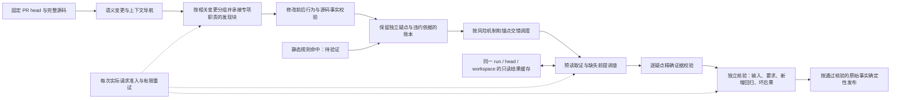
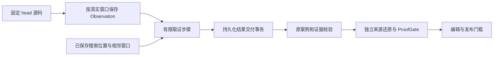

# Hypothesis Pipeline 实施规格 v1

> 状态：已批准的目标架构，交付给执行模型实施。
> 依据：[architecture-diagnosis-20260901.md](architecture-diagnosis-20260901.md)。
> 基线：`main@892de6a`。所有路径相对 `backend/src/reviewforge/`。
> 本文是执行的唯一事实源；与旧文档冲突时以本文为准。

### 当前生效修订（2026-10-15，内部协议 8）

用户明确要求取消产品预算限制。新运行依 [§14](#14-v4-token-只计量与末轮结果恢复内部协议-8)：取消产品阶段、PR、调查的 token 硬中止，快照使用 `usage-only-v1` 和 `limit=null`；步骤/请求、输入输出、重试、超时与机器资源约束保留。显式付费基准授权仍为独立有限外层边界。下文协议 1–7 的预算条款用于相应历史运行，恢复不自动升级；默认模式仍为 legacy，main 不发布未验收 v4。

### v4 共享请求预算与按工作量分配（2026-10-14）

用户授权调整预算策略。两问回查：原完整任务预占的假设是只有能负担最坏整项成本才值得启动；原固定 16k 假设下游成本与候选/源码大小无关。物理请求层已具有并发原子准入，这两项分配假设不再成立。保留硬费用边界和完整核验，修订分配而不放宽证据门禁：

- `budget_policy=adaptive` 只用于新协议 4 运行。请求快照冻结 `allocation_policy=adaptive-v1`；没有该标记的旧运行仍用原固定策略，不能在恢复时升级。`fixed` 可显式选择旧策略。PR 默认 250000、外层人工批准的付费评测上限、重试次数和 32k 单任务最高额度保持硬边界。估算不是账单保证，超额实际用量仍如实记录。
- 发现与调查共用剩余 PR 池。adaptive 中 `discovery_max_tokens` 是记录的阶段目标，允许借用未被下游保护的余额；fixed 中仍是硬阶段上限。发现不能占用已知 OPEN 任务的首个有效探索请求及收尾预测成本，也不能占用独立核验预留。候选尚未出现但还有发现单元时，保留 8192 调查启动预测与一项潜在核验的 prompt/输出容量；这是启动预测，不保证任意未来候选都能完成。
- 调查不再预占整项最高额度；每个物理请求仍同时预占任务/PR/外层额度。严重级别保留排队作用，额度改由实际探索和类型收尾消息、工具 schema、提供方选项及文件跨度估算：默认 4 步，多文件和大输入最多增到 8 步；额度为完整收尾预测加每步输入与 512 有用输出，范围 8k–32k。首个实际源码工具结果可能增大输入，之后仍按真实剩余额度逐请求准入。每任务原上限先持久化，恢复只取剩余原额度；物理回执和中断预占按任务归属保存，不能因最终 verdict 未写回而重新获得额度。
- 核验预留使用真实盲还原/ProofGate prompt、当前源码、规则、候选、绑定选项及批次大小预测；未知盲还原输出仅增加容量估算，不伪造事实或交付模型。当前调查新 Observation 也用于刷新预测。候选反驳或未确认后释放对应核验预测；实际核验仍执行原两阶段及 4 批限制。输出、重试和未来源码大小可能变化，预测不能保证完成，实际不足必须明确失败。
- 自适应收尾预留按当前 site/成功 Observation 数变化（2048–4000 输出），收尾请求使用同一上限；保存真实 schema/input 预算规划。原无进展/重复取证停止、源码和契约约束不变，不为得到有利结论重抽。
- 任务数上限输出 `policy-deferred/investigation-task-cap`；实际请求容量不足输出 `budget-exhausted`；正常完成而缺证据保持 `insufficient-evidence`。不能把正常语义 UNKNOWN 一律归因于预算，也不能用延期伪装已审。
- 未知费用继续保守计入上限，并保存逐物理尝试身份。仅在外部已核实提供方回执与该次请求对应后，才允许内部对账方法以真实用量替换预留，并保存唯一回执引用；重试成功、超时或本地估算均不构成退款依据。旧的纯聚合未知费用没有身份，不自动冲销。本轮未取得新的可靠账单回执，不调整历史消耗。

上述是预算分配与可审计性修订；离线回归验证额度、并发、恢复与状态边界，不证明模型准确率提升。原付费额度、旧评测实录及 main 生产路径保持原验收约束。

### v4 调查裁决绑定原触发条件（2026-10-13）

真实新候选调查暴露了比格式更深的错误：候选触发条件是组织者或参会者，收尾却改成既非组织者也非参会者，再根据变量名推断权限要求而确认。两条成功源码 Observation 已包含能否定原案例所称拒绝的 guard，因此不能把这次失败归为提供方中断或缺少源码。两问回查：原类型收尾与两前提证明假设模型始终判断同一输入，精确来源约束仍成立，但该隐含的同案例假设不成立。

- 协议 4 的扁平原生收尾增加必填 primitive string `assessed_trigger`，必须逐字复制实际交付 packet 的 `candidate.trigger`，保留每个条件和否定。请求绑定原触发条件、schema 版本和摘要，模型不得用缩小、修复或相反案例代替原案例。字段不由程序自动补齐，也不采用候选枚举暗中填值。
- 同次响应的文本兼容与探索阶段两种提前终结路径共用完整单根 JSON、重复字段与非 JSON 常量检查及原案例绑定。最终结果与源码工具调用或 progress 混用拒绝；工具查询与正常进度无需该字段。中央 finalize 再核候选触发条件，不能靠模型自报已检查来绕过。协议 1–3 保持原行为。
- 缺失或不一致的绑定保持 unknown/output-error，不修补响应、改 payload 重抽或新增收尾轮次。新增 schema 和消息与原收尾规划、结论预留使用同一真实请求估算，任务/PR/物理调用预算保持。原候选、Observation、错误确认与原响应均保留。
- 同案例中的正向事实可以反驳一个必要前提：原输入无法发生才是 trigger 反证；输入可发生但所称行为或坏后果不会发生，则是 mechanism/impact 反证，不因另一案例的契约缺失而要求确认原案例。变量名和未找到相反政策不能建立权限契约。精确字符串绑定只证明声明对象一致，不能保证自然语言论证仍围绕该对象，也不能证明反证、契约或执行解释正确；原精确引用、独立盲还原和发布门禁继续负责其余约束。

### v4 源码映射、记录交付与盲核验修订（2026-10-13，protocol_version=4）

用户在 Qwen 固定十 PR 全部 partial 后再次授权调整架构，并要求不再使用 6.1-sol 子智能体；本轮由主智能体直接实施。新运行使用内部协议 4，产品仍叫 v4，默认路径仍是 legacy，生产 main 不部署未验收版本。旧账本的协议不自动升级，原评测和失败回执不重写。

两问回查：源码范围和精确引用仍是必要约束；但把 `const x = (...)` 当函数会产生 `start>0,end=0` 空范围，把全部 JSON 当不可分事务会丢失已完整交付的候选，让发现模型先填写六字段证明则混淆提出疑点与证明义务。单次核验虽然有真实引用，仍会沿用调查阶段错误的语义解释。以下边界替代旧协议的相应假设：

- **先证明声明类型。** v4 声明提取要求 JS/TS 变量初始化的完整参数括号后确有箭头或返回类型声明；普通计算/await 表达式不作为函数单元。过滤后重新计算有效声明范围，相关修改继续归属真实外层函数或资源单元，legacy 提取器不改。
- **完整记录与覆盖分开交付。** v3/v4 发现先用无模型的严格记录解析：重复 key、多个根对象和外围文字不接受；仅缺最外层 `}` 时可恢复完整 envelope，不修改原始响应。完整顶层记录数组仅在每项有 unit_id 且 claim/checked/reason 单一显式类型时可无损分组，仍执行全部源码与覆盖校验。数组尾部损坏只保留完整记录，部分对象不补值；完整候选仍进入调查，但整个响应的覆盖保持 unresolved，不能产生 clean 结论。没有可恢复记录时仍保留原一次格式修复限额。v4 发布裁决若以完整对象/数组结束，只允许补足未闭合容器；不补字符串、标量、字段或引用，完整候选 ID 集合与证明约束必须重新校验，恢复方式写入账本，v3 发布解析不变。
- **发现只产生有依据的疑点。** 协议 4 保留具体 claim/trigger/impact/question/refutation、真实目标 site、行为比较与触发依据，移除强制的重复六字段 violation 对象。契约/输入支持的缺口由调查完成，候选始终 OPEN。替换/删除仍必须引用目标 changed before；纯增加不强迫引用无关的 unchanged before 来填槽，也不把局部增加解释为全局旧实现不存在。协议 3 保留原形状。
- **先盲还原，再裁决。** 对调查确认项，先独立交付固定 head 的成功 Observation 和适用规则；不交付 claim、trigger、impact、discovery_basis 或 assessment。源码还原返回实际执行、明确契约和缺口，无缺陷裁决。程序要求独立契约和执行事实均存在，否则直接保存缺证据、不调用最终确认模型；不能仅靠提示词期待后一阶段尊重缺口。还原中的无效记录单独保存拒绝原因并转换为显式缺口，不作为证据，也不使其他合法记录丢失。最终接受必须选择独立契约目录中的明确 ID，required_behavior 的真实引用与所选契约相连；该链接并不证明语义成立。核验看到原始源码，仍须处理方向、可达性、角色及契约分歧，不能把还原当权威。
- **裁决输出使用互斥形状。** accepted 只交付四义务与程序交付的契约引用 ID；refuted 只交付带精确引用的正向反证；unknown 只交付缺失义务。不让模型自行数数组下标。程序填充持久化的空字段，不要求模型为反驳填写四项“成立”的证明。协议 4 发布证明版本为 2，旧版许可不能复用；这不是将矛盾输出猜测转换成有利裁决。
- **领域契约显式绑定。** 直接本地化内容问题可使用既有审查规则绑定的实际目标 `messages_<locale>.properties/json` Observation；该规则不规定旧措辞、链接、markup 或未核实 formatter 行为。Java error-path 中明确比较两个异常类型的候选，须有被引用的类型敏感 consumer（真实 catch 或类型断言）才能使用其契约；仅调用/throws 声明、注释中的伪 catch 均不证明独占异常约定。这些是来源门槛，不是源码语义正确性的自动证明。
- **两阶段共用原预算。** 两阶段均经原 ModelRouter/editor、Tracked/Budgeted/Retry 包装；不增加 PR 250k、发现 80k 或资源上限。源码还原每批最多 32000 字符/4096 输出、每次运行最多四批、每项同一事实最多两次尝试；错误不放行。还原单独持久化，发布回执绑定其内容摘要及原事实摘要；还原改变后旧发布许可失效，恢复不能把有效缺证据结论当接口失败重试。
- **Qwen 的实际请求参数。** 新协议对已实测的 qwen3.8-flash 各阶段发送 `enable_thinking=false`；auto 不强制 JSON response_format，仍由严格解析检查正文。显式 JSON 设置保留，未知提供方与旧协议不套用 Qwen 参数。不是对所有中转行为的保证。

验收先重放已保存的失败输入和正反证据，再冻结新代码做真实诊断；不改 golden、严格裁判或既有报告，不用 mock 通过冒充模型质量提升。

### v4 发现交付与消费者导航（2026-10-13）

原固定两 PR 的实录暴露了三个设计假设失效：JSON 文本不能稳定交付逐单位的字段类型；Context 的前缀不一定包含实际检索命中；legacy 的 12 行声明展示样例不能当成内部完整修改集合。保持协议 4、原预算、单元身份和独立发布证明，修订如下：

- 发现的输出格式按块目标数预先确定：多单元用原严格 JSON 正文批量交付，单单元绑定 `submit_hypothesis`、`submit_no_issue`、`defer_unit` 三种扁平结果工具。`required` 不能证明模型会返回多次调用，不将逐记录工具当作整块覆盖协议。两条路径共用原源码与覆盖校验，不在失败后换 payload 重抽。
- 类型工具只交付记录、不执行源码操作，字段为必填 primitive/primitive-array；当前 unit 使用枚举，短源码引用使用 rN 形状并在客户端核验实际块成员、目标 site 和原精确来源。纯文本块不交付结构专用 `change_fields`；含结构单元时它仍必须显式选择，缺失不补。模型选择 behavior/trigger 角色与结构事实，程序只还原已冻结的来源值，不自动填证据。实际工具 schema、请求选项和消息同时进入原发现预算规划与物理准入。
- 同一响应中的完整候选可保留，但重复 key、损坏调用、混合正文、未知工具或截断会使整份覆盖不完整，不能由部分 clean 声明补齐。SDK 原始工具参数须保留，防止宽松 JSON 解析先消掉重复 key。无原生调用时可严格解析该次原始文本；v4 不再追加换 payload 的模型格式修复，v3 原文本与一次格式修复保持。
- v4 从原 diff 的真实 RIGHT 新增行恢复内部完整 `added_lines`，再按真实单元范围过滤。展示、源码限额及单元身份保持；缺原 diff 不猜测遗漏坐标。资源单元使用原 diff 中实际新增行。
- Context 可带实际检索命中的 `focus_line`，它仅是导航。v4 在已收集片段及原预算内交付围绕命中的连续完整行，更新实际范围并记录两侧省略；命中行本身放不下时明确省略，不以无关前缀充数。子块只使用已交付源码，v1–v3 保持原前缀行为。
- 调查增加有界 `find_references`：真实固定 head 中精确标识符、属性或 JSX 的字面引用，跨文件优先，最多 20 条、每文件 2 条；路径仅排序、glob 才过滤。跳过未知格式与超过 2 MiB 文件，并把搜索范围、截断、跳过和不可用状态作为独立元数据交付。命中行可作为已观察源码，查找本身不解析别名/完整数据流、不证明可达性或无消费者。模型仍须读取真实路由/调用绑定、同一对象和逐角色可见性，才能建立目标操作的消费者契约。

上述修订的确定性验证与新的真实模型诊断分别记录，不改旧结果或将手工查明的调用链注入模型。生产与正式计分门槛保持。

### v4 收尾与发布正文的类型边界（2026-10-13）

完整两PR回归显示收尾模型能推得正确角色集合，却把comparison枚举写成句子；另一方面，最终Gate已缩小原候选范围，但编辑正文仍复制早期草稿。这否定了“有JSON文本就能稳定交付类型”及“原输入指纹足以绑定最终输出正文”的假设。原调查、四义务、独立契约和精确来源约束继续成立。

- v4收尾绑定唯一结果工具`submit_investigation`并要求一次调用；assessment comparison是`conflict|compatible|unresolved`，引用只能来自当前成功Observation的精确分段ID，无成功事实时不能提交assessment/反证。结果工具不执行源码操作。仍经过原严格裁决/证据校验，错误、多调用或未知引用保持unknown，不把句子猜成枚举。提供方若忽略工具但在同一响应中交付完整合法原JSON可解析；参数HTTP400不能用换payload的静默fallback掩盖，恢复也不反复请求已拒参数。v1–v3保持原文本收尾。
- 收尾真实请求和探索时的结论预留使用同一绑定与消息变换，schema/选项计入物理请求估算，原步骤/任务/PR额度不增加。
- v4评论、overflow、结构摘要及resume只格式化当前accepted Gate的reason、四义务statement和精确原引用；保留原候选账本、不调用新措辞模型。v3保持原事实模板。
- v4冻结发送批次绑定最终review正文相关事实及renderer版本，原输入指纹仍独立核验。旧待发送批次无法证明新正文许可时阻止发送并要求新isolated run；不自动清除或重写。已送达旧正文不因格式迁移重复发送，真实新增事实仍按原覆盖/补充语义处理。
- v4行为引用上限为12，覆盖多处changed操作的真实前后对；v3仍为4。该数量是有界交付容量，不能代替目标范围、changed前后、消费者和结构事实校验。
- v4全PR概览只呈现已交付库存行的路径/范围/符号，隐藏其可复制的unit ID；真正允许回答的ID在当前Units行及结尾名单明确交付。原overview库存、单元身份、源码映射及v3呈现不变。全块invalid-other和完整覆盖约束保留，不把外块答案静默映射到当前单元。

首次真实类型收尾探针在两例都返回了工具调用，但nullable object的assessment被交付为JSON字符串。实录只能证明复杂参数类型未被保持，不能区分模型或中转站的责任。v4因此使用扁平primitive及primitive-array结果字段，assessment comparison/counter premise以显式none表示缺失，其关联字段必须为空；其它值按原语义形成assessment或反证。额外sites按等长路径/行/摘录数组确定性组装，缺字段、额外字段、未知引用、字符串化数组、不等长或矛盾none仍输出错误。组装后再走原裁决与精确源码校验，不解释字符串化对象，不新增模型格式修复请求。规则不因wire格式而减少，schema仍计入原请求与结论预留。

### v4 上下文交付去重（2026-10-13）

Keycloak 完整回归的发现阶段在 80k 中消耗 76675，末尾 12 个单元因剩余输入空间不足未审；Cal 调查则在仍有任务余额时，被不断增长的探索输入与必要收尾预留共同阻止继续读消费者。这否定了“保存完整工具对话等于有效上下文”以及旧 v3 六字段证明输出预留下限适用于 v4 疑点 schema 的假设。以下仅用于内部协议 4：

- 发现交付对已呈现 RIGHT/Context 的相同 path、line、完整正文共享正文；保留原 Context 来源和全部分段引用，不把 Context 升格为 RIGHT。未知格式、不同坐标/正文不共享，不增补原先未交付的源码。
- 子块只投影明确归属自身 unit 的导航，保留未知记录与父省略标志；紧凑导航表不增加关系。固定长 source_ref 以块内 rN 别名交付，映射保存于 discovery_blocks，消耗响应前只展开引用字段。源码正文、claim 与引用的 before/after/context 身份不改，原严格校验继续生效。
- 发现核心规则去掉重复表述；领域规则仍完整提供。v4 useful-output floor 改为 `min(8192, 256 + 192*units + 384*min(candidate_allowance, units))`，对应不含 violation 对象及短引用的 schema；v3 原策略不变。这只是准入下限，物理输出上限仍 8192，输入/重试/80k/250k 硬预算和缺失记录的未覆盖语义不变，不能据此保证每批交付完整。
- 调查每轮从不可变候选、完整成功 Observation 的精确引用、失败状态和 query、最近明确 proof-duty 重建输入；不再重播初始 Context 正文、历史工具消息和模型草稿。与原收尾共用证据序列化，原收尾内容不变。Context 只留下去重的固定 head 路径/范围/符号导航，省略数量与来源截断状态显式记录；导航不是证据。
- 权限调查沿目标操作的真实路由/消费者、对象可见角色和调用条件寻找契约，不把 helper 返回类型、变量名或另一端点策略当授权要求。角色必须分别计算，一个 helper 可能已包含另一个角色。原步骤/任务额度不加，未读到消费者仍 unknown，发布门槛不放宽。

随后同两 PR 的诊断中，Keycloak 58 个单元已全部实际交付，但 19 个单元仍因模型输出的证据/字段无效保留未覆盖。交付完整不等于评估完成。针对已观察到的契约断点补充：

- v4 Units 行附上程序按原目标范围与 changed 标志计算的 eligible before/after 短引用。模型仍必须自己选择与行为相关的引用；列表只是导航，不自动补 before，不代替检查，不改变校验结果。纯新增 before 列为空，纯删除可用已交付 after 上下文；结构重命名不套用文本规则。
- v3+ 的模型格式修复响应与首次响应使用同一严格解析，且修复必须完整无歧义；重复字段、重复引用键、残缺记录不能产生 clean。保存独立 repair framing，v1/v2 原解析兼容。
- v4 `find_callers` 明示直接调用查找的能力边界，不宣称完整数据流解析；空结果不能证明无消费者。已见符号的属性、路由、别名或 JSX 引用可用 grep 导航，再读真实绑定，引用命中本身不证明调用可达。
- 工具返回超过保存窗口时，把程序计算的 original/saved 字符数与 truncated 标志存入已有 investigation_progress；每轮重建和收尾保留该状态，不把省略正文变成证据，不猜测旧记录的原始长度。`read_change` 的 v4 path schema 限定当前 PR 全部已核验重命名路径，其他文本修改使用 read_diff，执行器继续独立校验。

这些改动释放输入空间，不证明召回或完整覆盖已改善。确定性与零模型字节重放之后，需另冻源代码、按原固定 head 实跑；先前失败和有效缺证据记录不覆盖。

### v4 独立核验缺口反馈（2026-10-13）

同两 PR 的实录再次显示：调查已确认权限疑点，却只取得 helper 和同文件证据；独立还原正确拒绝发布，但原设计没有把该缺口交给任何取证模块。这是阶段间的输入输出断点。新增一次仅取证的反馈阶段：首次调查 → 独立还原/发布门禁 → 有剩余额度时补取缺失事实 → 新事实独立还原/门禁 → 发布。

- 仅内部协议 4、当前合法还原明确缺契约/执行且发布记录为缺证 preflight 的原确认任务可补证；已有接受、反驳或有效最终语义裁决不重开。等价成员属于同一任务，共享证据且只收费一次。
- 原调查首次准入冻结步骤/token 限额和累计实报/未知用量。补证只能使用原剩余量，不创建新任务，不把确认项改成 OPEN。旧账本缺少冻结事实时不按当前严重程度补算额度。
- 调用前持久化单次 started 标志、原还原/裁决、固定 head/workspace 与分配余量；中断、失败及恢复不再次准入。补证继承原 Observation 和 query，只执行原只读工具；不重新 bootstrap，不生成另一份确认或收尾。正向或反向的新源码事实都交给独立核验。
- 仅真正新增的成功源码事实使证据包更新；失败读取、重复正文或模型草稿留在补证审计记录，不改变原证明与许可，也不触发同事实重采样。新增事实后，原许可不能继续使用，仍执行原独立契约目录和四义务验证。
- 盲还原按实际交付的源码/规则输入摘要复用，同一输入不因候选描述或普通进度变动重新采样；原 run 四批物理调用上限在账本持久化，反馈及恢复共同消耗该额度，dispatch 前 checkpoint。旧账本无法还原共享批次数时按已记 attempt 保守折算，不获得新额度。

余量不足、没有取得新事实或独立契约仍缺失时，发布仍保持 unknown；补证调用完成不等于问题成立。

### v4 发现与调查协作重设计（2026-10-12，protocol_version=3）

用户在 dev10 根因分析后授权主智能体负责设计、三个 GPT-6.1-sol 子智能体并行实施，允许调整架构。此修订优先于下文 v1/v2 对全 PR 单次发现、调查隔离、评测零重试、静态规则直通确认及编辑器必发调查确认项的约束。产品代号仍是 **v4**；`protocol_version=3` 是新账本的内部协议。`legacy` 仍为默认，已保存的 v1/v2 账本不升级、不改写，生产 main 不随 dev 开发部署。

两问回查得到三个失效假设：完整交付大段 diff 不保证模型逐处比较了行为；字符串完全相同才共享任务无法减少近重复调查；预算只在调查结束核算不能防止发现分块/接口重试超支。精确证据、独立裁决、固定源码与完整队列验收仍然成立，不降低这些边界。



- **发现按输入责任分块。** 默认目标 32000 字符，最多 12 个语义单元，以共享 hunk 和已知关联导航组织，提供全 PR 概览；不是对未发现问题反复抽样。同一个完整 hunk 不截断，超出目标的单 hunk 可使用原 120000 字符硬上限，真正超限明确 unresolved。最多尝试 8 个发现请求块，每请求仍最多 8192 输出 tokens；无源码等无法调用的块独立记未覆盖，不挤占有效块的调用名额。保留全 PR 候选上限，额度耗尽明确 deferred，不把未审单元伪装成 no_issue。账本 `discovery_blocks` 保存每块实际单元、状态与交付大小，恢复仅处理尚未完成的单元。
- **呈现压缩不改变取证输入。** v3 的范围与能力说明合入单份规则；Units JSON 表完整保留 ID、路径、符号、旧状态、LEFT/RIGHT 范围、职责和结构变更 ID。源码注册后仅去掉行号对齐空格，正文与 source_ref 原样保留；概览仅在更短时合并连续同文件的路径标题，不重排或删减条目。领域规则正文不改，完整 hunk、引用注册与解析、覆盖和预算上限仍沿用原约束。长度缩减不是语义质量或全 PR 覆盖保证。
- **专项作为首轮职责。** 沿用确定性 lens 风险触发器，将 security/localization/accessibility/concurrency/dependency 的职责和规则交给相关单元所在的首轮发现块，重复指导只交付一次。新协议不再独立调用 lens 重扫已评估单元。账本分别记录 requested/attempted/delivered 职责；交付成功不等于已完成审查，仍以带源码事实的有效输出判断覆盖。v1/v2 保留原独立专项调用。
- **结构变更独立取证。** 仅 v3 为无文本 patch 的 renamed 文件保留 `FileChange`：固定 base/head、旧/新路径，以及经 GitHub 固定 SHA compare 和完整 Git tree 核验的 merge-base/head blob、mode、type。相同普通文件 blob 和 mode 才证明内容未改；零增删行或缺 patch 不构成证明。最多核验 16 个候选、总时限 60 秒；失败、二进制或模式变化保留未覆盖。Context 提供实际 head 及有界旧/新路径 consumer 源码，元数据不伪装成代码行，无搜索命中不能证明安全。候选使用程序绑定的 `change_anchor` 和空 sites；调查重新读取 `read_change` 与真实 consumer，仍需独立前提证据。超过已保存 Observation 大小的元数据明确读取失败。确认项进入带不可变版本链接、契约和引用的摘要，不构造虚假 RIGHT 行；摘要进入原发布覆盖与恢复账本，恢复交付前重新绑定可信变更事实。v1/v2 不接受结构锚点。新 v3 账本另存结构核验耗时及结果；失败保留 pr-identity/pr-files/comparison-base/before-tree/head-tree/pr-recheck/proof-bind 阶段和固定异常类型，不能将重放成功推定为原运行已核验。
- **行为说明带源码定位。** v3 候选及 no_issue 都给出 before/after/observable 与来自本块的源码事实引用；有删除行的修改还需 before 引用。未改变行同时标出 LEFT/RIGHT 坐标；目标事实范围和新增声明状态明确交付。只有可见新增声明且没有对应旧声明/目标删除操作时才判断旧实现不存在，不把漂移到新方法范围内的旧右括号当作其旧实现；声明关系不明仍保持保守。候选另含具体差异及触发依据。代码只验证字段完整、定位属于交付源码、引用精确，不声称已经证明语义正确。候选的这些引用是发现依据，不能代替调查阶段的 Observation；确认仍走原两前提证明。无效候选不能因为带有 unit_id 就算已覆盖。
- **共享事实，保持裁决独立。** 原 exact-facts 任务共享保留；不同文字的疑点不自动共享结论。新调查在 run/head/workspace 内共享成功只读工具结果，最多 512 项 / 4 MiB，并合并相同在途读取；失败和未找到结果不成为共享证据。各疑点保存自己的 Observation 和引用，`shared_result_id` 仅提供相同源结果的审计关联。缓存不跨 run 持久化。
- **引用与未覆盖边界。** 发现输入在原源码坐标旁交付程序生成的短 `source_ref`，绑定本块、side/path/line 与精确片段；长行仅增加分段列区间，不再复制一份源码正文。模型引用先解析回原始事实，再执行原目标/修改范围约束；未知 ID、跨块 ID、拿 before/context 当 RIGHT site 均拒绝。兼容旧字段的精确长引用，不因未声明的 240 字符门槛拒绝真实源码。同一 unit 的合法候选可与显式 deferred 共存，保留候选并记录未覆盖；no_issue 与候选仍冲突。模型 deferred 不冒充程序已知的 capacity-deferred；恢复保留每次发现尝试，不重置原发现调用上限或请求预算。
- **行为差异不等于缺陷。** v3 发现候选须另交付 `violation`：要求及其源码依据、实际不兼容行为、具体坏后果、受支持输入及其源码依据。各文本最多 600 字符，每组引用 1–4 条，可复用同一真实来源；缺字段或无效引用保留未覆盖，不占候选名额。`behavior` 仍独立描述前后变化。该形状只使违约假设可审计，不代表程序证明了语义；调查继续核验来源、消费者绑定与后果。
- **静态规则无确认特权。** v3 的模式命中只生成 OPEN 候选，必须有可归属的实际 RIGHT 源码、经过同样调查与发布核验；不得用规则消息补造源码，规则 confidence 不决定确认或证据强度。JavaScript `Function` 构造器匹配保留标识符大小写，通用扫描器的忽略大小写选项不能把普通 `function` 声明当构造器。
- **独立证明核验替代自由改写。** v3 原 editor/publication_gate 调用改为对调查解释的独立核验，不把 CONFIRMED/strong 当权威。每项接受须说明并引用同一固定 head 的成功证据，分别证明受支持输入、要求、PR 引入的回归和具体坏后果；反驳需正向反证，缺证据、输出错误或接口失败均不得发布。核验与调查状态独立，持久化在 `publication_reviews`，以候选、assessment、完整 Observation、head/workspace 的摘要绑定；相同事实的有效裁决复用，执行错误也有有限尝试上限。核验最多 4 个逻辑批次，每项同一事实最多 2 次执行尝试，完整包最多 32000 字符、输出最多 4096；不截掉证据来挤入预算。有效接受、反驳、缺证据结果复用；provider/output 错误可在上限内恢复，原额度耗尽不能通过恢复重置。实际用量超额不得发布。预算仍是原每 PR 250k 与编辑预留，不另加一轮改写模型。
- **发布事实不可漂移。** 只有通过独立核验且摘要仍匹配的条目进入 v3 inline/summary；程序使用原 claim、trigger、impact、assessment 和精确引用生成文本，不生成未经核验的新问题、修复 patch 或相反解释。未通过者继续留在原账本和摘要计数。冻结 outbox 绑定核验版本和摘要，未送达的旧 v3 无核验载荷阻止投递；已送达记录不重发。v1/v2 保留原编辑流程。
- **发现请求按实际余量规划。** 完整 system/user 与绑定选项在发送前使用物理预算估算；输出仍最多 8192。有效输出的策略下限为 `min(8192, 256 + 256*units + 640*min(candidate_allowance, units))`，它不是不会截断的保证。不能容纳输入和该下限时，仅按原单元二分，保留各自完整原 hunk、实际已交付 Context、全 PR 概览和导航，不补搜或截去关键证据。父块仅记 partitioned，不算模型尝试；子块仍受原 8 次调用、全局 Context 和候选上限约束。单元不可再分或完整共享源码仍超额时明确 unresolved。一次纯格式修复也按剩余预算重新规划，不能重置额度。
- **先交付事实，再追缺失前提。** 调查先读取实际锚点和 before/after diff，作为真实工具 Observation，纳入原上下文与步骤预算。查到具体调用位置后优先读取实际生产调用，不把导航列表当成完成取证。`investigation_progress` 只保存缺失前提、下一取证位置和执行事件，不保存隐藏推理。正向反证允许及时结束；没有证据仍 UNKNOWN。任务数上限仍 12，同严重程度下按机制与锚点交错，近重复疑点不抢占所有调查名额。
- **v3 收尾单独交付裁决材料。** 专用收尾规则与紧凑包保留候选全文、适用的资源/格式/并发/状态契约规则，以及全部成功 Observation 的原 ID、版本、位置和逐字引用；失败仅交付状态，不可引用。不重发初始 Context、PR 意图、导航与工具操作流程。明确的正向源码反证可推翻一个必要前提，不因无关 open_question 未答而强迫 UNKNOWN；仅有 reason 文字仍不能升级裁决。结构确认的 actual 至少包含真实 read_file/read_diff 源码，不能仅靠重命名元数据；这只是证明形态门槛，具体 loader/root/alias/fallback 契约仍需语义核实。v1/v2 保留旧收尾。
- **请求级预算。** 所有 v3 模型请求在每次实际尝试前共享准入预算，默认每 PR 250000、发现阶段最多 80000、为编辑保留 16000。并发先预占输入估算加输出上限，成功按实际 usage 结算。失败或中断后的未知费用单独保守保留估算，不伪称为实付 tokens；旧预占在恢复后不能清零。提供方超出估算仍记录真实数值并使 budget stage 失败。调查探索与收尾使用同一物理请求估算，包含绑定工具和提供方选项，并取任务/PR 的较小可用额度；探索预留收尾，输出不足 512 时直接收尾，收尾本身也不足时明确 budget-exhausted。逻辑请求在进入重试前确定输出上限，重试请求保持相同；并发变化仍由实际发送时的硬准入裁决。估算无法保证提供方账单绝不超出上限。
- **有限传输重试。** 产品 v3 默认每个逻辑请求最多 3 次尝试，SDK 自身重试设为 0，避免重试层相乘。重发相同请求，不改提示词、不重执行业务工具。连接/超时/429/5xx可有限重试；401/403/参数错误不重试。已知中转瞬时 404 仅经显式配置允许，普通 404 不自动归为瞬时故障。每次 attempt 和未知费用可审计，取消立即传递。有效 Retry-After 在默认 60 秒上限内遵守提供方等待时间；超过上限停止当前重试，不能提前撞限流。只保存白名单错误 code/type、解析后的等待值及是否停止重试，不记录原始错误正文、请求地址或凭据；未知错误类型标为 unrecognized。评测显式记录重试参数；单 PR 失败保留记录并继续其它 PR，资源保护不以“出现任何 error trace”为整批终止条件。

已核验反驳或有效缺证据的候选不再触发模型恢复，耗尽的原预算/尝试也不重开。恢复先协调冻结交付；没有新事实和新摘要内容时不再创建补充批次，新增接受事实仍按原覆盖账本补发。

v3 hypothesis 运行的持久化摘要与控制台单次运行列表/详情使用分阶段计数：`investigation_confirmed` 是调查确认，`confirmed`/`publication_verified` 只计当前独立核验通过项，`publication_refuted`/`publication_unknown` 只计当前有效裁决，`publication_failures` 记录未完成有效核验的调查确认项。通过核验表示允许发布，不等于实际评论送达数。不能再从 legacy findings 表覆盖这些计数，也不伪造旧 findings 行；旧协议与 legacy/shadow 仍按原路径。全局趋势聚合不在本次改动范围内。

本轮验收先做确定性回归和固定源码预检，再冻结代码做真实开发集测试；保持相同模型、固定 head、完整仓库、原 golden 与严格裁判。新发现的基准标签争议另记，不修改原答案换取高分。真实评测前不能把单元测试通过表述成质量提升。

### v4 调查边界修订（2026-10-12，用户授权）

用户在固定 dev10 失败分析后授权按推荐方案优化。以下 `protocol_version=2` 规则用于新运行；旧 checkpoint 缺少版本时按 v1 读取，既有账本、完成状态和评测结果不重写。legacy 与生产 main 保持原行为。

- **覆盖与调查分开。** 原 unit/候选 identity 保留。调查前只归并 head/workspace、文件/锚点、mechanism、claim、trigger、impact、open_question、refutation 和 sites 全部一致的候选；无命名锚点的不同 unit 不归并。一个实际调查对应多个候选，原位置与覆盖关系都保存，token 仅在实际执行者记录一次。不同触发条件不能因同一函数而合并。
  同一旧 coverage identity 上出现不同 claim/trigger/impact/question/refutation 时，新 v2 候选增加稳定风险变体，保存 `coverage_identity` 原绑定；首条与全部 v1 identity 不改。变体仍保留末尾函数锚点，避免覆盖不同输入下的风险或破坏编辑定位。
  编辑预聚类遇到这些风险变体时也按实际调查任务分簇，保留同任务别名；不能又按同函数把不同风险静默折叠。后续跨簇合并仍须有同一处修复的证据。
- **上下文按实际锚点交付。** 同文件包含主 site 的最内层语义单元优先，原声明 unit 为补充；共同受原 12000 字符调查上下文限额约束。选择关系与证据需求只是导航，不能充当 Observation；resource 的 locale/契约边界保留。
- **阶段输出接口。** 新 v4 的生成/lens/editor 与调查收尾可请求 JSON object；DeepSeek 收尾可独立请求 disabled thinking。请求经原 ModelRouter 和 token/trace 包装，工具阶段不强制 JSON，收尾仍在同一调查预算内。未知提供方保持原默认；中转能力需真实小规模验证，不能根据请求参数声称实际生效。格式修复仍仅一次，空正文不修复，不能做发现重试。
- **两种证明形态。** confirmed 继续要求 expected/actual 的两个成功精确引用及 conflict。refuted 可用相同的 compatible assessment，或 `counterevidence={premise,statement,evidence}`，其中 premise 为 trigger/mechanism/impact/regression，statement 明确说明哪一个必要前提被源码反证，evidence 为已保存成功 Observation 的引用。负向搜索、Context 与工具 error 不能成为反证；同时提供矛盾/多种裁决、非法结构或引用均为输出失败，不得确认或反驳。仅文字回答/assessment=null 保持 UNKNOWN，不被猜测升级。
- **执行状态与不确定性分开。** 新调查持久化 outcome：resolved、insufficient-evidence、policy-deferred、provider-error、output-error、budget-exhausted、tool-error。有效且无工具错误的缺证据 UNKNOWN 是语义未决；按预声明每 PR 任务数上限未选中的候选为 policy-deferred，不能计为已取证。provider/输出/实际预算/工具错误与生成未覆盖块继续使执行 partial。摘要和事件同时报告未决、延期及执行失败数量；只有确认项发布。正式裁判仍要求完整固定队列；新协议的结果明确版本，未决/延期的漏报由正式质量指标体现，不能改写旧批次或挑子集计分。
- **输入可靠性。** 固定 head 归档的瞬时传输错误允许最多两次网络尝试；每次最多 180 秒，同 repo/SHA，完整校验后才可用。认证、HTTP 拒绝或损坏归档不通过无限重试掩盖，fallback 继续明确标记，严格基准仍拒绝不完整 workspace。
- **成本准入。** `max_tokens_per_pr=250000` 沿用原用量门槛；调查任务启动前从剩余 PR 用量中预留 16000 给编辑，再预占该调查原有完整额度，并发共享额度，结束后按实际 usage 释放余量。不足的任务明确 policy-deferred，不谎称已取证。提供方用量仍完整记录，估算超支会使 budget stage 失败，不隐藏或删改实际花费。

修订覆盖下文 §4.3/4.6/4.8 中 v1 的共享任务、反证与完成语义；v1 的两前提协议和 error UNKNOWN→partial 保留供旧 checkpoint 使用。原模型、步骤、输出/调查 token 限额、每 PR 任务数、发布与资源上限不提高。先复现已知失败，再冻结新版本做小范围真实验证。

---

## 0. 给执行模型的须知

**你在做什么。** 把审查核心从"9 个 reviewer 各自产候选 → 4 层 LLM 过滤"替换为"确定性上下文包 → 全 PR 假设生成 → 逐假设调查 → 一次全局选择"。旧路径保留在 kill switch 后面，直到新路径通过 holdout 基准。

**必须遵守。**
1. 每个 Phase 独立可合并、独立可回退。不要跨 Phase 合并 PR。
2. 新代码放在新模块里；改动旧模块只允许"加分支"，不允许改旧分支行为。`REVIEWFORGE_PIPELINE=legacy` 时所有测试结果必须与改动前完全一致。
3. 所有 LLM 调用经 `ModelRouter`，agent 名字见 §4.9；不得直接构造 `ChatOpenAI`。
4. 所有 LLM 输出走 JSON schema 校验；有原文的解析失败 → 一次格式修复重试 → 仍失败则该次调用结果为 `unknown`，**绝不**变成"无问题"或"已拒绝"。生成/lens 的空正文或纯空白没有可修复内容，直接记为未完成。
5. 不用 `confidence` 做任何分支条件。
6. 每个模块先写 `tests/test_<module>.py` 的确定性测试（用 `engine/mock_llm.py`），再接入 orchestrator。
7. 提交前跑：`cd backend && uv run ruff check . && uv run ruff format --check . && uv run reviewforge spec-check && uv run pytest -q`。
8. 不要"顺手"重构、删除或优化本文没列出的东西。退役清单在 §8，只在 Phase 4 执行。
9. 不确定就停下来在 PR 描述里写问题，不要自己填空白。

**验收怎么看。** 每个 Phase 末尾有"验收"小节。单元测试通过只是下限；Phase 2 起要跑 §7 的基准协议并附上配对结果。

---

## 1. 范围与非目标

范围：`engine/` 审查决策核心、`tools/` 仓库访问、`core/config.py` 开关、telemetry 事件、基准脚本的语言参数。

非目标：GitHub webhook / 控制台 / 数据库 schema（除新增表）/ 部署流程 / 前端。floor-v2 已落地的 `ReviewResult`、`RunHealth`、`reviewer_catalog`、`evaluation_telemetry` 保留并复用。

---

## 2. 已定决策

| 决策 | 取值 |
|---|---|
| 发布形态 | 默认最多 5 条行内评论；超出部分以折叠 `<details>` 摘要附在 review body；`error` 级且证据强度 `strong` 的可溢出至 8 条 |
| 专项 reviewer | security / localization / accessibility / dependency / testing / performance / doc 不再作为常驻 reviewer；改为 §4.5 的 lens，由 Change Model 风险信号触发，写入同一账本 |
| 输出语言 | 新增配置 `review.output_language`（`auto` / `en` / `zh-CN`）。`auto` = 按 PR 描述与代码注释主要语言判断，判不出取 `en`。基准跑 `en` |
| 模型角色 | 复用现有 5 角色：hypothesis→`deep_review`，investigator→`verifier`，editor→`publication_gate`，lens→`fast_review`。不新增控制台角色 |

---

## 3. 总体流程与开关

```
REVIEWFORGE_PIPELINE = legacy | shadow | hypothesis     （默认 legacy）
```

- `legacy`：现有路径，行为不变。
- `shadow`：现有路径发布；新路径完整执行到 §4.7 但不发布，结果落库 + telemetry，用于离线对比。
- `hypothesis`：新路径发布；现有路径不执行。

新路径顺序（`engine/pipeline_v4.py::run_hypothesis_pipeline`）：

```
1  PRHeadWorkspace.build(state)                      确定性     §4.1
2  compile_semantic_changeset(state)                 确定性     已有 semantic_diff.py
3  ContextPack.build(changeset, workspace)           确定性     §4.2
4  detectors (phase0.scan_changed_files)             确定性     已有；结果作为 seeded hypotheses 进账本
5  HypothesisGenerator.run(pass=1)                   LLM ×1     §4.4
6  lenses = select_lenses(changeset); 每个 lens 一次  LLM ×0–3   §4.5
7  Investigator.run(hypothesis) for each open one    LLM ×N     §4.6（并发 4）
8  Editor.run(ledger)                                LLM ×1     §4.7
9  publish（复用 _post_comments 的坐标校验与投递）    确定性
10 RunHealth.build + telemetry                       确定性     已有
```

每一步的失败语义在各节"失败"小节定义。总原则：步骤 1–3 失败 → run `failed`（不能审）；5–8 单次失败 → 对应对象 `unknown`，run `partial`。

---

## 4. 模块规格

### 4.1 `tools/workspace.py` — `PRHeadWorkspace`

**职责。** 为一次 run 提供绑定 `head_sha` 的只读仓库快照，支持文件读取和符号级搜索。替代 `search_code` 走默认分支的问题。

**实现。** 部署镜像无 git。用 GitHub `GET /repos/{head_repo}/tarball/{head_sha}` 获取固定源码，fork PR 用 `state.head_repo`。Linux 等主机解压到临时目录后计算 manifest；Windows 使用只读内存归档视图，不写入源码文件，避免宿主隔离或大小写冲突改变快照。归档视图按原安全成员/容量策略选取文件，先用 1 MiB 块检查成员正文完整性，再按需解码并复用原内容缓存；manifest 由所选成员的 path/size/mtime 计算。共享压缩流的读取与关闭串行化，代码只作为文本分析，不执行归档成员。Windows 会保留压缩包，占用由测评资源保护继续约束。

```python
@dataclass(frozen=True)
class WorkspaceInfo:
    repo: str; head_repo: str; head_sha: str
    root: Path                      # 解压根目录
    file_count: int; byte_size: int
    digest: str                     # sha256(sorted(path:size:mtime))
    truncated: bool                 # 超过上限时为 True
    source: str                     # "tarball" | "api-fallback"
    storage: str                    # "filesystem" | "archive-memory"
    archive_sha256: str             # 原始 tarball 摘要；API fallback / 旧手工快照为空

class PRHeadWorkspace:
    async def build(cls, state: StateStore, github: GitHubClient, *, max_bytes: int) -> PRHeadWorkspace
    def read(self, path: str, start: int | None = None, end: int | None = None) -> str | None
    def exists(self, path: str) -> bool
    def grep(self, pattern: str, *, globs: list[str] | None, max_hits: int, context: int = 0, diverse: bool = False) -> list[GrepHit]
    def find_symbol_definitions(self, symbol: str, *, language: str) -> list[SymbolHit]   # 用 symbol_extractor.extract_definitions 逐文件扫（带缓存）
    def find_callers(self, symbol: str, *, language: str, max_hits: int, diverse: bool = False) -> list[GrepHit]  # 排除定义行；可按文件轮转
    def cleanup(self) -> None
```

**限额。** `workspace.max_bytes` 默认 200 MB；超限时只解压 `files_changed` 所在顶层目录 + 常见源码目录（`src`, `lib`, `app`, `pkg`, `internal`, `packages`），`truncated=True`。下载失败 → `source="api-fallback"`：`read` 走 `get_file_content(ref=head_sha)`，`grep`/`find_*` 返回空并在 telemetry 记 `workspace.degraded`。

**失败。** tarball 与 API 都失败 → run `failed`，原因 `workspace-unavailable`。

定义查找在读取正文前检查现有 `DEFINITION_PATTERNS`：没有声明模式的文件不参与声明索引，`extract_code_definitions` 也在词法遮罩前返回空结果。完整 workspace 的成员、容量与摘要仍包含这些文件，资源单元和显式读取继续可用；通用 caller 的既有字面命中范围保留，只省去无可用声明解析器的遮罩。该优化避免视频、图片等资产为恒为空的声明结果分配大型字符数组，不推断新的语言语义。

调查工具内部异常继续保存空的 `error` Observation，不能用于缺陷引用。诊断日志仅记录异常类型及内部代码文件名/行号；异常正文、参数值和完整 traceback 不进入日志或证据。旧实录没有异常类型时，不能事后将其空 error 改写成某一种根因。

**接入。** `tools/gateway.py` 的 `_read_file` / `_search_code` 在 `REVIEWFORGE_PIPELINE != legacy` 时优先走 workspace；legacy 不变。

**测试。** 用 `tests/fixtures/workspace_repo.tar.gz`（构造 3 种语言、含定义/调用/测试的迷你仓库）覆盖：读文件、找定义、找 caller、超限截断、fallback。

### 4.2 `engine/context_pack.py` — `ContextPack`

**职责。** 对每个 `SemanticUnit` 确定性地收集 diff 之外、判断正确性所需的代码片段，作为 LLM 的输入。这是"交付上下文而非发现上下文"的实现。

```python
@dataclass
class ContextSlice:
    kind: str            # caller | callee | base_class | interface | sibling | test | lock_usage | field_usage | schema | config
    path: str; start_line: int; end_line: int
    symbol: str
    text: str            # 原文，≤ max_lines
    reason: str          # 为什么选它，例如 "calls Foo.bar at line 88"
    sha: str

@dataclass
class UnitContext:
    unit_id: str
    slices: list[ContextSlice]
    truncated_kinds: list[str]     # 因限额被砍掉的 kind
    pr_intent: str                 # 见下

@dataclass
class ContextPack:
    units: dict[str, UnitContext]
    pr_intent: str                 # PR title + body（≤2000 字符）+ linked issues 标题
    workspace_digest: str
    def render_for_unit(self, unit_id: str, *, max_chars: int) -> str
    def render_all(self, *, max_chars: int) -> str      # 按 unit.risk_score 降序水位填充
```

**收集规则（每 unit，按序执行，命中即取）。**

| kind | 来源 | 规则 |
|---|---|---|
| `caller` | `workspace.find_callers(unit.symbol)` | 取最多 `max_callers`（默认 4）处，每处取调用行 ±12 行；Java 方法使用固定源码的 package / 所属类限定，避免普通 `run` 调用混入 |
| `callee` | `unit.calls`（已有）| 对 diff 新增行中的每个被调符号，`find_symbol_definitions` 取定义签名 + 前 8 行（含 docstring）；Java 保留 receiver，并按源码的 import、所属类、可见参数/字段限定目标，不回退到全库同名方法 |
| `base_class` / `interface` | `symbol_extractor.extract_definitions` 解析 unit 所在类的 extends/implements | 取父类/接口定义的方法签名列表（去掉方法体），Python/Java/TS/Go/Ruby 各写一个 regex 提取器 |
| `sibling` | 同文件、同类、同前缀（`getX`/`setX`、`Create/Get/Update/Delete`）的其它方法 | 取最多 3 个，每个取头 20 行。目的：暴露"其它方法用 V2 flag，这个用 V1"这类不一致 |
| `lock_usage` / `field_usage` | diff 新增行中出现的 `mu`/`Mutex`/`lock`/`sync.` 或类字段名 | 同文件所有使用点 ±3 行 |
| `test` | `unit.candidate_tests` | 取测试文件中引用 `unit.symbol` 的函数体，最多 2 个 |
| `schema` / `config` | unit.kind 为 RESOURCE 时 | 同名 schema/迁移/配置的相关段 |

**限额。** 每 unit ≤ `context_pack.max_slices`（默认 12）、每 slice ≤ 60 行、全包渲染 ≤ `context_pack.max_chars`（默认 40 000）。超限按 `unit.risk_score` 降序保留，被砍的 kind 写入 `truncated_kinds`（生成阶段会把它作为"未检查项"告诉模型）。

Java 的限定检索是源码导航，不是完整类型/继承或反射分析；解析不了接收者、不存在已定位的声明或缺少静态调用命中时，对应方向记为未检查，不能把无命中当作反证。v4 Impact Manifest 保留 column/receiver/receiver_type，但定位重新检查固定源码中的可见声明，不相信其它方法的同名变量类型；legacy Manifest 仍用原三字段。Java workspace 的 `find_definition` / `find_callers` 接受 `类.方法` 或 `包.类.方法`，短类限定允许包歧义，但不能匹配嵌套类的另一个 owner。纯名称查询的原行为不变。

Context 的 Java callee 定位可沿显式的普通类父链读取接收者成员声明，最多 4 层，每层须唯一匹配固定源码中的限定 class。局部/当前类绑定优先；最近声明的 private 字段、跨包中断的 package 字段、泛型、缺失或重复声明、环与层数上限均不猜测。沿途 implements 不再阻止父链导航，但保留 callee 未检查标记，片段明确为 `candidate only, interface members unchecked`；发现直接接口声明的同名字段则拒绝绑定。v4 将真实 interface 声明加入现有 class-like owner 索引，接口字段隐式 public/final，方法参数不作为成员；不递归证明接口成员全集。按字段声明文件的 import/package 查找声明类型的方法，callee 标注 `runtime dispatch unproved`，另将成员声明 ±3 行交给原 `field_usage` 阶段。沿途包可见性和接口同名字段遵循 [JLS §8.3](https://docs.oracle.com/javase/specs/jls/se17/html/jls-8.html#jls-8.3)；这仍非完整类型检查，不解析继承方法的动态派发，不声称 caller 集合完整。原 12 slices / 60 行 / 40000 字符及 Observation 门槛不变，legacy 不使用此 Context 路径。

被调 Java 方法涉及可变 static 字段时，callee 的 reason 可附 `State navigation`：检查该方法及一层同类 helper，列出相关字段声明和同类方法引用位置，每条索引 ≤600 字符、最多 4 字段/每字段 6 方法，遗漏明确标示。它用来发现 configure/init/reset 等替代入口，不声明写入事实、调用顺序或完整性；仍计入原渲染预算，不新建工具、Observation 或 verdict。调查需用既有工具窄读取证。

Java 字段使用从实际的类成员声明选择，排除方法局部变量、参数、初始化块、注释和字面量；匹配区分大小写并限定当前 unit 的所属类，避免 `return;` 被当成字段。可变 static 的索引使用同一声明事实源。索引命中的同类方法各取首个字段引用位置 ±3 行作为 `field_usage` 源码片段，位于原字段类别的收集阶段；每被调方法仍最多 4 字段/6 方法，溢出记未检查，最终继续受 12 slices / 60 行 / 40000 字符限制。片段和 owner 限定方法位置帮助定位替代路径，属于 Context 导航；未重新保存成成功 Observation 前不能引用，更不能仅凭赋值推断执行顺序。

同一 callee 的 reason 还可附 `State caller navigation`：在上述字段/方法引用范围内，以赋值形状的代码 token 选择最多 4 个导航种子，排除被局部声明遮蔽的裸名；这不是 writer 集合或执行证明。用既有 qualified Java `find_callers` 每次最多 12 条、按文件轮转，重新核对固定源码的实际 call target 与 enclosing method（含嵌套 owner），每个种子保留最多两条无环候选路径，最多 5 跳；同一 caller 方法的多个调用行只占一个分叉名额。每层扩展后按终点与变更文件的目录公共前缀、距离、path/line/symbol 重新排序，不按测试/生产文件名分类，不因一个更近的中间文件就永远丢弃另一条路径。种子间轮转；每 unit 最多 20 次导航扩展，全包最多 40 个不同 caller 查询并缓存，新增元数据每项最多 2400 字符，仍计入原渲染预算，不增加源码 slice、工具或模型阶段。`callee <- path:callsite (caller)` 帮助直接窄读外层包装/入口候选，所有其它 caller、别名 mutation、动态派发、回调执行和顺序均明确未检查；即使无命中、环或达到限额也不得作为反证。原 600 字符同类索引、调查预算和 Observation 门槛不变。

有这类索引的 unit 在生成、lens 和调查阶段共用 `state_contracts.md`：定位替代 producer，证明目标输入的值绑定及实际入口顺序，不能仅凭初始化名称、注册注解或一次 configure 调用推断时序。指南只按该 unit 的已编译 reason 选择，不从源码正文中的同名文本触发；生成分块计入其字符，调查收尾保留同份规则，无关 unit 不额外交付。它是取证方法，不能作为 Observation，不改变既有证明门槛或预算。

**失败。** workspace 降级时 pack 只含 `pr_intent` 与 diff 内可得信息，`truncated_kinds=["all"]`；不阻断 run。

**测试。** 用 4.1 的 fixture 仓库，断言每种 kind 至少一个用例能取到正确片段；断言限额与排序确定性（同输入两次渲染字节相同）。

### 4.3 `engine/hypothesis.py` — 假设账本

```python
class Mechanism(StrEnum):
    WRONG_ARGUMENT = "wrong-argument"         # 传错参数/变量/字段
    WRONG_OPERATOR = "wrong-operator"         # && vs ||, === on objects, off-by-one
    NULL_PATH = "null-path"                   # 未处理 null/empty/missing key
    CONTRACT_MISMATCH = "contract-mismatch"   # 调用方/被调方/父类/schema 约定不一致
    MISSING_AWAIT = "missing-await"           # fire-and-forget、未等待
    LOCK_SCOPE = "lock-scope"                 # 锁范围/竞态/双检
    STATE_LEAK = "state-leak"                 # 共享可变默认值、缓存污染、资源未释放
    ERROR_PATH = "error-path"                 # 异常吞掉/错误分支跳过清理
    REGRESSION_REMOVED = "regression-removed" # 删掉了原有保护/字段/日志
    SECURITY_SINK = "security-sink"           # 注入/SSRF/XSS/权限绕过
    I18N = "i18n"; A11Y = "a11y"; PERF = "perf"; TEST_GAP = "test-gap"; DOC = "doc"

class HypothesisStatus(StrEnum):
    OPEN = "open"; CONFIRMED = "confirmed"; REFUTED = "refuted"; UNKNOWN = "unknown"

@dataclass
class Site:
    path: str; line: int; excerpt: str          # excerpt 必须是 diff RIGHT 侧的原文子串

@dataclass
class Observation:                                # 与 floor-v2 §4.3 EvidenceObservation 对齐
    id: str; tool: str; query: str
    path: str; line_range: tuple[int, int] | None
    sha: str; result_digest: str; excerpt: str    # excerpt ≤ 1200 字符
    excerpt_line_range: tuple[int, int] | None    # read_file 实际保存范围；旧记录可缺省
    status: str                                   # success | not_found | error

@dataclass
class Hypothesis:
    id: str                                       # "h_" + 8 hex
    identity: str                                 # f"{unit_id}::{mechanism}::{anchor_symbol}"
    unit_id: str; mechanism: Mechanism
    claim: str                                    # 一句话：什么错了
    trigger: str                                  # 怎样触发（输入/时序/环境）
    impact: str                                   # 后果
    open_question: str                            # 要确认此事必须知道的一个具体事实
    refutation: str                               # 什么事实能推翻它
    sites: list[Site]                             # ≥1
    severity: str                                 # error | warning | info（生成时给出，调查后可改）
    source: str                                   # generator | lens:<name> | detector:<rule>
    status: HypothesisStatus = OPEN
    evidence_strength: str = "none"               # none | weak | strong（调查后）
    observations: list[Observation] = []
    verdict_reason: str = ""
    attempts: int = 0

@dataclass
class HypothesisLedger:
    run_id: str; head_sha: str; workspace_digest: str
    items: dict[str, Hypothesis]                  # key = identity
    no_issue_units: dict[str, str]                # unit_id -> 检查边界说明
    def upsert(self, h: Hypothesis) -> tuple[Hypothesis, bool]   # 同 identity: 合并 sites/取更高 severity，返回 (merged, created)
    def open(self) -> list[Hypothesis]
    def to_dict / from_dict
```

**持久化。** 新表 `hypotheses(run_id, identity, json, updated_at)` + `observations(run_id, hypothesis_id, json)`，`core/database.py` 增加 append-only 写入。`StateStore` 增加 `ledger: HypothesisLedger | None` 字段，resume 时从表重建。

**identity 规则（关键）。** `anchor_symbol` = site 所在的最内层函数/方法名（用 `symbol_extractor._find_enclosing_function`），没有则用 `unit.symbol`。同一 unit、同一 mechanism、同一 anchor → 同一假设，只增加 sites。跨 unit 的重复（例如 6 处 `log.Error`）在生成提示里要求模型用一条假设 + 多个 sites 表达；仍漏网的由 §4.7 合并。

### 4.4 `engine/hypothesis_generator.py` — 假设生成

**调用。** agent 名 `hypothesis_generator`，角色 `deep_review`，temperature 0.1，`max_tokens` 8192。每 PR 1 次；若 PR diff + pack 超过 `generator.max_input_chars`（默认 120 000），按 unit 分块（每块 ≤ 上限，按 risk 排序），块间共享账本（后块提示里附前块已生成假设的 identity + claim 列表）。

**输入渲染（顺序固定）。**
1. 系统提示（§5.1）。
2. `## PR intent`：`pack.pr_intent`。
3. `## Changes`：本块各文件的 before/after diff hunk，每个 hunk 只呈现一次；可评论行就地标注 `RIGHT行号 | 原代码`，保留新增/删除标记与源码顺序，不再复制一整份右侧代码。之后逐 unit 保留独立 ID、符号和可用 RIGHT 行号。分块预算按共享 hunk 的实际渲染长度计量，同一 hunk 不能因多个 unit 重复入账。被删除的 guard/lock 等左侧代码与各 unit 的右侧锚点均不可省略，跨块仍需要各自携带相关完整变更。
4. `## Context`：按 `pack.render_all()` 的原风险顺序和全局字符预算选出的视图；每个 slice 以 `### {kind} {path}:{start}-{end} — {reason}` 开头。同一块内 path / 行范围 / SHA / 已交付文本均相同的片段可引用前一个 unit 的 source，保留当前 kind/reason/header；引用不能增加字符数或恢复预算外正文，不能跨块引用。独立 investigator 仍使用原 `render_for_unit()`。
5. `## Unchecked`：`truncated_kinds` 汇总——告诉模型哪些上下文没给到，这些方向只能提 `open_question` 不能下结论。
6. `## Existing hypotheses`（分块或 lens 时）：identity / status / claim 列表；OPEN 不是已证事实。当前 unit 已被同一 trigger/impact/待核实事实覆盖时，在 checked 中引用已有 identity，不能换 unit 或表述重复建候选。
7. `## Required assessments`：本块 unit ID 清单与数量，要求每个 ID 返回 hypothesis 或带 checked 边界的 no_issue（包括测试与 fixture）；不得由上下文或旧账本代替本轮返回。清单计入既有输入字符上限，省略仍进入 unresolved，不做补找重试。

**输出 schema（严格）。**
```json
{"hypotheses":[{"unit_id":"...","mechanism":"wrong-argument","anchor_symbol":"updateDevice",
  "claim":"...","trigger":"...","impact":"...","open_question":"...","refutation":"...",
  "severity":"error","sites":[{"path":"...","line":93,"excerpt":"return ErrDeviceLimitReached"}]}],
 "no_issue_units":[{"unit_id":"...","checked":"..."}]}
```
校验：`sites[].excerpt` 必须是该 path 的 diff RIGHT 侧某行的子串（≥12 字符），否则该 site 丢弃；无有效 site 的假设丢弃并计 `generator.dropped_unanchored`。`mechanism` 必须在枚举内。每次调用最多接受 `generator.max_hypotheses`（默认 12）条，超出按 severity 保留并记 telemetry。

**失败。** 非空正文解析失败一次格式修复重试；再失败 → 该块 `unknown`，其 unit 进入 `ledger.no_issue_units` 不允许，而是记为 `unresolved_units`，run `partial`。空正文/纯空白直接记 `empty model response`，同样保留 unresolved，不调用无原文的格式修复；8192 输出上限不变。

**禁止。** 不做"没发现就再来一次"的重试。没有假设就是没有。

### 4.5 `engine/lenses.py` — 专项 lens

**触发（确定性）。**

| lens | 触发条件（任一） | 角色 |
|---|---|---|
| `security` | 任一 unit 有 `security-sensitive*` risk signal；或 detectors 命中；或 diff 新增行匹配 `engine/detectors/security.py` 的 source/sink 正则 | `fast_review` |
| `localization` | 改动了 `*.properties` / `*.po` / `messages_*.json` / `locale/` 路径 | `fast_review` |
| `accessibility` | 改动了 `*.tsx/*.jsx/*.vue/*.svelte` 且新增行含 `<button`/`<input`/`aria-`/`role=` | `fast_review` |
| `concurrency` | 新增行含 `go func`/`Mutex`/`RLock`/`asyncio.gather`/`Promise.all`/`threading`/`forEach(async` | `fast_review` |
| `dependency` | 改动了 lockfile / manifest（复用 planner 的 `_detect_patterns` 路径规则） | `fast_review` |

**执行。** 每个触发的 lens 一次调用，输入 = 与 §4.4 相同的渲染但只含触发它的 units + 该 lens 的 SKILL.md（复用 `skills/security_rules` 等）+ `## Existing hypotheses`。输出 schema 同 §4.4，`source="lens:<name>"`。写入同一账本，`upsert` 合并。

**限额。** 每 PR 最多 3 个 lens（按触发 unit 的 risk 之和排序）。

### 4.6 `engine/investigator.py` — 调查

**职责。** 对每个 `OPEN` 假设回答它的 `open_question`，核实本次改动如何使 trigger 可达或产生新的后果，产出三值结论与 observations。head 中已有某个现象不代表本 PR 引入；旧代码也可能因新调用/数据流成为回归，不能只按旧侧是否存在某段表达式判定。这是唯一有工具的 LLM 阶段，也是唯一的过滤阶段。

**调用。** agent 名 `investigator`，角色 `verifier`，temperature 0。并发 `investigator.concurrency`（默认 4）。

**预算分配。**
```
budget_steps = base(severity) + bonus
  base: error 6, warning 4, info 2
  bonus: +2 若 refutation 涉及 diff 外文件；+2 若 open_question 提到 caller/父类/schema
  上限 8；token 上限 = steps × 4000
```
每 PR 调查总预算 `investigator.max_hypotheses_per_pr`（默认 12）。先按 severity 分层；层内按 mechanism 轮转取一条，组内仍按 sites 数量降序 → identity 排序，mechanism 的轮转顺序由其首条的原排序确定。避免同一广泛机制挤占全部调查名额，不改变严重级别优先或增加预算。超出的标 `unknown`，reason `budget-exhausted`；不按类别过滤、自动推翻或确认。

预算包含结论调用，不能把全部额度用于工具循环。每轮先预留结论输入及输出（输出预留为总预算的四分之一，最多 4000 tokens），不足以继续工具调用时提前结束调查。v1/v2 结论输入重用原始假设/上下文及代码保存的 Observation excerpts；v3 使用顶部修订规定的紧凑裁决包。都不重放完整工具结果或模型探索文字。估算计入工具参数、schema 与非 ASCII 文本；v3 使用与物理请求一致的估算和实际剩余额度。实际 usage 仍如实记账，超支不可写已确认结论。

**工具（通过 gateway，绑定 workspace）。** `read_file(path, start?, end?)`、`grep(pattern, glob, max_hits)`、`find_definition(symbol)`、`find_callers(symbol)`、`read_diff(path, start?, end?)`。diff 行窗口选择与指定 RIGHT 行相交的完整 before/after hunk，保留删除行与上下文；省略窗口保留原完整 diff 行为，未命中为空/`not_found`，不得用作反证。每次工具结果 ≤ 6000 字符，同一 (tool,args) ≤ 2 次。每次工具调用自动记录一条 `Observation`（tool/query/path/sha/digest/excerpt/status）——**observation 由代码写，不由模型写**。

v4 的 `read_file` 两个边界都省略时，优先使用该文件最近一个已保存的成功 grep/caller/definition 命中行；其次用 compiler 关联假设的 site，或该 unit 自己的 Context slice 起始行。默认请求该行前 3 / 后 8 行，把相关正文交付到现有 1200 字符保存区，避免整份文件的版权头占满证据。显式任一边界仍按原请求读取，无已知位置仍读原文件；工具描述和返回标签明确窗口，query/line_range 记录实际请求参数。只用已保存的正向命中，不从 not_found/error 或不可引用的 Additional context 猜位置。每个调查员独立计算窗口，不增加工具调用、预算或证据保存长度；workspace/legacy 的读取 API 不变。

宽范围 `read_file` 的请求与原 6000 字符工具水位不变。在已返回的源码内部，若保存的成功搜索命中落在 1200 字符前缀之外，保存区优先选择该命中前 3 / 后 8 行；长前导行会再次挤掉命中时从命中行开始。不得补读工具水位之外的正文，也不得使用未保存、负向或请求窗口之外的位置。`excerpt_line_range` 独立记录实际保存的起止行，query/line_range 继续记录请求，收尾、editor 和失败模板使用实际位置；旧 checkpoint 缺该字段按原前缀位置展示。超出已返回源码的搜索命中只给窄读导航提示，无证据 ID，不能作为 verdict 引用。digest 仍取原有界工具结果，引用校验、UNKNOWN 门槛和预算不变。

**探索输入。** 系统提示（§5.2）+ 假设全文 + 该 unit 的 diff hunk + `pack.render_for_unit(unit_id)` + 已有 observations。额外交付 `pack.pr_intent` 的前 2000 字符；作者意图是理解行为变化的背景，不能作为正确性证据或豁免契约。v1/v2 收尾保留这份背景，v3 收尾不重发。

`i18n` 的主 unit 为 resource 时，额外交付该 unit 与 sites 对应 resource 的 path/provenance，逐文件保留已编译的 locale 信息。直接语言/字形违规以声明 locale 和变更文本为本地契约，无需页面引用；格式语法/参数和运行时后果仍需实际消费端及输入契约。生成器/lens 的问题与反证必须决定所述契约，而非无关调用方事实。metadata 不构成 defect evidence，Observation、精确引用及 UNKNOWN 门槛不变。

v4 的格式契约指南由 `verification_guidance.py` 共用，localization 路径判定保持既有 lens 规则。生成器仅在包含相关资源的块中交付指南并计入块预算；localization lens 仍在系统规则中交付一次；调查员对 i18n 或对应 localization resource 的候选交付同一指南，收尾保留。指南解释标准默认值与配置边界，不证明目标资源实际使用了该标准；引用必须证明具体消费调用/初始化，import、邻近文本或未搜索到其它库不足以推翻格式缺陷。共享 legacy SKILL.md 不变，未新增独立模型阶段或发现重试；增加的指南仍受原块预算约束，可能影响分块。

Python 并发契约也由同一模块交付：生成器只对 `.py` 且 diff 含进程/线程库或构造器的块交付并计入预算，concurrency lens 在系统规则中交付一次，调查员对关联 `.py` diff 使用同一选择规则并保留到收尾。规则覆盖 CPython context 工厂的具体类型、已完成子进程的自动回收、仍存活的挂起进程、共享 IPC 与限额生命周期；需绑定实际对象、平台及契约，不能因缺少显式 join/reset 就断言缺陷。原 lens 触发、legacy skill 与调用次数不变，指南不能作为 Observation 或自动 verdict。边界输入假设需有真实调用、配置或支持契约，方法允许传入 0/None/空集合本身不证明业务支持。

生成器、全部 lens 与调查员共享 `defect_scope.md`：沿用排除纯测试/文档建议、风格与命名的既有审查范围，事实回答不足以确认缺陷，必须有真实义务与同一输入下的新后果。测试本身执行错误或掩盖已观察到的失败仍可构成缺陷，缺一次断言本身不构成。调查和收尾保留同一范围说明；它是审查规则，不能充当源码 Observation。只改阶段规则交付，不增加代码侧候选类别过滤；Editor 仍不能丢弃已确认项。

**输出 schema。**
```json
{"answer":"对 open_question 的直接回答",
 "severity":"error|warning|info",      // 可修正
 "additional_sites":[{"path":"...","line":1,"excerpt":"..."}],
 "assessment": {
   "expected":"同一受支持输入的预期行为或契约",
   "actual":"本次变更的实际行为或反证",
   "expected_evidence":["obs_0:e1"],
   "actual_evidence":["obs_1:e1"],
   "comparison":"conflict|compatible|unresolved"
 },
 "reason":"..."}
```
校验：`confirmed`/`refuted` 的 assessment 两组引用均需来自 `status=success` 的 observation。工具回复与收尾输入提供代码从已保存源码生成的 `obs_N:eM` ID，模型复制 ID；代码将其解析为内部 `{observation_id, quote}`，再用原精确匹配校验。源码按完整行分段（目标 400 字符，单行可更长），搜索命中/定义分段不跨结果边界；不增加现有 1200 字符保存区，负向结果不生成 ID。未知、拼造或带多余字符的 ID 为 UNKNOWN/ungrounded-assessment。旧 assessment 原文引用仍兼容并逐条精确校验，不能用有效 ID 掩盖无效旧引用。

新模型响应只写一份 `assessment.comparison`，不重复输出 verdict。两前提及引用通过原校验后，代码将 conflict/compatible/unresolved 分别映射为 CONFIRMED/REFUTED/UNKNOWN；assessment=null、未知或畸形关系保持 UNKNOWN。若响应仍显式携带旧 verdict，按原一致性检查处理，矛盾仍为 UNKNOWN/inconsistent-assessment；显式 UNKNOWN 不被提升，也不改写已有账本或历史响应。减少同一三值判断的重复转抄，不增加确认/推翻条件。

从通过校验的引用派生内部 `evidence_ids/evidence_quote`，模型无需再抄第三份引用。若响应仍显式提供旧的顶层 `evidence_ids/evidence_quote`，继续精确校验，失败为 UNKNOWN/ungrounded；不忽略无效旧引用。`read_file` 从固定 workspace 原始正文按范围切片，保存不含展示行号的源码；path / line_range 为独立元数据，解析后的原文保留缩进、换行、Unicode 和真正的数字前缀，落库/续跑也不 trim quote，不做模糊引用匹配。`refuted` 不能仅基于 `not_found`（"没搜到"不是反证）。

工具回复只交付实际保存的 excerpt 与位置元数据；超过 1200 字符的正文不再以 Additional context 展示，保留缩小 read/search 范围的提示。结果摘要 digest 与既有最大工具读取水位不变，原始 Context 仍作导航而非 Observation 证据；需更深正文时通过既有工具窄读，不增加新工具或调查预算。缺少证明为 UNKNOWN，不能凭“未看到触发路径”推翻；声称值转换失败时需追踪引用的具体输入、运算及结果，不能只看语法推断失败。

v4 Investigator 的 `grep` / `find_callers` 使用 workspace 的 `diverse=True`：先选不同文件各自的首条命中，再按文件中的命中序号轮转，序号相同时按 path/line 排序。结果仍不超过请求的 max_hits，选择器最多保存这么多行，找到足够的不同文件后停止；避免一个早排序文件的重复调用占满结果和 1200 字符证据区。原 workspace 默认 path/line 顺序、显式 glob、源码行、位置与引用校验保留；不按“生产/测试”猜测过滤。这仍是有界抽样，长行或超过文件名额的路径可能遗漏，不能把未返回的调用当成不存在。更广的扫描可能增加检索耗时，评测的 CPU/内存/总时限约束继续生效。

事实回答不等于缺陷成立。新调查的 `confirmed/refuted` 还必须分别交付 expected 与 actual 的非空陈述和引用；每条引用必须精确命中其指定的成功 Observation，而不能用一个无关成功读取掩盖另一前提的缺失。同一 Observation 能证明两者时可复用，但不能把实际 throw 当成“必须收集消息”的契约。标准库的预期行为可来自已文档化契约，引用需绑定实际类型/配置/数据流，无需本地包含库源码。`confirmed` 仅接受 `conflict`，`refuted` 仅接受 `compatible`；结构缺失、引用无效、关系与 verdict 矛盾分别降为 UNKNOWN（`incomplete-assessment` / `ungrounded-assessment` / `inconsistent-assessment`）。UNKNOWN 不要求完整 assessment，也不会因附带证明被自动提升。代码核实引用和关系一致性，语义判断仍由调查员承担。

`ContractAssessment` 随假设落入现有 JSON 账本/checkpoint，交付 editor 和失败模板；不增加数据库表或 LLM 阶段。旧 checkpoint 缺少该字段仍可加载，不重开已有 CONFIRMED/REFUTED。证据强度按通过校验的两组引用判断 diff 外来源，而非无关 observation。预算、UNKNOWN 准入和严格裁判保持原值。

**evidence_strength。** `strong` = 引用 ≥1 个 diff 外文件的 observation 或 detectors 命中；`weak` = 仅 diff 内 observation；`none` = unknown。

**失败。** provider 错误 → `unknown`, `retryable=True`；步数耗尽 → 强制一次"只输出 JSON"→ 仍无 → `unknown`。任何情况不得写 `refuted`。

**测试。** mock LLM 脚本化工具序列，断言：ungrounded 降级；not_found-only 降级；observation 自动记录；预算按 severity 计算；并发下账本 upsert 不丢 sites。

### 4.7 `engine/editor.py` — 选择与写作

**调用。** agent 名 `editor`，角色 `publication_gate`，temperature 0，每 PR 1 次。输入 = 所有 `CONFIRMED` 假设（含 sites、observations excerpt、evidence_strength）+ `UNKNOWN` 假设的 claim 列表（仅用于摘要，不可发布）+ `pr_intent` + 输出语言。

**确定性预处理（先于 LLM）。**
1. 同 identity 已合并；再按 `(mechanism, scoped_anchor)` 跨 unit 聚类，同簇合并 sites。已命名符号的 scope 包含主 site 文件路径与 anchor；无符号或 `<module>` 的 scope 使用 unit_id，不把不同文件/资源单元的空 anchor 当作同根因。显式多 site 假设保留全部位置；跨簇仅在证据支持同一处修复时由编辑合并。
2. 排序键：`severity_rank × strength_rank × min(len(sites),3)`，severity error=3/warning=2/info=1，strength strong=3/weak=1。
3. 取前 `publish.max_inline`（默认 5）为 inline 候选；`error` + `strong` 溢出到 `publish.max_inline_overflow`（默认 8）。

**LLM 任务。** 对 inline 候选写评论；对余下 confirmed 写一行摘要；标出它认为应合并的候选对（跨簇同根因）。输出 schema：

修复应保留 PR 的有效新行为，只修已证实的不一致。不能整段恢复旧文本并重新引入有意移除的非法内容；证据不足以确定改法时描述目标契约，不编造 suggestion patch。
```json
{"comments":[{"hypothesis_ids":["h_..."],"path":"...","line":93,
   "title":"≤60 字符","body":"issue / why / where / fix 四段","suggestion_patch":"可选"}],
 "summary_items":[{"hypothesis_id":"h_...","one_line":"..."}],
 "merged":[["h_a","h_b"]]}
```
校验：`path:line` 必须是引用假设的某个 site；`body` 必须包含每个 site 的 `path:line` 列表（多处同因一条评论）；条数 ≤ 上限。

**发布。** inline comments 走现有 `_post_comments` 的坐标校验与投递；`summary_items` + `unknown` 假设的"未能确认"列表进 review body 的 `<details>`。unknown 项措辞固定为"未能在预算内确认"，不写成问题。

**失败。** editor 调用失败 → 用确定性预处理结果直接生成模板评论（title=claim，body=claim+trigger+impact+sites），语言按配置；run 记 `editor.fallback`。不允许因 editor 失败而不发布已确认假设。

### 4.8 `engine/pipeline_v4.py` — 编排

- 新文件，函数 `run_hypothesis_pipeline(orchestrator, state) -> RunHealth`，按 §3 顺序执行；`Orchestrator.run()` 在开头根据 `REVIEWFORGE_PIPELINE` 分派，`legacy` 走原逻辑不变。
- `shadow` 模式：先跑 legacy 到发布完成，再跑新路径到 §4.7（不投递），把 editor 输出写入 `shadow_publications` 表。
- checkpoint：账本每次 upsert 后落库；resume 时 `OPEN` 假设重新调查，`CONFIRMED/REFUTED` 不重做。
- `RunHealth.build` 增加 stage `hypothesis`（生成失败块数）、`investigation`（unknown 数 / 总数）。`completed` 要求 unknown 中 severity=error 的数量为 0，否则 `partial`。

### 4.9 配置与路由

`core/config.py` 新增：
```python
@dataclass
class PipelineV4Config:
    mode: str = "legacy"                       # legacy | shadow | hypothesis ; env REVIEWFORGE_PIPELINE
    output_language: str = "auto"              # env REVIEWFORGE_OUTPUT_LANGUAGE
    workspace_max_bytes: int = 200_000_000
    context_pack_max_slices: int = 12
    context_pack_max_chars: int = 40_000
    generator_max_input_chars: int = 120_000
    generator_max_hypotheses: int = 12
    max_lenses: int = 3
    investigator_concurrency: int = 4
    investigator_max_hypotheses_per_pr: int = 12
    publish_max_inline: int = 5
    publish_max_inline_overflow: int = 8
```
`reviewforge.yaml` 加 `pipeline_v4:` 段，默认值同上。`ROLE_MAP` 加：`hypothesis_generator→deep_review`、`lens_*→fast_review`、`investigator→verifier`、`editor→publication_gate`。`reviewer_catalog` 不改。

**语言。** `prompt.py:_language` 改为读 `output_language`；`auto` 的判定函数放 `engine/language.py`：PR body 与 diff 注释中 CJK 字符占比 > 30% → `zh-CN`，否则 `en`。legacy 模式默认值保持 `zh-CN` 以不改变旧行为。

### 4.10 Telemetry 事件

沿用 `EventBus.emit`，新增事件名与必填字段：

| 事件 | 字段 |
|---|---|
| `workspace.built` | source, file_count, byte_size, truncated, digest, ms |
| `context_pack.built` | units, slices, truncated_units, chars |
| `hypothesis.generated` | pass, source, accepted, dropped_unanchored, dropped_overflow, tokens |
| `lens.selected` | lenses[], reasons[] |
| `investigation.completed` | hypothesis_id, verdict, steps, tokens, observations, strength |
| `investigation.skipped` | hypothesis_id, reason |
| `editor.completed` | inline, summary, merged, fallback |
| `pipeline_v4.completed` | mode, hypotheses_total, confirmed, refuted, unknown, published, tokens_by_agent |

`core/evaluation_telemetry.py` 的 schema 加 `pipeline_v4` 块，`eval/architecture_floor.py` 读取它。

---

## 5. 提示词骨架

提示词放 `engine/prompts_v4/*.md`，用 `{{placeholder}}` 模板，由代码填充；不在 Python 字符串里硬编码。以下是必须包含的段落与措辞约束，执行模型按此写全文。

### 5.1 `generator.md`

- 身份：资深审查者，任务是对**这个 PR 引入的**缺陷提出可验证的假设，不是列出所有可改进之处。
- 输入说明：Changes 是 diff；Context 是我们替你找到的相关代码，**优先基于 Context 判断跨文件一致性**（调用方约定、父类要求、兄弟方法模式、锁范围）；Unchecked 列出没给到的上下文，对这些方向只能提出 open_question。
- 假设质量：每条必须有 trigger（具体输入或时序）、impact（可观察后果）、open_question（**一个**能用工具回答的具体事实问题，例如"`getOrCreateResource` 创建资源时 owner 是否设为 `resourceServer.getClientId()`"）、refutation（什么事实会推翻）。写不出 trigger 和 refutation 的不要提。
- 合并规则：同一机制在多处出现（同一函数被多次误用、同一日志级别误用多行）只写**一条**假设，全部位置放进 sites。
- 排除：风格、命名、注释措辞、"建议加测试/文档"、纯理论风险（没有 trigger）、对被删代码的猜测（除非 Context 显示仍有调用方依赖它）。
- 输出：只输出 JSON，schema 见 §4.4；excerpt 必须逐字来自 diff 右侧。
- 语言：`{{output_language}}`。

### 5.2 `investigator.md`

- 身份：调查员。任务是**回答 open_question**，不是评价假设写得好不好。
- 流程：先读 Context 里已有的片段；不够再用工具，优先 `find_definition` / `find_callers` / `grep` 定位事实，再 `read_file` 取证。每次工具调用前说明要证明或推翻的具体事实。
- 判定：`confirmed` = 你读到的代码使 trigger 成立且 impact 会发生；`refuted` = 你读到的代码使 refutation 成立（例如调用方已做检查、父类有默认实现）；其余为 `unknown`。**"没找到"不是反证。** 不要因为"风格可以更好"而 confirmed。
- 证据：`evidence_quote` 必须逐字来自你读到的工具结果。
- 输出：只输出 JSON，schema 见 §4.6。

### 5.3 `editor.md`

- 身份：审查评论编辑。输入是已经证实的问题清单，你的工作是合并、排序、写清楚。
- 合并：两条描述同一根因（相同修复能同时解决）的合并为一条，sites 合并。
- 每条评论四段：**Issue**（一句话）/ **Why**（引用证据：Context 或 observation 的原文，标明 path:line）/ **Where**（全部 sites）/ **Fix**（具体改法，可给 patch）。
- 不写：客套、免责声明、"建议考虑"。有把握就直说。
- 语言：`{{output_language}}`；代码标识符保持原样。
- 输出：只输出 JSON，schema 见 §4.7。

---

## 6. 分阶段任务

### Phase 0 — 测量修正（不改审查逻辑）

1. `output_language` 配置 + `engine/language.py` + `_language()` 改造；legacy 默认 `zh-CN`。
2. `.reviewforge/benchmarks/martian_runner.py` 增加 `--output-language` 参数透传。
3. 固定拆分：`eval/workloads/dev10.json`（沿用 representative-10 的 10 个 PR）与 `eval/workloads/holdout40.json`（其余 40 个），从 `minimax-m3-final-v3-full50-20260730/workload.json` 生成，提交到仓库。
4. `eval/paired_report.py`：读两个 `judged-strict.json`，输出每 PR 配对差值、win/tie/loss、P10 / worst F1。

验收：legacy + `en` 在 dev10 跑一次，与中文基线做配对（这一步的差值就是"语言混淆"的量化，记入 benchmark.md）。

### Phase 1 — 确定性地基

1. §4.1 `PRHeadWorkspace`（含 fixture 仓库与测试）。
2. §4.2 `ContextPack`（含每种 kind 的测试）。
3. §4.3 账本 + 持久化表 + `StateStore.ledger`。
4. §4.9 配置、`ROLE_MAP`、§4.10 事件名（先只发 `workspace.built` / `context_pack.built`）。
5. `pipeline_v4.py` 骨架：`shadow` 模式下只跑 1–3 步并落 telemetry。

验收：dev10 在 `shadow` 下跑通，`context_pack.built` 对每个 PR 都有记录；抽查 keycloak#36880、grafana#97529、sentry#80168 三个 PR 的 pack，确认 `base_class`/`sibling`/`lock_usage` 片段确实包含了 golden 需要的代码（把片段贴进 PR 描述）。

### Phase 2 — 假设生成 + 调查（shadow）

1. §4.4 生成器 + `generator.md` + schema 校验 + 测试。
2. §4.5 lens 触发与执行。
3. §4.6 调查员 + 工具绑定 workspace + observation 自动记录 + 测试。
4. `shadow` 模式跑到 §4.6，账本落库。
5. `eval/ledger_recall.py`：把账本里 `CONFIRMED + OPEN + UNKNOWN` 的 claim 当作候选，用 `martian_judge.py` 同口径判"账本召回"（生成阶段有没有覆盖 golden），并单独报告 `CONFIRMED` 召回与 `REFUTED` 中的 golden 数（= 调查误杀）。

验收（dev10, 同一模型 MiniMax-M3）：账本召回 ≥ legacy 发布召回 + 10pp；REFUTED 中 golden ≤ 2；每 PR token ≤ 250k。不达标不进 Phase 3，先在 dev10 上做提示词/限额消融并记录。

### Phase 3 — 选择与发布（hypothesis 模式）

1. §4.7 editor + `editor.md` + fallback + 测试。
2. 接入 `_post_comments`，review body 的 `<details>` 摘要。
3. `RunHealth` 新 stage；`pipeline_v4.completed` 事件；`evaluation_telemetry` schema。
4. resume 路径测试：中断后 OPEN 重调查、CONFIRMED 不重做、不重复发评论。

验收（先 dev10，再 holdout40，各跑 2 次，同一模型）：
- holdout40 配对：F1 相对 legacy 提升且 P10/worst 不回退；FP 中"同根因重复"用 `eval/duplicate_audit.py`（按 `(path, mechanism)` 簇内 >1 条计重复）≤ 3 条；零评论且含 golden 的 PR ≤ 4 个。
- 与 Qodo 的比较只作为参考行，不作为 gate。

### Phase 4 — 退役与默认切换

1. 默认 `REVIEWFORGE_PIPELINE=hypothesis`；控制台显示模式。
2. 执行 §8 退役清单。
3. 更新 README / benchmark.md / v3-architecture.md，写明新数据流与基准结果（含置信区间与 holdout 声明）。

---

## 7. 评测协议

- 集合：dev10 用于迭代，holdout40 只在 Phase 3 验收时跑；holdout 结果不得用于调参。
- 模型：所有角色同一模型（先 MiniMax-M3），`ModelRouter` 的 role override 与 legacy profiles 清空；从管理端 `GET /api/admin/llm-settings`（`api/admin.py:146`）返回的 effective 配置核对。
- 语言：`en`。
- 裁判：`.reviewforge/benchmarks/martian_judge.py`，SHA 固定，与 `test_martian_judge_strict.py` 一致。
- 报告：`eval/paired_report.py` 输出；每次跑 2 遍取配对均值，并附每 PR 明细。
- 声明：只能说"在该 workload、该模型、该裁判下相对 legacy 的配对差值"，不做普遍优劣宣称。

---

## 8. 退役清单（仅 Phase 4）

| 退役 | 理由 |
|---|---|
| `engine/calibrator.py` 的对抗/judge 轮次 | 被 §4.6 取代；`apply_actionability_gate` / `apply_code_evidence_gate` 迁到 `engine/deterministic_gates.py` 保留 |
| `engine/escalation.py` 的 `EscalationReviewer` 与 `PublicationGateReviewer` | 被 §4.6 取代 |
| `engine/publication_triage.py` | 被 §4.7 取代 |
| `engine/coverage_gap.py` | 默认已关闭且无收益 |
| `engine/cross_pr_analyzer.py` | 50 PR 零产出；historical graph 写入保留为 `core/history_graph.py`，LLM 确认链删除 |
| orchestrator 的 V3 targeted closure（含 "look harder" 重试） | 被 §4.4 取代 |
| `verifier.py` / `root_cause.py` / `publication_policy.py` 的 6 层 dedup | 被 identity + editor 取代；`finding_anchors.py` 坐标校验保留 |
| `reviewer_catalog` 中 performance / doc / accessibility / dependency / testing 常驻 reviewer | 变为 lens；catalog 条目保留但 `planner_enabled=False` |
| `skills/` 下 10 个 style 类 SKILL.md | 从未注入；移到 `skills/archive/` |

退役前提：holdout40 验收通过，且 `legacy` 模式在退役 PR 中被整体删除而非部分删除。

---

## 9. 风险与回退

| 风险 | 缓解 |
|---|---|
| tarball 下载慢/大 | 限额 + 目录裁剪 + api-fallback；`workspace.built.ms` 进 telemetry，P95 > 60s 时调低上限 |
| 生成器把整个 PR 塞进一个上下文时质量下降 | 分块 + 共享账本；`generator_max_input_chars` 可调；分块数进 telemetry |
| 调查员被 open_question 引导得太窄 | 输出允许 `additional_sites` 与 severity 修正；lens 提供第二视角 |
| ≤5 条上限丢 TP | 溢出规则 + 摘要区；`duplicate_audit` 与 FN 审计一起看 |
| 模型不支持 tool call | 复用 `scripts/probe_tool_calling.py` 的两轮探针；不通过则 investigator 走单发（只用 Context Pack，不用工具），结论最多 `weak` |
| 任一阶段回归 | `REVIEWFORGE_PIPELINE=legacy` 即刻回退；Phase 4 前 legacy 代码不删 |

## 10. v4 引用交接与工具身份修订（2026-10-14）

Cal.com #14740 的固定 head 实录暴露两个失效假设：不含文件/侧别的全块 rN 编号仍能被稳定选择；把候选的所有附加定位都视为必需证明，能提高发现质量。实际有六个单元引用其他文件，两个完整原生疑点各因一个附加定位失效而整条丢失。调查还绕过工具参数 schema，导致同一次读取的整数和字符串边界分别执行。

- 新交付使用 `fN.B行号` / `fN.R行号` / `fN.C行号`，附文件字典；长行片段保留独立 `.sN` 标识。它们仍仅映射原始 canonical source ref，不改源码、引用归属或列范围，也不按相似代码猜测纠正旧引用。旧 rN 映射保留用于历史回放。
- 单目标原生输出的 `site_refs` 仅选一个实际允许的 RIGHT 主定位；行为与触发来源保持独立。结构变更仍显式无源码定位。所有必需来源、双侧改动、目标归属和触发来源继续由原消费者验证。
- 历史完整候选若已有合法目标定位，可隔离错误的附加定位，保留原文与逐项拒绝记录，仅将有证据的线索送往调查。该响应保持 incomplete，不能建立 clean 覆盖；没有合法定位、必需来源错误或形状不完整仍拒绝。此举不建立缺陷或发布证明，独立契约、调查及发布门禁不变。
- v4 工具入口先按同一 schema 规范化参数与默认值，再生成查询身份、查询共享缓存并执行。数字字符串与整数边界等价；无效参数不执行。旧检查点仅在比较时规范化，不改写原查询、观察或裁决。

确定性测试与保存响应回放只能验证上述交接边界，不能替代另次冻结的真实完整 PR 及原 dev10/holdout 验收。

## 11. v4 受控工作循环（2026-10-14，内部协议 5）

用户在完整单 PR 复测仍失败后批准第一性原理方案并要求实现后复测。原假设“发现只能单次提交、取得合法候选后才需要源码工具”与实际索取证据的动作失配；按分块单元数切换文本/原生协议、统一扁平收尾填空也使结果交接不稳定。新运行默认内部协议 5，产品仍叫 v4、默认模式仍 legacy；已冻结的协议 1–4 不升级、不重解释原输出。

- **控制器负责状态与额度。** 发现和调查均使用注册的原生动作协议，不再按单元数切换文本 JSON。只执行实际提供且参数合法的只读工具；XML、周边文字、未知动作、冲突裁决得到明确错误反馈，不猜测执行。反馈是同一受限任务的延续，不能重置预算、再打开有效终结裁决或无限重抽。HTTP 请求边界可选择记录模型、工具 schema/选择、消息及原始响应摘要，保留提供方实际返回工具名；不记录认证头、URL query、提示词正文或回复正文。
- **发现可先取证。** 每组最多 4 个目标，全部原始 before/after 与固定版本限制保留。可在提出候选前 read_file/read_diff/grep/find_definition/find_callers/find_references；读取结果作为程序生成的 Observation，搜索只是导航。每组最多 3 次；总调度名额按实际工作组数量计算为 max(原 discovery_max_blocks, 2×工作组数)，再受 session_max_requests（默认 32）硬上限限制，避免缩小组后固定 8 次必然漏掉超过 32 个单元。发送前保存计数，恢复取原冻结上限与当前上限的更紧者；增加调度名额不增加费用上限。输入/输出与所有物理重试仍受实际 PR/任务/外层授权的交集约束。
- **独立结果逐项提交。** `submit_hypothesis` / `submit_no_issue` / `defer_unit` 保留精确目标、修改前后侧和结构 consumer 来源校验。协议 5 不再让发现模型重复填写 before/after/observable 段落或平行 source_roles；证据引用和具体差异/checked 是原生结果的必需字段。合法目标结果独立落盘；已确认收到的工作不再次索取。不能归属的损坏响应不产生 clean，缺失目标始终未覆盖。候选仅为 OPEN，不能代替调查证明。
- **有额度才继续取证。** 发现请求明确交付剩余步骤；每组或全局最后一步只提供结果动作，缺证据明确 defer。额外读取前，用相同消息/结果工具预测另次收尾输入及按待审单元计算的有效输出空间；不足则提前收尾，保存更紧步骤上限，恢复不得再开放读取。它是同一硬预算内的工作预测，不新增费用额度，也不保证新工具返回增长或并发支出后仍可收尾。末轮非法动作或证据不足继续未覆盖，不能强制 clean。
- **证据与解释分离。** `evidence_records` 保存固定 head/workspace、真实交付源码与实际工具观察及稳定摘要，限 4096 项 / 4 MiB；恢复重新核摘要和版本。before 保留原 base 身份，Context 不变为 RIGHT。新增工具源码的别名追加而不重编号。发现阶段实际观察可交给调查复用；不将模型引文或导航伪装成成功取证。候选判断与独立发布许可不共享。
- **缺证据是工作状态。** 已注册的读取动作使 session/progress 进入 needs-evidence，拿到新观察后继续；调查不必先 confirmed 才能补查事实。观察在读完后立即保存，实际请求前保存步骤。终结结果互斥为 `submit_confirmed`（同输入的 expected/actual 及两组真实引用）、`submit_refuted`（正向反证）、`submit_unknown`（明确缺口）。程序以 head/id/原 claim-trigger-impact 生成 case_id；只在类型校验与该 ID 匹配后绑定原案例，不要求复制一遍自然语言触发条件。精确 ID 仍不证明语义推理正确。
- **原发布底线保持。** 新收尾仅映射为原两前提/反证表示，仍经过原来源、调用/格式/语言约束、盲还原和独立 ProofGate。正文中的确认措辞不能覆盖结构化 unknown。已确认项的核验缺口仍可在原任务剩余额度内补证据，所有尝试累计。没有改变严格完成门槛、golden、裁判或 main。

验收先验证真实工具交接、有限反馈、独立单元提交、断点保留、费用准入与保存响应重放，再冻结同一开发 PR 实跑。工作循环运行成功与缺陷质量通过分别报告；完整 dev10、legacy 配对及 holdout 约束仍有效。

## 12. v4 轮转发现与结果恢复（内部协议 6）

61ec50f 的完整 PR 尝试在仍有 93955 授权 token 时触达十次派生名额；四单元组的最后一次响应只提交一项或缺必填分类，也无修复机会。原假设“一次末轮能覆盖整组且无协议错误”失效。用户已授权修复结果提交、错误恢复和覆盖调度，并使用这 93955 剩余额度复测。旧协议 1–5 不升级、旧账本计数不重置；新运行默认内部协议 6，产品仍为 v4，默认 legacy，main 未验收不部署。

- **名额分开、状态冻结。** 每组最多两次带读取工具的请求、至多单元数+2 次纯结果请求；全局只受原 session_max_requests（默认 32）约束，不再派生 2×组数的更小上限。初次坏回执后最多两次协议修复，连续或累计错误仍受该限额及总请求/实际费用限制。原生物理重试与全部未知费用仍累计。恢复检查两类计数和总派发计数相等，原冻结名额只能收紧；改变分组也不能丢掉历史派发次数或重问已确认单元。
- **轮转保护覆盖。** 优先派发次数较少的组，再按原计划顺序。可选探索不会先于未尝试组的第一次机会。新读取前，按实际消息和工具预测所有待审组的一次有效结果，以及一次额外修复的空间；不足就固定进入结果阶段。结果请求尽可能保护其他待审组的结果空间，无法容纳所有预测时按确定顺序降级，不能形成全局等待死锁。预测不保证模型一次交付全部结果或任意新源码增长都能容纳；硬费用与源码输入限制仍会明确留下未覆盖。
- **批量传输、逐项确认。** 结果统一为原生 submit_assessments(records)。每项 kind 为 hypothesis/no_issue/deferred，字段沿用原严格类型、来源、目标归属和结构消费者验证；没有补猜 mechanism 或降低证明。合法项逐单元落盘，不被同批错误项清空；部分提交只继续未确认单元，有效终结结果不重抽。明确 deferred 仍未覆盖，但恢复不重问。读取只在实际提供读取工具时可执行；模型返回未注册动作只能收到协议反馈。
- **错误是持久工作状态。** 每次回执保留动作、字段路径/错误类型、拒绝的原始记录和当前未完成单元。拒绝记录只作不可信修复材料，不是证据；大反馈保留错误元数据，原完整模型回执在 trace。读取后、逐项确认后、下一请求前均保存观察、回执和计数；取消不能重置名额。修复耗尽、容量/费用不足继续 unresolved，不制造 clean。
- **源码表示无损压缩。** 文件字典 fN→path 与 [source_alias, 原始文本] 分开交付。别名已编码 before/RIGHT/context、行号和片段；新来源仍追加而不重编号。所有原源码文本、必要侧、可选主定位与规范 ref 映射保留，测试逐项解码比较。历史读取列表仅导航，不冒充新证明；同一响应中新读的来源不能被并行结果提前引用。

发现得到的 OPEN 线索继续使用协议 5 的调查循环与独立 SourceAudit/ProofGate。内部协议升级不改变 PR、任务、编辑、外层授权、严格完成检查、golden 或裁判。真实复测必须另冻代码/输入/脚本，旧失败实录保持原样。

## 13. v4 完成路径预算与局部修复（内部协议 7）

协议 6 在剩余授权 93955 token 的真实运行中，8 次 HTTP 均成功，却把 91293 token 用在发现阶段：12 条格式拒绝中只修复了 2 条，7 个候选都未得到调查模型调用。原设计的两个假设失效：外层费用上限不只是最后的保险丝，它也是工作规划的真实资源；格式修复不需要再次交付完整审查输入。用户授权继续分析并实施修复。本轮沿用 dev，默认仍 legacy，不改变 main 或既有质量门槛。

### 13.1 同一预算约束贯穿规划、发送和验收

发现可用额度为 `max(0, min(PR 原始余量, 授权原始余量) - 调查预留 - 核验预留)`；调查只扣核验预留，核验可使用所保护额度。每份原始余量均先扣该账本已报告、未知预占和在途请求。任务额度再单独取交集，不能重复扣阶段预留。旧算法 `min(PR 余量 - 预留, 授权余量)` 在授权更小时丢失了下游保护。

`external_request_budget_scope` 将同一外层账本绑定到真实 RequestBudget；规划、同步准入、重试与并发使用同一可用值。每个物理尝试在 PR、任务、外层账本同时预占，并在 HTTP 前持久化；有 usage 按真实费用结算，失败或取消按未知预占保留。外层与 PR 是同笔费用的两个视图，不能相加。预发送保存失败会释放内存预占且不会联系提供方；已经保存但未完成的记录在崩溃恢复时保守计为未知。预估仍不是提供方计费保证；真实超支不截账，SourceAudit、ProofGate 和运行完整性均检查外层超支。

外层身份和上限写入 PR checkpoint；缺原作用域、换身份或扩大冻结上限不能继续花费，作用域关闭后捕获的模型也不能再发请求。外层独立恢复原消费，pending 只转未知一次。基准入口 `--token-budget` 和 `scripts/benchmarks/authorized_budget.py` 使用原生作用域，持久化授权账本并用独占锁防止同一文件被并行重置；恢复必须提供原值，已有运行不能挂一个空白账本。该入口用于已获授权的 hypothesis 顺序队列，不自行授予新额度；需要裁判时调用方须把裁判包在同一作用域内。旧冻结脚本与运行数据不修改。

### 13.2 把协议恢复作为有边界的记录事务

协议 7 延用协议 6 的读取/结果/修复名额、全局请求上限和轮转顺序。结果仍逐项校验来源与目标归属。新增 repair_assessments 原生动作：只接受已登记的草稿 ID、列出的待修字段和须删除的额外字段。ID 绑定原始记录、head、workspace 和工作组；保存原回执、错误和修复草稿，恢复检查摘要及绑定。

- 超长文本、过长但全部有效的 source_refs、额外字段可进入局部修复。输入仅含原草稿、字段约束；需要缩减引用时附原先引用的真实源码行、文件映射和目标必需侧。没有重新交付全组源码或已完成单元。
- 修复只能改失败字段，引用只能从原列表选择；不能更改 kind/unit、补造新来源或改动已经合法的主张。拼回完整记录后重新执行原 schema、before/after、目标、结构消费者和候选检查。缺必需语义字段、非法引用或不成立的来源关系仍需要完整源码请求，不能走局部补猜。
- 合法候选先保存，但同一单元还有坏记录时不能提前完成覆盖。只保留通过原语义准入的兄弟记录；语义无效的旧记录不会粘住后续正确重提。有效候选重放不重复占候选名额，也不扩大全 PR 上限。合法显式 deferred 仍未覆盖，矛盾结论不得自动 clean。
- 坏回执计数在逐项 checkpoint 前冻结，取消与恢复不能重置修复名额。重复/未知草稿、修改有效字段、增加引用、源码缺侧或恢复篡改均失败关闭。局部修复也消耗真实 token 与原结果请求名额。

发现已有 claim、trigger、impact、open_question、refutation 五项定义具体疑点；重复描述 discrepancy 不提供新的证据，因此仅在协议 7 变为可选。缺失时保存为缺失，不从其他字段复制或自动生成。mechanism、严重程度、主定位、触发引用及来源约束照旧，独立调查与发布证明照旧。

### 13.3 验证范围

回归覆盖 PR 250k/外层 70k、昂贵输入与坏回执叠加后仍能进入调查；发现花到可用边界后，受保护费用仍能执行真实 SourceAudit 与 ProofGate 控制路径；各次重试、并发、取消/恢复、保存失败、外层超支、关闭作用域与额度身份检查。真实 OpenAI SDK 配合本地 MockTransport 检查局部修复的实际 JSON 工具请求。原始 12 条失败回执原样抽取并记录 trace 摘要：1 条仅因重复 discrepancy 缺失而不再被格式拒绝，10 条可进入局部修复，1 条仍需要完整源码。

这些是机制回归和旧回执分类，不是新的模型质量测评。工作预测保护的是有用请求空间，不保证任意来源增长、提供方超估计计费或模型推理一定成功；预算不足仍明确 partial。实现阶段未新增付费调用，原 250000 授权已用 247338、剩 2662，未混用更早余款。

用户随后另行授权 250000，用冻结 e3521d7 完整复测同一 PR：实报 214180、余 35820，5/18 发现交付、三项调查 UNKNOWN、零评论，仍 partial。九份局部修复草稿没有获得实际派发；两个调查因在途/核验预留变化遭到临时准入拒绝后未重新调度；唯一执行的调查末轮 reason 超过 600 字符且无协议恢复机会。结果与审计见 [开发记录](v4-development.md#协议-7-的独立额度真实复测2026-10-15)。这些未解决边界不能被离线测试通过覆盖，也不改写旧实录。

## 14. v4 token 只计量与末轮结果恢复（内部协议 8）

用户提出“取消这个预算限制”。回查 `168a2c67` 的请求准入、`3a5dc44` 的分配和 `b7b57e20` 的调查循环：费用只能衡量消耗，不能证明工作已经完成。上一轮在 214180 实报、35820 余量时仍因阶段预留/在途不足终结任务；同一控制流还把末轮格式错误当成调查结束。产品不再以 token 分配模型推进任务。

- **无产品 token 天花板。** 新协议 8 默认 `budget_policy=metered`；不执行 discovery_max_tokens、max_tokens_per_pr、调查 8k–32k 或步骤×4000 的 token 中止，也不执行调查/核验的阶段费用预留。历史配置字段仅服务旧协议，不把它们提高到巨大数模拟无限。快照 `allocation_policy=usage-only-v1`、`limit=null`、`discovery_limit=null`；无额度上限用 None 表示，请求输出仍为有限正整数。发现、调查、补来源、SourceAudit、ProofGate 和运行完成检查全部遵循同一语义。
- **账目照记。** 每个物理尝试仍登记 pending、实际 usage、未知保守预占、阶段/任务归属和关联请求；重试不抹账，未知费用只能凭原可靠账单调平。中断 pending 恢复只转未知一次。取消产品上限不取消记录、超时、有限请求/调查步骤、无进展停止、输入输出限制、并发与机器资源保护。
- **授权与产品策略分开。** 用户明确批准的评测额度保留为有限外层 RequestBudget；metered 产品与该外层逐请求相交，所有重试和未知费用仍扣外层。没有原作用域、身份不符、作用域关闭或余额不足都不能发送；核验和完整性检查仍识别外层真实超支。不得把无产品额度的计量器用作无限外层授权，不自动合并旧余额或授予额外费用。
- **历史语义冻结。** 默认内部协议为 8，产品仍称 v4；已有协议 1–7 不升级、不重新计数、不改实录。恢复有限预算仍保留原限额，即使调用方传入 None；新 metered 检查点恢复保持原政策和账目。基准元数据记录有效 token_policy 和 null 产品上限，避免把历史配置中的 250000 误写为新运行的实际限制。
- **末轮结果有独立修复机会。** 调查的原生终结结果若只有超长字符串错误，可在原结果上执行最多两次 `repair_case_result`。草稿保存原始 action/参数、head、workspace、case_id、失败字段与摘要；字段修复不携带全量源码，不能改合法字段、决策或引用，不能替缺语义或错误身份填空。重建后重新执行原 schema、案例绑定和来源/证明校验，独立盲还原与 ProofGate 照常。修复只解决交付问题，不证明原裁决正确。
- **修复恢复不重开调查。** 独立修复计数发送前落盘，末轮已用完调查步骤也能恢复该草稿；中断已计的修复次数不补回。完成的修复可以再次验证并交接 verdict，不重新取证或调用模型。篡改绑定、增加引用、修改合法字段、两次无效修复均不放行。调查步骤和格式修复分别计数，所有物理费用仍完整归属原任务与外层授权。

离线回归覆盖超旧阶段/PR/任务限额仍完成工作、独立核验仍必需、有限外层拒绝/恢复、未知费用、补来源和末轮中断。原 Cal.com #14740 的 825 字符回执按原参数保存并经真实 SDK MockTransport 重放：只修 reason 后仍验证原证据，缺来源不能凭格式成功确认。以上只验证控制机制，不是缺陷准确率成绩。此次实现不新增付费模型调用，现有独立授权仍余 35820；真实完整 PR、dev10 和 holdout 待另次受授权的冻结复测。

用户随后单独批准 500000，用冻结 919246b 对同一 PR 实跑。68 次请求均 HTTP 200，实报 437545、剩 62455，产品与外层预算拒绝均为 0，最高单调查实报 54153；旧余额保持。发现交付从上轮 5/18 提高到 18/18，但最终仍 partial：八项调查一条反驳、七条未知、零确认/评论；严格裁判未运行，指标为 null。六份调查草稿的十二次字段修复只完成一份，五份仍超 600 字符；另有一项末轮在只提供裁决动作时返回未注册读取动作，直接耗尽步骤；一项实际未取得关键函数体。字段修复请求没有呈现上次失败的改写和实际长度，且本地说明长度仍与裁决事务耦合。原始终结动作中也没有 submit_confirmed，不能把消除格式失败当作缺陷质量通过。完整账目和原始回执索引见 [开发记录](v4-development.md#协议-8-的独立额度真实复测2026-10-15)；本次结果不撤销独立证明、完整性或 holdout 门槛。

## 15. 结果交付事务与可追踪源码窗口（内部协议 9）

第一性原理：审查需要获得输入事实、根据事实形成案例结论，再可靠交付结论。说明文字长度不是事实正确性的判据；花完取证步骤不是交付完成的判据；有文件路径也不是已取得调用处证据的判据。原来的三个假设分别失败：固定 600 字符可被模型稳定满足、最后一步一定能一次交付、首个符号命中可作为默认业务位置。



- **格式与语义解耦。** 新原生 discovery/case 记录使用严格非空字段与 32768 UTF-8 bytes 的整份记录保护。发现消费端和独立来源还原同样取消局部 600 字符门槛，避免仅修改对外 schema、内部仍拒绝。原数组数量、身份、来源所有权、期望/实际冲突、反证义务和独立发布校验不变。没有静默截断结果；不能因格式交付成功就宣称发现了缺陷。旧协议 1–8 的 schema、prompt、消费与字段修复不升级。
- **取证与交付分相。** `case-transaction-v9` 冻结 run 所属 case/head/workspace 与原取证步数；最后一个取证步骤仍可执行已注册读取。随后只提供三个互斥终结动作，最多两次交付请求，计数在物理请求前持久化。两阶段都受同一任务计量、原生重试及外层有限资金约束，交付请求不凭空增加取证步骤。
- **交付不是重猜。** 无效动作/不完整原生响应保留实际回执和具体错误供下次交付；只提供终结工具时返回的读取动作不执行。接受一个严格案例绑定的原生结果后，先保存原参数、摘要及其证据集合摘要，再执行原 `_finalize`。中断可从已保存结果重验，不能再询问模型改判；损坏绑定/证据/计数失败关闭。零剩余取证名额可继续有限交付，已确认/反驳的独立任务不重开。
- **读取必须交付实际源码。** `read_file(path)` 从已保存成功命中优先未读使用处，导入/声明/注释仍可显式选择。此排序仅是导航，不声称可达性或别名解析。显式 start/end 不覆盖；自动窗口为命中前 48/后 16 行，最多实存 6000 字符，分为多个不超过 1200 字符、带实际行范围的原 Observation。查询分组、被省略的范围和前后相邻读取位置可恢复；宽窗口中的所有已交付片段都可被引用，没保存的字节不能被引用。单工具回包仍有限，重复查询重放原片段，不制造新证据。
- **验收边界。** 用协议 8 的六份真实长草稿验证按原文交接，用原未注册末轮工具回执验证错误恢复，用真实 import/调用双命中与 handler 参数构造验证导航。还需覆盖取消、零取证名额、已交付重放、错误案例/引用/混合动作以及独立来源核验，脚本样本不作为质量分数。真实复测可以复用明确冻结的前次取证前缀以节约剩余额度，但必须标为定向回归，不冒充空状态完整 PR 或 holdout。

实现 `34336aa` 的本地全量 2817 passed / 1 skipped、CI 成功。用原授权剩余 62455 进行三案取证前缀回归和独立来源还原，6 次请求全 HTTP 200、实报 49658、剩 12797。三案均完成原生交付，770/1209/668 字符 reason 无须压缩；原缺证据案取得 handler 1–174 行。两个反驳、一项调查确认；后者来源还原虽完成，却没有独立行为契约，ProofGate 在付费证明请求前判为 UNKNOWN。零发布评论，严格裁判和完整 PR 指标未运行。当前机制故障的恢复与后续真实契约缺口必须分别报告，详见 [开发记录](v4-development.md#协议-9-的剩余额度定向回归2026-10-15)。


## 16. 后续评测取消 token 额度限制（2026-10-29）

用户明确取消后续评测的 token 额度限制。新建协议 9 评测使用计量模式，不设置外部授权额度作用域或 `--token-budget`；记录模型提供方实报用量及失败请求未知用量。保留请求/步骤次数、超时、重试、上下文与机器资源保护，它们不是 token 费用上限。已冻结的旧运行及其额度绑定、账本和回执保持原样；需要继续评测时使用新的运行目录，不将旧 checkpoint 转换为无额度状态。本文此前有关有限外层授权的要求适用于历史有限授权运行，不再要求为后续新评测设置额度。取消限制本身不会解决证据调查未完成，也不代表质量验收通过。


## 17. 大证据包的独立核验（2026-10-29）

协议 9 新运行将 32000 字符作为多案例批量目标，而非单案例硬上限；单案例来源重建及证明请求保留完整来源，分别允许最多 128000 字符。单案例超出该资源保护上限时明确报告 packet-too-large/output-error，实际 token 容量不足单独报告 request-budget-insufficient；历史协议 1–8 保持旧语义。来源重建仍不得看到候选及先前判断，所有引用、独立行为契约和发布证明要求不降低。上限不保证所有模型的上下文均可容纳该请求，提供方失败仍如实记录；更大案例需后续设计有引用绑定的分段重建，不能静默截断或自行确认。


## 18. 同一案例的多个后果（2026-10-29）

Grafana #97529 的一个候选把重复构建、双重打开与可能丢失文档放在同一 impact；调查确认重复构建可能发生，但仅以丢失文档未成立反驳整项。原“反驳一个必要前提即可反驳一个案例”的假设适用于单一后果，不适用于多个并列后果。协议 9 调查指引要求逐项核实原候选已陈述的后果：一个后果不成立不能否定另一个；若另一个有完整来源、需求、回归和具体危害证据，则仅以该已陈述后果构造原案例的限定判断；若尚缺证据则 UNKNOWN。不得改换触发条件、捏造后果或引用；现有案例绑定、独立来源、四义务和仅发表最终核验结论保持。此为模型行为指引，程序不解析自然语言后果或保证模型照做，须真实回归检验。


## 19. 完整来源还原与按工作量调度发现（2026-10-30）

三 PR 实跑显示来源还原的五个合法 JSON 结果包含 9–19 条执行事实；原 8 条数组数量假设导致整包拒绝，即使结果远低于已有 32768 字节的整记录边界。协议 9 对执行、契约和缺口数组不再使用固定条数，继续限制每条证据引用数、完整记录字节、真实来源和严格结构；坏引用逐条拒绝并记录缺口，保留其余有效记录及所有原有缺口。协议 1–8 的原限制不变，独立 ProofGate 与来源真实性要求不变。

Keycloak 有 16 个发现分组、58 个单元；固定 32 次在 16 次取证与 16 次结果后仍有四个未完成，表明单一固定次数不随 PR 工作量变化。协议 9 新运行的发现请求上限为配置值与 `min(128, 2 × 分组数 + 单元数)` 的较大者；配置值因此作为基准而非硬上限，128 为自动扩展的上界（显式更高配置仍生效）。允许正常取证，不为减少 token 而裁去源代码。所有请求计数持久化，恢复运行不得扩大原冻结上限；旧协议原语义保留。这个有限保护不保证模型完整交付，失败及遗漏仍明确标记。


## 20. DeepSeek JSON 证明消息（2026-10-30）

协议 9 的最终 ProofGate 若使用 DeepSeek JSON 输出，消息须明确写出 `JSON` 且给出目标结构；来源还原已有该字样，最终证明旧 prompt 没有。为新协议使用独立 prompt，原四义务、独立来源绑定和旧协议提示保持。Keycloak 原失败请求经同输入单次定向探测，加该字后 HTTP 200；探测输出不得当作未经 ProofGate 校验的发布许可。


## 21. 证明回执持久化与不可满足的发现输入（2026-10-30）

协议 9 的证明 envelope 识别精确的可选传输元数据 `type: json_object`，原始回执保留并在 output_framing 记录；不接受其它根字段、类型值、重复 JSON key、冲突裁决或缺失/重复/额外案例 ID。此标签没有缺陷语义，不应导致合法完整证明作废；后续四义务、契约选择和引用逐项验证保持。旧协议解析器仍要求根仅 reviews。

通过 envelope 和批案例身份校验后，先持久化完整响应、SHA256、批案例 ID、received 状态，再校验证明。中断恢复在原 head/workspace/案例及来源还原摘要绑定下重验同一回执，不重新调用模型，不增加尝试次数或再次计费；损坏摘要失败关闭。完整回执最多 128000 UTF-8 bytes。成功、UNKNOWN 和反驳的现有复用规则保持；尚未收到合法 envelope 的提供方/传输错误仍按原有限重试规则处理。

无文本 diff 的纯重命名不能走普通 before/after 文本证据通道。缺失/不完整 diff 的发现块在模型调用前标记 input-unavailable，不再让模型重复提交不存在的修改侧引用。固定评测须同时冻结比较基点与 old/new Git blob/type/mode，供已有结构变更验证路径使用；前次 Keycloak harness 阻止了未冻结的结构读取，造成纯重命名元数据验证失败，这是评测输入缺口，不是模型不会审查或协议次数不足。用户继续授权修复与单 PR 复测，新运行补齐真实固定 Git 条目；旧原始运行不改写。


## 22. 结构任务隔离与同值 discriminator（2026-10-30）

补齐 Keycloak 重命名证据后，一个工作组同时含结构重命名与普通文本单元；共用 schema 要求所有项填写 change_fields，模型给普通文本填 path 后被下游拒绝。这是任务和 schema 类型串扰。协议 9 新运行将已验证结构单元单独成组，与普通内容单元隔离。分组策略写入 checkpoint；旧工作组没有该策略时保持原分组和原计数，不以重分组取得新尝试。

另一组的三个真实原生回复均在同一记录重复输出完全相同的 kind=hypothesis；SDK 已解析的记录与原文含义完全一致。协议 9 发现通道仅识别同值重复的 kind discriminator（hypothesis/no_issue/deferred），保留完整原始调用并记录 duplicate-identical-kind 规范化。不接受不同 kind、其它重复字段、非 JSON 常量或原始/SDK 参数不一致；完整来源、单元和引用验证继续执行。旧协议及调查裁决的严格唯一键语义保持。该规则没有生成新的模型判断，仅避免丢弃同一原回复中的合法兄弟项。


## 23. 来源侧错误反馈（2026-10-30）

协议 9 的来源侧引用不足反馈明确指出 before/after 哪侧缺失，并列出同一输入 target_source_choices 中的合法原引用，保留原被拒记录。它不替模型选择证据、不自动补引用或更改评估，不增加冻结的修复额度。延期条目不要求来源列表。来源、目标和行为验证仍使用原逻辑，未知/伪造引用不会因此有效。


## 24. 完成驱动执行策略（内部协议 10，2026-10-30）

用户已取消后续 token 额度，并授权清理影响模型工作的人工限制。新运行默认协议 10；旧 1–9 的请求/步骤/交付/资金绑定不变。不得恢复旧 checkpoint 后换协议来解除绑定。

1. **无业务配额**：发现、调查、盲来源还原与独立证明不以固定读取次数、请求数、取证步骤、修复次数、候选条数、引用条数、结果字符或字节数、来源库条数/总字节数、发布评论数停止正常工作。次数与 token 继续持久化计量。模型 API 的物理输出容量、机器内存/磁盘/并发及网络异常退避独立保留。
2. **工具持续可用**：取证与结构化交付是模型可选动作；局部交付或一次格式失败不撤掉取证工具。发现只继续未完成单位。合法原生调用可伴随说明，说明不计为案例结论。DeepSeek 新运行使用 auto 工具选择，尊重模型思考配置；不再因 required 调用强制关闭思考。原始调用、案例身份和来源仍严格验证。
3. **真实进展与恢复**：重复同一证据/待办状态、同一失败回执及反馈才标记无进展循环；新来源、新完成项或不同纠错均可继续。指纹持久化，可跨恢复识别循环，无固定轮次计数门槛。循环标记显式 unresolved/output-error，不能转换为 clean/refuted 或伪造覆盖。
4. **交付不重猜**：通过完整来源和案例验证的原生结论冻结并重验恢复；未通过引用/来源验证的交付保留原文和错误，允许纠正。盲来源还原与证明只恢复执行错误，不重采样有效语义裁决。证明完整回执继续先保存再验证。
5. **上下文按需读取**：初始切片、分页、软批目标用于组织输入，不是完成上限。后续分组不共享会耗尽的全局上下文配额。超出软批大小的单案例仍交付；显式读取的源窗口完整分片保存为原有大小的 Observation，身份/位置不变。引用查询的模型指定 max_hits 不再被隐性总数或每文件条数再次裁切；源码大小与二进制资源边界仍属主机保护。
6. **质量门槛保留**：固定 head/workspace、实际源码与引用、明确原始案例、独立契约及最终发布核验不取消。移除成本/风格配额不能把缺失证据当成证明。旧测试与真实回执重验仅确认执行协议，完整 PR 与 holdout 质量仍须单独测评。

DeepSeek 每请求输出容量取当前接口文档的物理最大值 393216；来源为 https://api-docs.deepseek.com/api/create-chat-completion/ （2026-10-30 核验）。这不是每 PR 总 token 上限。输入能否容纳由实际提供方上下文窗口约束；批大小字符目标不能拒绝完整单案例。

## 25. 运行内共享调查工作空间（内部协议 11，2026-10-30）

新 v4 运行默认协议 11；协议 1–10 的已存记录不升级。协议 10 的无业务配额策略与发布证据门槛继续有效。实施背景及后续工作见 [共享审查工作空间改进方案](shared-review-workspace-plan.md)。

1. **一个账本，分离信任级别**：`HypothesisLedger.evidence_records` 仍保存不可变原始来源；新增 `shared_workspace` 保存结构化调查笔记和当前快照指针。笔记包括作者/任务、关联单元/路径、摘要、未解与已解问题、下一步及证据 ID，固定标记 `untrusted-navigation-only`。它不能创建证据、改变候选状态或供给行为契约。
2. **持久化和范围**：工作空间及新原始证据绑定 `run_id/head_sha/workspace_digest`。恢复验证绑定、内容哈希、当前快照所属任务/作者和所有证据引用，拒绝跨运行搬用。视图和读取返回副本；旧笔记作为审计历史保存，模型默认只收到每个相关任务/作者的当前快照。
3. **按需工作集**：发现和调查每轮接收与其任务、单元、路径及已读取依赖相关的视图。自动输入只附按来源路径/真实保存范围聚合的目录；`query_review_workspace` 可查询其他依赖路径并展开完整证据 ID；`read_shared_evidence` 返回经验证的原始记录，并为当前消费者建立本地证据引用。目录表示不截断或删除原始证据，避免每轮重复附上逐行元数据。共享的是源码与可追溯的调查线索，不能通过共享候选裁决跳过单案证明。
4. **来源侧保持**：head/context 原文可建立固定 head 的读取 Observation；before 来源只能保留原有 side/base 供发现比较，不能被标成当前 head 的成功观察。需要调查前后行为时，用实际 `read_diff` 获取带原始差异语义的证据。未知工具、失败状态和不匹配来源在导入前拒绝，整批校验后再变更消费者状态。
5. **进展与交接**：发现通过 `checkpoint_review_progress` 保存工作快照；调查通过 `checkpoint_investigation` 及控制器阶段交接保存进展。发现重复状态由去重源码位置/内容、实际导航事实、有效交付和稳定失败方向决定；笔记改写、响应措辞或随机观察 ID 不重置进展。首次思考/交接允许继续，重复无进展状态记为 unresolved，不伪造 clean。
6. **取证复用**：流水线拥有同一运行的 `SharedEvidenceCache`，发现、调查和后续补证共享只读结果；键包含工具、参数和固定范围。缓存命中仍建立消费者自己的 Observation。新协议原始结果不截断；内存留存上限不阻止返回大结果。流水线在正常结束、异常或取消时关闭缓存，单个消费者取消不关闭其他消费者的在途读取。
7. **裁决独立**：共享空间 `proof/source_audit` 视图只允许原证据目录；实际盲来源还原和 ProofGate 继续使用自身显式构造的输入，不接收共享笔记。笔记新增或改写不能重采样已冻结的独立裁决，也不能补足缺失契约。

8. **流式调度与原子案例**：发现回执完成验证、附证及持久化后触发同一 `StreamingReviewScheduler`，在下一发现请求前调查新案例；持久化领取状态绑定原案例摘要。取消时保留未完成发现单元。新的 `atomic_hypotheses` 按模型显式子主张逐项校验、接收和冻结，不按文字相似性合并裁决。
9. **定向补证**：仅发布预检缺独立契约/执行事实的 UNKNOWN 可按盲还原缺口继续获取原始来源。分段进度绑定原任务；新事实才触发独立重验，相同来源和失败方向记为 incomplete。有效语义裁决不重采样；运行时间/容器随机 ID 不构成新证据状态。
10. **需求资料与隔离执行**：调查可读取固定 head 仓库文档和预先冻结的同仓 Issue 原文；Issue REST incoming cross-reference 明确为部分覆盖。独立盲审的 documentation/issue 类型须校验完整回执及分片。隔离工具只重放已有 Python unittest / Node tests，禁止任意 shell 和主机执行；固定源码/镜像/参数/退出码与全部输出保存成原始回执。目录和失败工具不是成功证据，非零退出仍须证明与原案例相关。机器保护触发时明确不完整。

完整工具和执行边界、验证记录见方案文档。跨 PR 长期学习与跨仓依赖图索引尚未实现，离线检查不替代真实质量验收。
