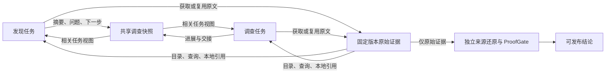

# v4 共享审查工作空间改进方案

日期：2026-10-30。状态：协议 11 编码、离线检查及远端 CI 已通过；首次真实 Cal.com 测试暴露上下文缺口，诊断中止。协议 12 复测又确认局部进展覆盖缺陷，协议 13 的持久进展日志及全量离线回归已完成，准备复测；历史协议 1–12 保持原语义。

## 问题与设计依据

停止的 Keycloak #37429 协议 10 运行在完成 17/58 个发现单元时仍没有缺陷候选。较早的只读快照中，136 次模型响应全部发生在发现阶段，累计 2,234,878 tokens。这能证明发现阶段成本和进展存在问题，不能证明完整 v4 的准确率低于 v3；尚缺同模型、同 PR/head、同判分规则的对照。

当前 `HypothesisLedger` / `EvidenceStore` 已保存跨任务证据，但发现阶段主要重建本组源码、读取历史摘要和最新回执。调查阶段的 `SharedEvidenceCache` 未贯穿发现阶段，而且旧缓存会截取长结果。仅取消执行额度并不能解决重复探索和上下文失忆。

TCyber 的可借鉴部分是 Lattice 的结构化共享状态、按任务构建 workset、持久化策略和显式交接。ReviewForge 保留自身的不可变源码证据和独立发布核验：模型笔记是调查线索，不能成为源码、行为契约或核验结论。

### 产品对照与取舍

以下是截至 2026-10-30 的厂商公开架构说明，用于设计参考，不是同条件准确率排名。

| 参考 | 公开机制 | 与当前 ReviewForge 的差距及本次取舍 |
|---|---|---|
| [CodeRabbit context engine](https://www.coderabbit.ai/blog/explainable-reviews-coderabbit-review-context-engine) | 按改动筛选代码依赖、Issue、工程规范、历史 PR 和团队知识 | 我们有固定版本源码与验证链，但组间已完成的分析不能有效交接。本次先补运行内相关视图；接入固定仓库文档及有版本的 Issue 原文 |
| [Greptile codebase context](https://www.greptile.com/docs/introduction) 与 [learning](https://www.greptile.com/learning) | 仓库依赖图、作用域规则、反馈学习 | 我们已有语义单元与搜索工具，仍会重复查相同调用方。本次补原始取证复用和显式进展；跨仓图与跨 PR 学习另行验证 |
| [Qodo context engine](https://www.qodo.ai/features/qodo-context-engine/) | 代码、需求与审查历史的统一上下文；专家职责分工与独立 judge | 我们已有专门规则和独立核验，缺少持续共享的调查记录。本次把共享资料与裁决隔离，避免共享错误判断造成互相确认 |

这些对照支持“相关上下文、持久进展、独立核验”这一改进方向，不支持单纯增加 agent 数量或让所有 agent 读取同一份完整聊天历史。

## 本次实施范围

| 工作包 | 交付 | 验收 |
|---|---|---|
| A：共享状态 | 在现有 ledger 增加持久化工作空间；结构化进展、未解问题、下一步、证据索引；按任务/单元/路径生成相关视图 | A 写入后 B 可见；恢复后仍可见；跨 run/head/workspace 拒绝；模型笔记无法成为证据；盲审视图不带候选结论 |
| B：发现闭环 | 发现模型读取共享视图并保存进展；查询已有原始证据；本组进度跨轮保留；根据实际新增源码/已接受结果/失败回执识别重复 | 改写解释或读取窗口但未增加源码不算进展；新的源码、有效提交和修复仍能继续；循环以未完成结束，不变成无问题 |
| C：跨阶段复用 | 同一运行的发现和调查共用只读取证缓存；长结果完整返回；调查输入接收相关共享进展并发布交接记录 | 相同读取只执行一次；每个消费者保留自己的可引用 Observation；取消和异常释放缓存；不同 head 不共享；盲核验不接收上游判断 |

三名 GPT-6.1 Sol / high 编码代理分别负责 A/B/C；主代理负责协议入口、文档、集成审查和回归。工作区统一使用 `dev`，不推送 `main`。

## 公共接口约定

新增 `engine/review_workspace.py`，入口 `SharedReviewWorkspace(ledger)`，状态存于 `ledger.shared_workspace`，仅协议 >= 11 启用。由控制器提供身份与绑定，模型不能指定其他运行。

- `publish_progress(*, task_id, actor, unit_ids, paths, summary, open_questions, resolved_questions, next_action, evidence_ids)`：保存当前任务的调查笔记；返回记录。所有 `evidence_ids` 必须在本 ledger 的不可变证据库中验证通过。幂等更新不凭空增加进展；笔记始终标记为不可信的模型解释。
- `view(*, task_id="", unit_ids=(), paths=(), role="discovery", catalog="references")`：返回与当前任务、单元或路径相关的笔记、证据目录和任务/候选状态。自动输入使用 `catalog="directory"`，按来源路径/范围聚合；显式 query 使用完整 references，按需取得原始证据 ID。`investigation` 可见相关调查资料；`proof`/`source_audit` 仅可见原始证据目录，不能看到笔记、候选主张或裁决。返回深拷贝。
- `read_evidence(evidence_ids)`：返回经过内容哈希和运行绑定验证的原始记录。调用方为消费者重新建立本地引用；不能把笔记文本登记成 Observation。

如代码事实要求调整签名，由 A 提前同步 B/C 与主代理，避免并行猜测接口。共享工作空间不复制原始证据，不成为第二本候选账本。路径相关性用于输入选择，不作为审查完成条件。

## 不变约束

1. 不恢复 token、请求次数、候选数、取证次数、输出长度或评论数配额。缓存内存上限仅决定是否留存，不能截断一次取证的返回值。
2. 发现/调查笔记和原始证据分开；引用必须重新绑定消费者的固定版本及本地证据记录。独立来源还原和 ProofGate 的发布边界不变。
3. 语义重复检测不能依赖响应措辞、随机 ID、窗口参数变化或模型声称的进展；真实新增源码/结果可以继续。不把暂时没有缺陷候选当作停止理由。
4. 新行为由协议 11 隔离；旧 checkpoint 不自动升级，不修改历史账本、评测目录或资金记录。

## 验证与后续

本次以离线、确定性的端到端测试验证共享交接、实际源码复用、恢复、版本隔离、长结果完整性、重复状态及旧协议兼容；完成后运行相关回归和后端完整测试。通过这些检查仅说明协作机制成立，不宣称准确率或召回率已提升。

最终离线验证：完整后端 **3043 passed、1 skipped、6 个既有弃用警告**；Ruff lint/format、离线 spec-check、严格裁判 2 项 unittest、diff whitespace 检查通过。第一阶段基线为 2947 passed。本次在它之上完成下列剩余实施项，真实结果单独记录。新能力仍属于同一尚未发布的协议 11，不升级历史 checkpoint。

| 方案项 | 实现与验收 |
|---|---|
| 发现提交后调查 | `StreamingReviewScheduler` 持久化候选领取/中断/完成及案例摘要。每个发现回执后串行交错调查，后续发现可读调查交接；并非无限并发。已覆盖重启冻结案例不重跑、失败隔离、取消保留未完成发现和原证据。 |
| 原子候选 | `atomic_hypotheses` 显式携带独立子主张、触发、影响、待证明问题与反证条件。合法子项先接受，错误兄弟可纠正；已接受案例不可改写，不同后果独立裁决，不靠“and”等词猜拆分。 |
| 定向补证 | 仅缺契约/执行事实的发布预检 UNKNOWN 可按照盲审缺口续办。实际新增原始来源才重新盲审；相同来源/失败方向明确 incomplete。已有有效语义裁决保持冻结。分段恢复、取消留证及计量均有测试。 |
| 需求与历史来源 | `query_review_knowledge` / `read_review_knowledge` 读取固定 head 的 README/ADR/规范等原文和冻结 Issue 快照。REST GET timeline 只取得同仓库 incoming cross-reference Issue，明确 `coverage=partial`，不声称包含全部 closing/manual 关联。Webhook 和评测入口真实接线；快照校验 repo/PR/head/hash。 |
| 可复现执行 | `run_repository_test` 重放仓库已有 Python unittest / Node test，不接任意 shell、不安装依赖。固定原始源码以 tar 复制进**从不启动**的准备容器，提交临时源码镜像后在只读、断网、非 root、无 host 挂载/凭据的受限容器执行。记录源码 SHA、基础及执行镜像 ID、argv、退出码和原始输出。取消/超时清理容器及临时镜像。 |
| 独立来源与发布 | 协议 11 独立盲审新增 documentation/issue 契约类型，必须验证完整原文、所有分片与版本绑定。目录/笔记/执行失败不成为成功来源；非零测试退出也不自动代表产品缺陷，仍须独立证明。 |

机器保护：单个执行容器 256 MiB、1 CPU、64 PIDs、临时目录 64 MiB；每次 Docker 操作 60 秒、进程输出捕获 32 MiB。触发后明确 timeout/resource-limit，不截断成成功证据，也不构成审查 token 或调用次数额度。执行仅支持上述两个现有测试适配器，缺镜像/依赖/不支持的框架明确 unavailable。跨仓依赖图与跨 PR 长期反馈学习仍是独立研究范围，不声称已实现。

本机真实 Docker 验证：Python 5 项（基本执行、非 root、源码只读、断网、无传入凭据）通过；Node 故意失败用例返回 exit 1，完整输出保留。主机没有物化或执行 PR 源码。原始本地回执：`.reviewforge/eval-private/context-sandbox-smoke-20261030.json`。

### 真实评测约定

全部编码和回归完成后，从 canonical50 固定选 **calcom/cal.com #14740**，15 文件、5 条 golden comments，head `92f44dcea7ff19e9123a30c63c167a2938df5a55`。选择先于新模型调用；复用固定 PR/diff/tarball 输入，新目录、空状态、DeepSeek flash、协议 11，仅计量，不设 token grant。Issue 快照也预先保存，当前结果为没有同仓 incoming issue 引用，不能解读为不存在需求。

评测使用 Windows Job Object 资源隔离及只读 GitHub 包装；输出仅本地，不发布 PR 评论。完整才运行严格裁判；partial 保留真实覆盖、未完成原因与全部成本，不伪装为零缺陷通过。该单例能验证此次改动的实际效果，不能与不同模型的 v3 五十题汇总拼出准确率提升结论，也不能代替 holdout。

### 本地成本检查

使用停止的 Keycloak 运行只读 SQLite 快照，在内存中重建证据视图；不改旧账本、不调用模型。16 个分组的完整引用目录合计 2,765,264 字符，聚合目录为 110,310 字符。最大引用目录的一组从 714 项、226,998 字符变为 24 项、7,356 字符；完整引用及原始源码仍能通过显式查询读取。这衡量的是共享目录表示的体积，不能换算为整轮审查 token 节省率或质量收益。

## 真实诊断结果与协议 12 修复

协议 11 实现 `147621fb4466079a1cf86487fe40ebe68865aeca` 已推送 `dev`，远端 [V4 Dev CI](https://github.com/Wayne0607/ReviewForge/actions/runs/41037810967) 成功。2026-10-30 本机 Windows Job 运行 `.reviewforge/benchmarks/deepseek-calcom-v11-20261030-180352/`，完整固定源码预检通过（5823 文件 / 193288201 bytes）。系统保留 2 GiB，评测 Job 上限 1.5 GiB；初次 2 GiB Job 的启动因不足 4 GiB 可用内存被预检拦截，零模型调用，另目录保留。

真实测试**没有通过**。51 个完整响应均为发现阶段，实报 1,808,871 输入 + 139,788 输出 = **1,948,659 tokens**；候选 0、完成 0/18、评论 0。确认上下文设计缺口后停止，不是 token 额度停止。1 个输入没有最终响应，用量未知，不能记成 0；严格裁判未运行，不计算 precision/recall/F1。原 `execution.json` 因外部终止可能仍写 running，实际终止和进程检查见该目录 `termination.json`；原账本及冻结代码不改写。

只读复核得到三点事实：

1. 每轮仅有 System、完整源码包和最新 controller receipt；模型此前的可见调查进展没有强制保存。checkpoint 动作调用为 0，notes 始终为空。只提供可选共享工具不能保证跨回合连续性。
2. 自动视图含聚合目录，但同时出现空 `evidence_catalog`；显式查询又返回 558 项、约 166927 字符的逐行目录，使一次输入达到 261872 字符。部分共享读取请求全部指向本地已有证据，却再次建立 Observation。
3. 发现读取回执提示复制 `obs_N:eN`，发现提交 schema 要求 `fN.B/R/C`；提示同时要求覆盖 ALL pending 和增量提交。模型明确反复犹豫引用选择，尚无合法候选提交被校验器拒绝的记录。

协议 12 的根本修复：取证工具必填模型**显式可见**的 `review_progress`，在执行前校验并持久化，后续/恢复输入必然读到；不保存或回放 provider reasoning。共享查询默认目录，原引用显式展开；导入按消费者和 evidence ID 幂等。发现回执只引导使用下一源码包的 `f...` 别名，明确每个非空来源侧选择实际支持的依据即可；任意单元可增量提交源支持的 OPEN 线索，缺契约交调查，不要求发现阶段先完成独立证明。没有重新引入请求、步骤、候选或 token 配额。

协议 12 完整离线回归：**3096 passed、1 skipped、6 个既有弃用警告**；Ruff lint/format、离线 spec-check、严格裁判 2 项 unittest 和 diff whitespace 均通过。新增完整流水线回归验证可见进展恢复、提前进入调查、盲审隔离及冻结恢复。随后固定新代码、新目录，从空账本重跑同一个 Cal.com #14740。第一轮全部费用仍列入改进成本，不能通过新目录抹掉。真实质量仍待验收。

## 协议 12 复测与协议 13 修正

代码 `a165dc296cad444d96466e2eff08d8186902d2d9` 已推 dev，[远端 CI](https://github.com/Wayne0607/ReviewForge/actions/runs/41041803557) 成功。固定同一 PR 空状态运行 `.reviewforge/benchmarks/deepseek-calcom-v12-20261030-183503/`：47 完整响应，1,499,209 输入 + 179,277 输出 = **1,678,486 tokens**，0/18 完成、0 候选、0 评论，另 1 个中断请求用量未知；未运行严格裁判。确认代码缺陷后停止，实际终止见目录内 `termination.json`，不改原执行记录。

真实轨迹证明：第一次 grep 已取得 5 个翻译键；下一响应第一个工具把键存在写入 resolved_questions，第二个工具为模板注册保存局部笔记且 resolved_questions 为空，覆盖同 task+actor 的 current。再下一轮只收到后者，已确认事项不在输入。后续重新查询那 5 个键，同时新增 2 个键，因此不能把整次查询说成完全重复，也不能把全部成本归因于这一缺陷。原始证据一直保存在 ledger；丢失的是自动提供给模型的工作进展。

两轮诊断合计 **3,627,145 个已知 tokens**，另 2 个中断请求未知。这些成本保留计入改进工作，不因新目录重置。

协议 13 修复设计假设：每个工具携带的是局部进展，不保证是完整任务快照。保留最新局部快照，并持久化按任务/actor 有序的进展日志，相关视图自动提供其历史。后续明确纠正保留来历，不把所有旧 open/resolved 合成权威事实。连续完全相同的记录不重复追加；所有笔记仍为不可信导航，不进入独立来源还原或 ProofGate。旧协议 1–12 不升级，不恢复业务执行配额。

验收增加真实缺陷对应的多工具回归：先解决问题、后保存另一局部问题，下一请求与恢复后都必须见到先前事项；并检查跨任务相关性、显式纠正、日志绑定和独立核验隔离。完成离线回归后，再固定新代码复测同一个 PR。

同时发现初始 `block.unchecked` 被每轮当成未检查提示重放，即使已经读取相关源码也不更新。由于旧文本缺少精确来源坐标，协议 13 不推测其已解决，而是明确改为初始历史导航、按 pending 单元过滤并精确去重，保留未知格式；当前原始源码与回执不受影响。

协议 13 离线验收：完整后端 **3144 passed、1 skipped、6 个既有弃用警告**；Ruff lint/format、spec-check、严格裁判 2 项 unittest 和 diff whitespace 通过。三位代理分工为有序工作空间、发现交付/提示和完整流水线恢复；本轮不重复运行未改动的 Docker 真实 smoke。随后以干净提交冻结快照开展同 PR 复测。
