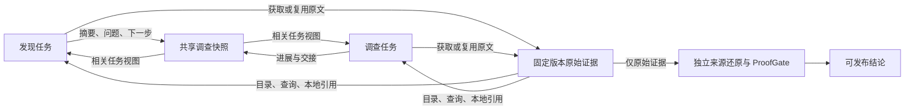

# v4 共享审查工作空间改进方案

日期：2026-10-30。状态：共享工作空间及后续流式、原子案例、定向补证、需求资料与隔离执行已编码，整体验证通过，接下来执行 canonical50 单 PR 评测；新运行使用协议 11，旧协议 1–10 保持原语义。

## 问题与设计依据

停止的 Keycloak #37429 协议 10 运行在完成 17/58 个发现单元时仍没有缺陷候选。较早的只读快照中，136 次模型响应全部发生在发现阶段，累计 2,234,878 tokens。这能证明发现阶段成本和进展存在问题，不能证明完整 v4 的准确率低于 v3；尚缺同模型、同 PR/head、同判分规则的对照。

当前 `HypothesisLedger` / `EvidenceStore` 已保存跨任务证据，但发现阶段主要重建本组源码、读取历史摘要和最新回执。调查阶段的 `SharedEvidenceCache` 未贯穿发现阶段，而且旧缓存会截取长结果。仅取消执行额度并不能解决重复探索和上下文失忆。

TCyber 的可借鉴部分是 Lattice 的结构化共享状态、按任务构建 workset、持久化策略和显式交接。ReviewForge 保留自身的不可变源码证据和独立发布核验：模型笔记是调查线索，不能成为源码、行为契约或核验结论。

### 产品对照与取舍

以下是截至 2026-10-30 的厂商公开架构说明，用于设计参考，不是同条件准确率排名。

| 参考 | 公开机制 | 与当前 ReviewForge 的差距及本次取舍 |
|---|---|---|
| [CodeRabbit context engine](https://www.coderabbit.ai/blog/explainable-reviews-coderabbit-review-context-engine) | 按改动筛选代码依赖、Issue、工程规范、历史 PR 和团队知识 | 我们有固定版本源码与验证链，但组间已完成的分析不能有效交接。本次先补运行内相关视图；接入固定仓库文档及有版本的 Issue 原文 |
| [Greptile codebase context](https://www.greptile.com/docs/introduction) 与 [learning](https://www.greptile.com/learning) | 仓库依赖图、作用域规则、反馈学习 | 我们已有语义单元与搜索工具，仍会重复查相同调用方。本次补原始取证复用和显式进展；跨仓图与跨 PR 学习另行验证 |
| [Qodo context engine](https://www.qodo.ai/features/qodo-context-engine/) | 代码、需求与审查历史的统一上下文；专家职责分工与独立 judge | 我们已有专门规则和独立核验，缺少持续共享的调查记录。本次把共享资料与裁决隔离，避免共享错误判断造成互相确认 |

这些对照支持“相关上下文、持久进展、独立核验”这一改进方向，不支持单纯增加 agent 数量或让所有 agent 读取同一份完整聊天历史。

## 本次实施范围

| 工作包 | 交付 | 验收 |
|---|---|---|
| A：共享状态 | 在现有 ledger 增加持久化工作空间；结构化进展、未解问题、下一步、证据索引；按任务/单元/路径生成相关视图 | A 写入后 B 可见；恢复后仍可见；跨 run/head/workspace 拒绝；模型笔记无法成为证据；盲审视图不带候选结论 |
| B：发现闭环 | 发现模型读取共享视图并保存进展；查询已有原始证据；本组进度跨轮保留；根据实际新增源码/已接受结果/失败回执识别重复 | 改写解释或读取窗口但未增加源码不算进展；新的源码、有效提交和修复仍能继续；循环以未完成结束，不变成无问题 |
| C：跨阶段复用 | 同一运行的发现和调查共用只读取证缓存；长结果完整返回；调查输入接收相关共享进展并发布交接记录 | 相同读取只执行一次；每个消费者保留自己的可引用 Observation；取消和异常释放缓存；不同 head 不共享；盲核验不接收上游判断 |

三名 GPT-6.1 Sol / high 编码代理分别负责 A/B/C；主代理负责协议入口、文档、集成审查和回归。工作区统一使用 `dev`，不推送 `main`。

## 公共接口约定

新增 `engine/review_workspace.py`，入口 `SharedReviewWorkspace(ledger)`，状态存于 `ledger.shared_workspace`，仅协议 >= 11 启用。由控制器提供身份与绑定，模型不能指定其他运行。

- `publish_progress(*, task_id, actor, unit_ids, paths, summary, open_questions, resolved_questions, next_action, evidence_ids)`：保存当前任务的调查笔记；返回记录。所有 `evidence_ids` 必须在本 ledger 的不可变证据库中验证通过。幂等更新不凭空增加进展；笔记始终标记为不可信的模型解释。
- `view(*, task_id="", unit_ids=(), paths=(), role="discovery", catalog="references")`：返回与当前任务、单元或路径相关的笔记、证据目录和任务/候选状态。自动输入使用 `catalog="directory"`，按来源路径/范围聚合；显式 query 使用完整 references，按需取得原始证据 ID。`investigation` 可见相关调查资料；`proof`/`source_audit` 仅可见原始证据目录，不能看到笔记、候选主张或裁决。返回深拷贝。
- `read_evidence(evidence_ids)`：返回经过内容哈希和运行绑定验证的原始记录。调用方为消费者重新建立本地引用；不能把笔记文本登记成 Observation。

如代码事实要求调整签名，由 A 提前同步 B/C 与主代理，避免并行猜测接口。共享工作空间不复制原始证据，不成为第二本候选账本。路径相关性用于输入选择，不作为审查完成条件。

## 不变约束

1. 不恢复 token、请求次数、候选数、取证次数、输出长度或评论数配额。缓存内存上限仅决定是否留存，不能截断一次取证的返回值。
2. 发现/调查笔记和原始证据分开；引用必须重新绑定消费者的固定版本及本地证据记录。独立来源还原和 ProofGate 的发布边界不变。
3. 语义重复检测不能依赖响应措辞、随机 ID、窗口参数变化或模型声称的进展；真实新增源码/结果可以继续。不把暂时没有缺陷候选当作停止理由。
4. 新行为由协议 11 隔离；旧 checkpoint 不自动升级，不修改历史账本、评测目录或资金记录。

## 验证与后续

本次以离线、确定性的端到端测试验证共享交接、实际源码复用、恢复、版本隔离、长结果完整性、重复状态及旧协议兼容；完成后运行相关回归和后端完整测试。通过这些检查仅说明协作机制成立，不宣称准确率或召回率已提升。

最终离线验证：完整后端 **3043 passed、1 skipped、6 个既有弃用警告**；Ruff lint/format、离线 spec-check、严格裁判 2 项 unittest、diff whitespace 检查通过。第一阶段基线为 2947 passed。本次在它之上完成下列剩余实施项，真实结果单独记录。新能力仍属于同一尚未发布的协议 11，不升级历史 checkpoint。

| 方案项 | 实现与验收 |
|---|---|
| 发现提交后调查 | `StreamingReviewScheduler` 持久化候选领取/中断/完成及案例摘要。每个发现回执后串行交错调查，后续发现可读调查交接；并非无限并发。已覆盖重启冻结案例不重跑、失败隔离、取消保留未完成发现和原证据。 |
| 原子候选 | `atomic_hypotheses` 显式携带独立子主张、触发、影响、待证明问题与反证条件。合法子项先接受，错误兄弟可纠正；已接受案例不可改写，不同后果独立裁决，不靠“and”等词猜拆分。 |
| 定向补证 | 仅缺契约/执行事实的发布预检 UNKNOWN 可按照盲审缺口续办。实际新增原始来源才重新盲审；相同来源/失败方向明确 incomplete。已有有效语义裁决保持冻结。分段恢复、取消留证及计量均有测试。 |
| 需求与历史来源 | `query_review_knowledge` / `read_review_knowledge` 读取固定 head 的 README/ADR/规范等原文和冻结 Issue 快照。REST GET timeline 只取得同仓库 incoming cross-reference Issue，明确 `coverage=partial`，不声称包含全部 closing/manual 关联。Webhook 和评测入口真实接线；快照校验 repo/PR/head/hash。 |
| 可复现执行 | `run_repository_test` 重放仓库已有 Python unittest / Node test，不接任意 shell、不安装依赖。固定原始源码以 tar 复制进**从不启动**的准备容器，提交临时源码镜像后在只读、断网、非 root、无 host 挂载/凭据的受限容器执行。记录源码 SHA、基础及执行镜像 ID、argv、退出码和原始输出。取消/超时清理容器及临时镜像。 |
| 独立来源与发布 | 协议 11 独立盲审新增 documentation/issue 契约类型，必须验证完整原文、所有分片与版本绑定。目录/笔记/执行失败不成为成功来源；非零测试退出也不自动代表产品缺陷，仍须独立证明。 |

机器保护：单个执行容器 256 MiB、1 CPU、64 PIDs、临时目录 64 MiB；每次 Docker 操作 60 秒、进程输出捕获 32 MiB。触发后明确 timeout/resource-limit，不截断成成功证据，也不构成审查 token 或调用次数额度。执行仅支持上述两个现有测试适配器，缺镜像/依赖/不支持的框架明确 unavailable。跨仓依赖图与跨 PR 长期反馈学习仍是独立研究范围，不声称已实现。

本机真实 Docker 验证：Python 5 项（基本执行、非 root、源码只读、断网、无传入凭据）通过；Node 故意失败用例返回 exit 1，完整输出保留。主机没有物化或执行 PR 源码。原始本地回执：`.reviewforge/eval-private/context-sandbox-smoke-20261030.json`。

### 真实评测约定

全部编码和回归完成后，从 canonical50 固定选 **calcom/cal.com #14740**，15 文件、5 条 golden comments，head `92f44dcea7ff19e9123a30c63c167a2938df5a55`。选择先于新模型调用；复用固定 PR/diff/tarball 输入，新目录、空状态、DeepSeek flash、协议 11，仅计量，不设 token grant。Issue 快照也预先保存，当前结果为没有同仓 incoming issue 引用，不能解读为不存在需求。

评测使用 Windows Job Object 资源隔离及只读 GitHub 包装；输出仅本地，不发布 PR 评论。完整才运行严格裁判；partial 保留真实覆盖、未完成原因与全部成本，不伪装为零缺陷通过。该单例能验证此次改动的实际效果，不能与不同模型的 v3 五十题汇总拼出准确率提升结论，也不能代替 holdout。

### 本地成本检查

使用停止的 Keycloak 运行只读 SQLite 快照，在内存中重建证据视图；不改旧账本、不调用模型。16 个分组的完整引用目录合计 2,765,264 字符，聚合目录为 110,310 字符。最大引用目录的一组从 714 项、226,998 字符变为 24 项、7,356 字符；完整引用及原始源码仍能通过显式查询读取。这衡量的是共享目录表示的体积，不能换算为整轮审查 token 节省率或质量收益。
