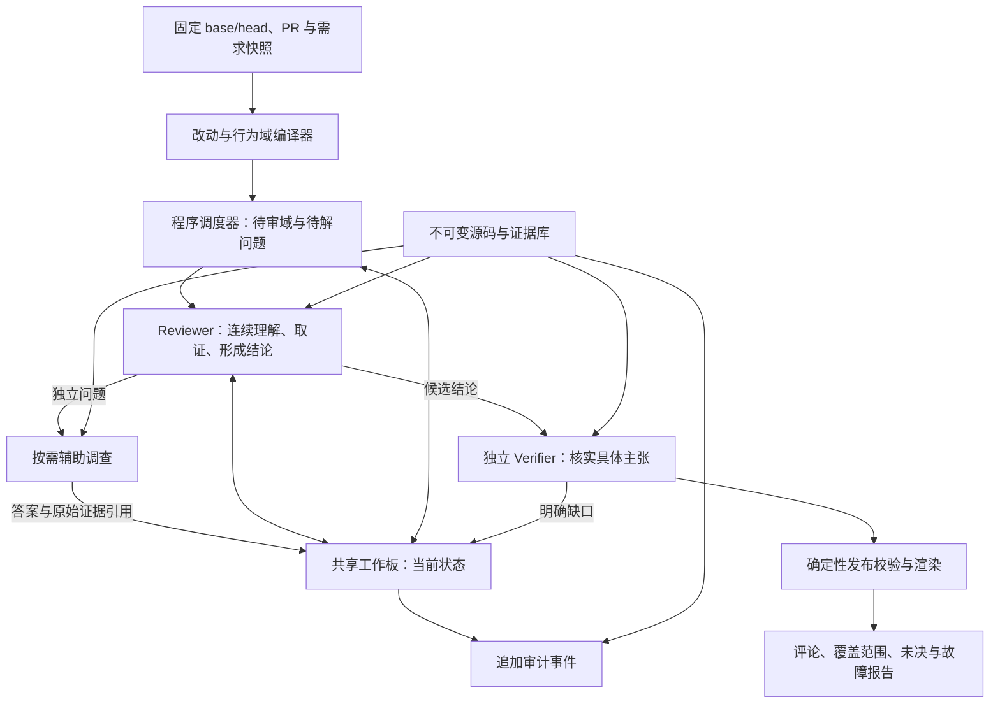

# ReviewForge v4.2：以审查决策为中心的架构重设计

设计日期：2026-10-31。状态：**部分方案已实验性实现，真实质量与成本尚未验收**；最新代码和测试状态以第 19 节为准。

依据：`dev@e21b805` 的代码与文档、协议 11–13 的真实 Cal.com 诊断、v3 固定 50 PR 报告、TCyber 本地 Lattice 实现，以及下文链接的厂商公开资料。

本文件定义新的 v4.2 运行内核，不追溯修改协议 1–13。设计后的编码授权于 2026-11-02 下达，三名 GPT-6.1 Terra / xhigh 分别承担状态/证据、连续审查、独立核验；主代理负责产品入口、固定输入和基准集成。实施及验收状态见文末，`main` 继续保留生产路径。

## 1. 结论与设计取舍

当前系统的主要问题是**决策过程没有收敛为产品交付，而状态保存、上下文装配和证明协议反复消耗了推理能力**。移除配额使这些问题充分暴露。继续扩大窗口、增加 agent 或给现有循环添加提示词，不能解决职责重复和状态模型错误。

v4.2 建议采用：

> 按改动行为组织审查，一个审查员连续负责一条行为链；只有明确、独立的问题才分派辅助调查。结构化共享工作板维护当前状态，原始证据完整外置。准备发布的结论经过一次职责明确、可自行取证的独立核验，再由程序校验和交付。

“一次核验”指一个持续负责的核验任务，不是限制只能调用一次模型或一个工具。新证据改变案例时，该核验任务可以继续；没有新事实时不重复抽样投票。

主要决策：

1. **合并发现与调查的认知职责**。普通案例由同一个 Reviewer 从理解改动做到结论，避免发现员先调查一遍、调查员再重建一遍。
2. **共享当前状态，不默认广播历史**。问题、答案、争议、任务归属都是有身份的记录；日志留作审计和显式回查。
3. **按行为链分工**。文件、符号、审查维度都是索引，不能直接变成重复推理任务的笛卡尔积。
4. **独立核验检查具体主张**。来源、身份、引用和版本由程序校验；语义由能读取源码的独立 Verifier 判断。取消每个候选都必须经过通用盲来源还原的固定流水线。
5. **完成取决于审查责任是否交代清楚**。已检查、已反驳、证据不足和运行失败分别记录，不以耗尽配额结束，也不要求证明整个程序无缺陷。
6. **先建立简单、强模型的参考实现**。多 agent、检索索引和分级模型逐项证明收益后再进入主路径。

这不是“模型完全没有问题”的结论。现有轨迹不能排除模型、提示词或供应商适配的影响；但已经足以证明架构存在独立于模型能力的浪费。强模型也不应被要求每轮重新理解几十万字符的历史。

## 2. 证据：什么已确认，什么还只是解释

### 2.1 实测事实

| 项目 | 已记录事实 | 可以得出的结论 |
|---|---|---|
| 协议 11 | 1,948,659 tokens；51 个完整响应；0/18 单元完成 | 发现循环没有有效交付；可见进展交接存在缺陷 |
| 协议 12 | 1,678,486 tokens；47 个完整响应；0/18 完成 | 局部进展覆盖已解决问题，引发重复查询 |
| 协议 13 | 9,832,616 tokens；91 个完整响应；47 分钟；12/18 完成 | 有序保存恢复了部分进展，但交付效率仍不可接受 |
| 协议 13 输入 | 9,444,484 input / 388,132 output，输入占 96.05% | 首先应检查每次输入为什么这么大，而不只压缩输出 |
| 协议 13 阶段用量 | 发现 3,129,825；调查 6,702,791 tokens | 只压缩发现阶段的 journal 不够；调查工作集和重复判断同样需要重设计 |
| 最大发现请求 | packet 480,190 字符；journal 361,292；源码 rows 41,781 | 进展历史占该请求 75.24%；该请求最终 HTTP 402，不能计成成功计费响应 |
| 协议 13 产出 | 5 个候选；调查 confirmed 3 / refuted 1 / unknown 1；0 评论 | 形成了线索，尚未形成通过独立发布核验的交付 |
| 运行结束 | 6 个 HTTP 402；来源还原未成功；裁判未运行 | 最后零评论不能归因于 ProofGate 的语义驳回；precision/recall 未知 |
| 三轮累计 | 已知 13,459,761 tokens，另有 8 请求用量未知 | 成本失败是事实，不能把未知请求当零消耗 |

来源：[共享工作空间实测记录](shared-review-workspace-plan.md#协议-13-实测结论2026-10-30)。本地原始报告：`.reviewforge/benchmarks/deepseek-calcom-v13-20261030-190537/evaluation-report.json`；原始数据不提交 Git。

输入占比不等于浪费占比，真实源码阅读也需要输入。最大请求中的历史比例也不能直接换算成全运行可节省费用。当前证据证明存在膨胀与重复交接，节省多少必须由新运行验证。

v3 的 50 PR 平均为 331,552 tokens，全部 PR 级运行完成，严格 precision 42.76%、recall 47.45%、F1 44.98%。但 v3 用 MiniMax 系列，本轮用 DeepSeek；工作量也不是同一分布。可以说明当前单 PR 消耗异常，**不能把平均值比值解释为同条件退化倍数**。详见 [v3 benchmark](benchmark.md)。

### 2.2 两问法则：为什么原设计合理，哪里不再成立

开工前复查 GitHub Issue：当前仓库 Issue 列表为空。设计依据来自历史规格、git blame 与已合并 PR；例如 [T7 调查员 PR](https://github.com/Wayne0607/ReviewForge/pull/125)。没有把“搜不到 Issue”当成“没有历史设计”。

| 原设计及意图 | 失效的假设 | v4.2 的根本处理 |
|---|---|---|
| 保存最新进展，降低上下文体积 | 最新笔记代表整个任务；实际只代表一个局部话题 | 问题有独立 ID，更新只影响指定问题 |
| 回放完整有序 journal，避免局部覆盖 | 模型每轮读完历史就能廉价恢复当前状态 | 持久日志与当前投影分离，更新时维护投影 |
| 每次取证都填写进展结构 | 增加记录一定增加有效工作记忆 | 程序记录工具事实；模型仅在问题/结论改变时提交语义更新 |
| 发现与调查分工 | 发现足够轻量，调查只补缺口 | 真实发现已经是深度工具循环，改成连续责任人 |
| 交错调查提升交付速度 | 交错等于并发或公平调度 | 当前回调 await 完整调查，改成持久队列和独立任务调度 |
| 通用盲还原抑制上游偏见 | 每种缺陷都能先独立提取外显契约，再判断 | 按缺陷的证据类型核验，缺业务规则才要求业务规则 |
| 完整覆盖账本保证质量 | 所有语义单元均填表近似代表实际检查充分 | 账本保存可观察检查范围，不宣称形式化完备 |
| 大量协议单测保护质量 | 协议正确意味着模型能高效完成任务 | 另设真实模型交付、轨迹效率和召回验证 |

代码定位：

- `engine/discovery_workflow.py::request` 重建 packet、共享视图和最新回执；不是持续携带完整可见工具会话。
- `engine/review_workspace.py::view` 只要某一历史事件相关，就展开该 owner 的完整 journal。提交 `8605923` 的注释明确说明，这是为了保留跨话题纠正关系。
- `engine/investigation_workspace.py::publish_progress` 自动附加累计成功 observations 的证据 ID；历史事件再重复保存和交付这些累计列表。
- `engine/streaming_review.py::on_candidates` 在锁内顺序 `await self._investigate({identity})`，发现提交会等待调查结束。
- `engine/source_audit.py` 与 `engine/proof_gate.py` 实施独立还原和最终裁决；这是对真实错误确认的防御，不能简单删除后直接相信调查员。

最初的 [2026-09-01 诊断](architecture-diagnosis-20260901.md) 已提出减少重复过滤、让调查获取新信息。后续局部修复逐步增加了交接与证明负担。前面三次工作空间修补解决了真实缺陷，但仍在同一控制流内纠偏；这次应重新划定边界。

## 3. 从第一性原理定义任务

### 3.1 一条有用的审查意见是什么

审查的产品价值来自：开发者能据此修复一个由改动引入或暴露的、可解释的行为问题。

最小逻辑是：

```text
具体输入/状态 x
    ↓ 实际可达的调用或数据路径
当前版本行为 actual(x)
    ↔ 有依据的预期 expected(x)
差异造成具体影响，且与本次改动有因果关系
```

这五件事应在最终结论中清楚，但**不等于每个阶段都要分别填写五套证明对象**。最初只有一个可疑行为也允许进入调查。系统不得替模型补造缺失前提。

预期可以来自测试断言、调用方约束、schema、语言/库契约、已确认业务规则，或有充分上下文的关系不变量。旧代码不是天然正确；变量名不是业务规则；模型信心不是证据。

### 3.2 三种不同的“完成”

1. **行为域已审阅**：已检查哪些改动及关键依赖，候选/疑点已经登记。它不证明该域无 bug。
2. **候选已裁决**：具体主张成立、被反证，或者因明确缺失事实而无法判断。
3. **运行已交付**：可发布结论、覆盖边界、未决事项、执行错误都已持久化并正确呈现。

这三个状态不能相互代替。一个域可以已审阅但含待调查候选；一个候选可以因环境缺失而 unresolved；一个运行可以交付部分有效结论但仍为 partial。

运行记录分开保存执行状态、审阅覆盖状态和案例结果。进程正常退出只表示执行结束；不能让它自动设置“审查完成”。验收的完整交付还要求责任范围已检查、调查/核验队列清空、没有阻断必要判断的未决问题。已交付但有保留的报告单列，不能通过改状态名称提高完成率。

### 3.3 成本为什么会失控

一次运行的模型成本由所有物理请求的输入、输出和缓存价格共同决定：

```text
总输入 = Σ(稳定指令 + 当前工作集 + 会话历史 + 重复交接 + 结果协议)
有效工作 = 新的相关观察 + 消除的关键不确定性 + 可交付结论
```

如果第 t 步输入包含前 t 步的所有工具内容，每步新增 a 个 token，累计输入近似 `N·B + a·N(N+1)/2`。这只是线性积累历史的二次增长模型；当前“历史事件内再携带累计引用”的做法还会进一步放大。不能在没有测量时给整条流水线断言精确复杂度。

因此应同时减少：不必要的步骤、每步无关输入、重复重新开题、重复裁决。缓存只能降低部分计费和延迟，不能让无关历史变成有用上下文。协议 13 的 cache_read 约占输入 21.77%，并非全量高命中。

### 3.4 不设人为配额，仍然需要停止语义

“继续取证直到完成”必须包含：**当前要消除什么不确定性；下一个动作的不同结果会怎样改变结论**。

完全放任模型持续发现新问题，不能保证有限时间终止；给它固定步骤上限也不能证明工作完成。v4.2 采用可解释的审查范围、问题状态与无进展处理，保留资源和外部故障保护。不能承诺既无限探索、又确定有限成本、还穷尽所有 bug。

## 4. 外部方案与 TCyber：借鉴机制，不照搬形态

以下为 2026-10-31 查阅的官方公开资料。厂商效果数字未在我们的模型、PR、裁判下复现，不用于排名或成本承诺。

| 参考 | 可核实机制 | 对 v4.2 的启发与边界 |
|---|---|---|
| [Cursor Bugbot](https://cursor.com/blog/building-bugbot) | 从固定多轮流程转向自主取证；按离线数据和实际修复信号迭代 | 模型应能沿新线索继续；工具和完成协议必须参与消融。无需复制旧版多票过滤 |
| [Greptile v5](https://www.greptile.com/blog/greptile-v5) | 并行 agent 分别探索范围很窄的缺陷假设 | 支持“独立疑点才拆任务”；并行可能降延迟，不能自动推出降低总 token |
| [CodeRabbit context engine](https://www.coderabbit.ai/blog/explainable-reviews-coderabbit-review-context-engine) | 代码关系、Issue、规范、历史与工具信号按本次改动筛选；审查后验证；持续评估 | 投资上下文选择和评价闭环；不要把全仓知识一次性塞入所有任务 |
| [Qodo context engine](https://www.qodo.ai/features/qodo-context-engine/) | 代码、需求、PR 历史、组织规则及分工核验 | 需求和组织记忆是独立数据源；多个专家不是充分条件 |
| [Anthropic context engineering](https://www.anthropic.com/engineering/effective-context-engineering-for-ai-agents) | 按需检索、外部笔记、压缩和隔离子任务上下文 | 存储容量与模型工作上下文应分离；保留关键决策，避免历史工具回执无限增长 |

[Anthropic 多 agent 研究经验](https://www.anthropic.com/engineering/multi-agent-research-system)也明确指出，多 agent 成本较高，强共享上下文、强依赖任务未必适合并行。这不否定 Greptile 的设计；两者共同要求任务能被清楚地拆开。

### 4.1 TCyber 本地代码的具体启发

只读核对了 `E:/tcyber/backend/src/tcyber/`：

- `core/lattice_schema.py`：targets / findings / evidence / notes / tasks 各自保存领域状态；证据正文通过 `content_ref` 外置。
- `core/lattice.py`：按 domain 与 entry_id 读取、更新条目。
- `engine/strategy/dispatch.py::build_conductor_workset`：从状态派生待执行、待核验等紧凑工作集。
- `engine/strategy/lattice_queries.py`：共享 pending/claimed 查询，避免重复派发。

借鉴的是**结构化状态、任务归属、按职责投影、证据外置**。不能由类名 Lattice 推断已有 CRDT、自动冲突合并或事实正确性保证；上述核心实现本质上是有 schema 的状态容器。ReviewForge 还需要版本比较、冲突显式记录和独立核验。

不直接移植 TCyber 每轮 Conductor 的 LLM 调度。PR 审查多数队列操作可以由程序完成；额外调度模型必须先证明比简单规则有收益。

## 5. 总体架构



最小上线形态只有两类模型职责：Reviewer 与 Verifier。辅助调查是同一 Reviewer 实现的窄任务模式，按需启用，不另建一个通用 agent 框架。

| 部分 | 谁负责 | 不可转嫁的责任 |
|---|---|---|
| 快照、路径、版本、证据存取 | 程序 | 来源完整性、绑定与权限 |
| 改动域初始拆分、队列、幂等 | 程序；Reviewer 可提出调整 | 不漏改动、不重复启动、失败可恢复 |
| 理解行为、选择调查方向、给出语义判断 | Reviewer | 同一案例的连续推理和明确交付 |
| 小型独立事实问题 | 按需辅助调查 | 返回答案、范围、证据和不确定性 |
| 发布前独立语义检查 | Verifier | 可达性、因果、实际危害、反例与证据缺口 |
| 引用、坐标、去重记录、投递 | 程序 | 不能通过模型“觉得可用”跳过 |

Verifier 与 Reviewer 可以使用同一模型，但这只提供角色、会话和取证路径隔离，不等于统计独立。跨模型核验作为实验选项，不能用模型多数票替代证据。

## 6. 工作单位：行为域与具体案例

### 6.1 行为域取代 unit × dimension 调用矩阵

语义单元继续保留，用于完整映射改动；调度单位改为 `ReviewScope`，即一次相关行为变化。例如一次“添加参会者”改动可能跨 UI、RPC、数据库和通知，不应因跨四个文件就安排四名互不知情的审查员。

编译器先做不调用模型的工作：

1. 固定 base/head，生成完整 changed-region 清单；不支持的语言、二进制和解析失败必须可见。
2. 利用可靠的 import、符号、调用和共享数据关系构造局部关联；标注每条边是解析确认、字面匹配还是模型建议。
3. 初始合并紧密关联的改动，保留跨域依赖索引；父函数与子函数重叠部分只归属一次审查责任。
4. 每个 changed region 都有责任归属，任何自动排除都附原因。格式化、生成文件等也保留可恢复入口。
5. Reviewer 首次读整体改动地图，可以提出拆分、合并、增加漏掉的依赖。程序校验映射，不把语义边当成可达性证明。

小 PR 默认由一个 Reviewer 看全局并负责到底。大 PR 才拆分独立域；共享同一核心状态、事务或调用链的域优先合并。依赖图只是导航，不能沿所有邻居无限展开。

### 6.2 候选不是完整证明书

Reviewer 可以在工作板登记一个 `Case`：可疑操作、触发条件、可能影响、当前缺口及源码锚点。允许不完整，但必须标出未知字段，不能发布。

同一机制有两个独立后果时，在一个 Case 下登记两个主张，各自裁决；避免一个较强后果被反驳就删除另一个已成立后果。只有需要独立修复或触发条件完全不同，才拆新 Case。这样既防止整包误驳，也避免原子化制造重复评论。

### 6.3 意图与需求快照

PR 描述、明确关联 Issue、仓库规则、相关 ADR/测试都可检索。`Fixes #...` 等链接需解析并抓取对应正文；只查 timeline 不能声称已覆盖全部需求。

外部资料记录来源 URL、获取时间、内容摘要与访问状态。它们是运行时冻结的资料，**不伪装成 head 当时的历史需求**。历史评测如拿不到当时版本，标记时间泄漏风险或不向模型提供该资料。文档和 Issue 是待解释的证据，不是工具执行指令；相互冲突要记录。

## 7. 共享空间：当前工作板、原始证据、审计日志三层分离

### 7.1 六类持久对象

| 对象 | 核心内容 | 信任边界 |
|---|---|---|
| `Run` | repo/base/head、环境、模型与策略版本、运行健康、费用回执 | 程序生成；失败与语义判断分开 |
| `ReviewScope` | 改动责任、依赖、检查范围、候选关联、完成状态 | 完成是审阅记录，不是无 bug 证明 |
| `Question` | ID、具体问题、相关 Case、状态、当前答案、证据 refs、revision、owner | 答案是可质疑的解释，不能变成原始事实 |
| `Case` | 触发、机制、主张、影响、支持/反证、revision、裁决 | 只有独立核验许可才能发布 |
| `EvidenceRef` | repo/revision/path/range/content hash 或测试/资料 artifact、完整性 | 正文不可变；引用真实不等于解释正确 |
| `Task` | 对象及输入 revision、责任、lease、状态、交付结果 | 调度去重、崩溃恢复、过期结果检测 |

早期使用现有数据库与本地内容寻址文件即可，不引入 Kafka、Neo4j、通用工作流平台或向量数据库作为前置依赖。跨仓检索是以后可插拔能力。

### 7.2 更新规则

```text
update_question(id, expected_revision, answer_delta, evidence_refs)
    → 校验来源、权限与版本
    → 同一事务更新当前条目 + 追加审计事件
    → 返回新 revision 与受影响对象
```

- ID 表示问题身份，不从会变化的自由文本直接生成。类似问题先检索现有条目；只有同一对象、条件和问题才能复用。
- 局部更新不会清空其他问题；空数组不能表达“所有历史已解决事项作废”。撤回必须指定记录及原因。
- 同一 revision 的并发语义更新不 last-write-wins：返回冲突并保留两方依据，由责任人消解。普通追加证据可以按内容身份幂等合并。
- 结论或依赖变更时，依赖它的 Case/核验许可失效；纯时间戳、lease 心跳不触发重审。
- 每条解释保留 `supported / disputed / retracted` 等状态。即使引用存在，也不能把“模型说已解决”当成程序证明。
- 日志保留完整审计；默认 prompt 读取当前条目及相关冲突。只有显式追溯纠正过程时读取历史。

### 7.3 工作集投影

每个任务默认只获取：

1. 自己的责任与尚未决定的问题。
2. 相关问题的当前答案、争议、短依据及原文引用。
3. 当前判断实际需要的源码片段、最新工具结果。
4. PR 改动地图和其他任务的简短状态索引。

不因某条历史笔记提过同一路径，就导入整个 owner 的所有记录。相关性依据显式问题/案例依赖、符号/范围与改动关系；路径仅是候选信号。

**完整保存与完整重复输入是两件事。** 显式请求的源码完整存入证据库并提供原文；超过物理模型窗口时使用有边界和续页标志的连续页面，不能静默截断。工作集可以替换已消费的正文，但必须保留引用、覆盖范围和重新读取能力。没有重新读到的细节不能仅凭摘要成为发布依据。

### 7.4 三种复用分别计量

- 工具结果复用：同 revision、规范化参数、同环境只获取一次；并发请求 single-flight。
- 当前答案复用：省去重复调查，但使用者按所需事实检查原始来源；争议答案不自动继承。
- 模型前缀缓存：稳定指令与固定资料排序，使用供应商实际回执计量命中；不以缓存为理由扩大输入。

同一文件不同范围、同一测试不同输入、不同 head 的相同路径都不能粗暴视为相同证据。跨运行可复用不可变 blob，但必须重新绑定当前运行的许可和适用性；模型判断不能仅凭代码哈希跨运行自动沿用。

## 8. Reviewer：一个连续闭环，少量清楚的动作

### 8.1 任务提示只围绕审查目标

Reviewer 理解改动、检查实际路径、沿关键疑点取证、挑战自己的解释、交付结论。security/performance/testing/i18n 等以适用规则注入，默认不启动各自重复审查同一份代码的 agent。

发现候选不自动创建第二名调查员。只有问题可独立回答且并行收益明确时才派辅助调查，例如核实一个外部库版本的特殊语义。子任务不需要读完整 PR，也不需要写全套发布证明。

### 8.2 工具接口

保留普通源码工具，语义交付工具保持简单：

```text
read_source(ref / path+revision+range)
search_code(query, scope)
find_references(symbol, scope)
read_diff(scope)
read_knowledge(query_or_ref)
run_check(test_spec)

save_question(question_id?, statement_or_answer, evidence_refs)
submit_case(case_id?, trigger, behavior, impact, evidence_refs, open_questions)
finish_scope(scope_id, checked_regions, result_refs, unresolved_refs)
```

以上是逻辑 API 草案，不要求每轮同时暴露全部管理动作。Case 对象细节由程序读写；模型使用短引用，不生成长 hash、run_id、证据复制对象和自计数组索引。

工具调用自动生成审计和 EvidenceRef。取消每次 read/grep 前强制填写完整 `review_progress` 五字段的要求；有语义变化才更新问题。有真正未解决的问题才能派发辅助任务，不能靠“换个视角再看看”制造无边界工作。

### 8.3 会话连续性与压缩

任务内保留协议支持的可见 assistant/tool 交互，避免每一步重建为“静态 packet + 最后一次回执”。但可见历史也不能无限追加：在问题闭合、任务交接或上下文容量需要时，基于当前工作板重建工作集。

压缩保留：未决问题、当前判断及反证、依赖、必要源码引用、尚未消费的工具结果、明确检查边界。已归档工具正文通过证据库重读。压缩失败不得伪造已消费状态。

不索取或回放供应商内部 reasoning 字段。模型能力、工具协议和原生续接行为由适配器实测；不能假定所有供应商兼容同一消息格式。

### 8.4 输出错误的处理

合法记录独立提交，事务边界是记录；无效兄弟记录不冲掉成功交付。结构错误返回准确字段错误，仅修该条，不重启整个审查。语义结论只有出现新证据、纠正事实或实际格式错误时才重开；不能通过反复请求取得想要的 verdict。

协议本身不再编码大量当前缺陷特有字段。持久化结构可以丰富，模型交付结构只需表达当前动作；复杂关系由程序从已存在对象连接。

## 9. 完成、继续、暂停：真正的控制策略

### 9.1 下一步的必要性

每个活跃调查至少有一个具体 `Question`。下一动作应能解释它与该问题的关系，例如“调用方传入的是去重后集合还是原始集合”。无需为每次工具调用写长计划，但若持续无法指出问题与动作关系，应返回任务决策点。

可观察进展包括：获得所需范围的源码或执行结果；回答/反驳问题；发现有明确因果联系的新必要问题；提交合法案例；解决真实协议错误。

新的路径、新字符串、新笔记或更长回答本身不算有效进展。搜索无命中可能是有效信息，但必须带完整查询范围与限制，不能证明全仓不存在。

### 9.2 状态与结束条件

| 情况 | 动作 | 对外含义 |
|---|---|---|
| 已有具体可获取的关键事实缺口 | 继续取证，工具保持可用 | 正在审查 |
| 当前证据足以支持候选，剩余问题不影响主张 | 提交核验；必要时把独立问题另立 Case | 本案例进入交付，不等待全 PR |
| 正向反例否定必要前提 | 附反证结束该主张 | refuted，不是接口失败 |
| 已审阅责任范围，未发现有依据的候选 | `finish_scope` 记录检查内容 | reviewed，无可报告问题；不宣称无缺陷 |
| 关键业务规则/环境不可获取 | 明确缺失事实及解锁条件 | unresolved / blocked，不能当 clean |
| 同证据、同问题、同动作结果反复出现 | 抑制重复动作，要求交付结论或具体不同路径；无新路径则保存 stalled | partial，可恢复；不编造问题不存在 |
| provider 认证/余额等账户级故障 | 该账户请求通道熔断；保存等待和在途回执 | execution-blocked，不是语义 unknown |
| 机器资源、网络或用户取消 | 保存 checkpoint；取消无用在途任务 | interrupted，实际用量与未知用量分别记录 |

同一动作的缓存命中仍可供重读、核验与恢复使用，不能简单禁止。重点是它是否被用来宣称新的调查进展。

### 9.3 谁判断“信息已经够了”

程序不能证明任意自然语言任务的信息增益。Reviewer 给出明确结论或缺口，程序验证状态、来源、范围与重复，Verifier检查准备发布的语义。不能伪装成一个完全确定性的“智能停止器”。

不加每 PR token、每案步骤、候选数、修复次数或评论数配额。任务并发和物理窗口是资源控制；排队任务保留，不因达到并发上限消失。离线性能目标也不转化为运行时截断。

当没有候选时，仍须完成预先声明的改动审阅责任；但完成后不能以“还没找到 bug”为由再开同一轮。剩余高风险路径未检查就只能标记 partial。

### 9.4 状态冻结的粒度

冻结的是 `case_revision + evidence_digest + verifier_policy` 下的结论。相同输入不可为了翻转 verdict 而重抽；新事实显式生成下一 revision，保留旧结论及更改原因。不同案例不因共享证据而共享 verdict。

## 10. 独立核验：减少重复阶段，保留实质审查

### 10.1 程序与模型各管什么

确定性校验负责：repo/base/head、原始内容哈希、完整性、路径和行号、案例身份、引用存在、权限、发布幂等、失效依赖。程序能够保证这些，不需要 LLM 再写一遍。

Verifier 负责：触发条件能否发生；真实路径是否支持所称行为；预期是否有依据；改动是否引入/暴露该问题；有没有反例；影响是否值得报告。

“源码是真的”与“从源码推导的结论正确”必须分开。删去通用盲还原不等于删除独立语义核验。

### 10.2 每个拟发布案例都经过独立 Verifier

输入：固定案例的简短主张与触发条件、相关 base/head 原文、证据引用、适用规则、已知反证。**不输入 Reviewer 的确认标签、信心分、长篇论证或共享笔记历史**。

Verifier 有源码/资料/测试工具，可独立寻找反例与缺失前提。它输出：

- `accept`：明确实际行为、预期依据、触发与影响的引用关系；形成发布许可。
- `reject`：指出被证据否定的具体前提，不是“没有证明所以错误”。
- `needs_evidence`：唯一缺口或相关缺口集合，连回同一 Case 的问题表；有可执行来源才继续调查。
- `unresolved`：确实缺资料或无法区分解释；记录解锁条件。

一次返回多个缺口时按依赖处理，不默认全部并行。复核输入只增加新证据和受影响的主张，不再次还原所有源码。语义观点分歧没有新证据时保持 unresolved，不用无穷辩论或多数票解决。

### 10.3 不同问题需要不同证据

| 问题种类 | 可接受的预期依据 | 不能代替依据的内容 |
|---|---|---|
| 语言/类型/API 误用 | 实际版本的类型、语言规则、库文档或可重现行为 | 未绑定版本的模型常识 |
| 数据流、集合、状态机错误 | 实际 producer/consumer、schema、测试断言、具体不变量 | 变量名、“常见实现应该如此” |
| 权限/资金/组织业务语义 | 对应角色规则、策略、需求或可验证调用契约 | 把旧代码当政策，把未找到拒绝当授权 |
| 回归 | base/head 相同触发场景的差异，加有效预期 | 只有前后不同，没有说明为什么变坏 |
| 并发/性能 | 可达交错、复杂度与实际工作量依据；必要时重放 | 想象最坏情况、无数量依据的“很慢” |
| UI/本地化 | 实际生命周期、交互/资源约定与用户可观察后果 | 个人风格偏好或仅凭键名判断 |

允许经过明确论证的关系不变量；它仍是模型解释，需要 Verifier 检查原始上下文。没有业务需求不能报告纯业务政策冲突。不是给所有候选降低同一门槛，而是避免要求无关的证明材料。

### 10.4 测试执行的地位

复用现有隔离执行能力，优先已有测试。新增可选的最小复现实验：在独立临时 overlay 中运行，记录完整测试源码、运行命令、输入、镜像/依赖摘要和 base/head 输出；不改被审仓库，不携带凭据。

自编测试失败只是线索。Verifier 要检查断言是否来自真实契约，避免“把猜测写成 assert，然后证明猜测”。环境失败必须与行为失败分开；无法准备依赖就 unavailable，不能据此判断代码正确或错误。镜像和依赖准备属于独立环境步骤，测试容器仍保持隔离约束。

通用盲来源还原保留为离线对照实验，或明确需要去除先入为主影响的特殊核验模式；它不再是所有评论的必经固定阶段。该变更会影响误报/漏报权衡，必须通过消融和 holdout 决定是否成立。

## 11. 调度与增量交付

调度器是程序，处理 `scope_ready / question_answered / case_ready / verification_done / provider_blocked` 等事件，不按固定“发现全部结束再调查全部结束”的批次推进。

- 候选提交事务只入队并确认，不 await 整个调查。
- 同一案例的同一 revision 仅有一个活跃责任人；lease 过期可以接管，迟到结果按输入 revision 检查。
- 独立域和独立问题可并行；紧密共享上下文优先同任务。并行降低墙钟时间的同时可能增加总费用，两项分别统计。
- 调度优先考虑危害、当前证据、依赖解锁价值，并使用等待时间避免低优先级永久饥饿。模型自报 confidence 不作为唯一派发开关。
- provider 账户级故障阻断该账户后续启动，其他独立账户是否切换取决于明确策略；不暗中换模型、换账号或消耗另一授权范围。

每条已独立通过的结论立即形成 durable result，不依赖其他域最终完成。对用户可先展示已验证结果及 `partial` 状态；GitHub 投递按产品配置聚合，必须如实展示未覆盖范围。不能因为有一条可发布评论就把整个 PR 标为完成。

评论使用已核验的事实模板渲染，不再增加一个自由改写结论的模型。需要改措辞时只能在事实边界内，改动主张则必须新 revision 重验。跨案例去重依据根因、触发及修复位置；相同文件或相似文本只能提名为可能重复，不能自动吞掉独立缺陷。

## 12. 模型策略与可观测性

### 12.1 先把参考模型跑顺

v4.2 首先用一个在真实审查上可靠的强模型完成 Reviewer 和 Verifier 参考路径。以固定模型比较架构，以固定架构比较模型，不能同时更换后只归因于架构。

便宜模型不默认承担最难的行为分析；摘要、结构提取等能程序完成的事情也不因便宜就调用 LLM。需要跨模型路由时，用实测的每条正确结论成本、延迟和错误类型选择，而不只看单价或自报信心。

模型可用性、原生工具、思考模式、输出容量和缓存以真实适配测试为准。请求记录实际模型标识与选项；物理容量不同通过分页/任务切分解决，不静默省略必要证据。

### 12.2 每次请求需要回答的账本问题

| 观测 | 作用 |
|---|---|
| 物理请求 ID、任务/案例/revision、provider 选项 | 区分重试、续接和重新开题 |
| input/output/cache_read、计价版本、未知用量 | 真实成本，不把缓存读重复计入总 token |
| prompt 按规则/源码/当前状态/历史/协议分类大小 | 定位上下文膨胀 |
| 本轮交付原文位置、已交付重放比例、工具缓存命中 | 区分工具 I/O 节省与模型 token 节省 |
| 问题状态变化、候选首次交付、核验缺口和结果 | 判断调用是否推进任务 |
| 首条候选/首条可发布结论延迟、队列等待 | 发现长调查阻塞其他工作的现象 |
| 反复查询、重复候选、每次 handoff 成本 | 衡量协作是否真正节省推理 |
| 环境 unavailable、provider 失败、来源失败 | 不把基础设施问题混成质量问题 |

“问题已解决率”可能被模型误报，不能直接当业务 KPI。质量仍由独立标注、严格裁判与真实开发者处理结果检查。实际修改或点赞也不能直接证明评论正确。

## 13. 模块边界与迁移

### 13.1 新内核保持小

建议 `backend/src/reviewforge/review_v42/`：

```text
contracts.py          六类对象、输入输出与版本
store.py              当前状态、事务、事件、lease、依赖失效
scope.py              changed-region 责任映射、行为域和检索导航
context.py            当前任务工作集、可见会话与证据装配
reviewer.py           连续审查与窄任务执行
verifier.py           独立核验与明确缺口回传
runtime.py            程序队列、失败恢复、运行健康
publication.py        核验许可、去重、渲染与投递适配
```

模块目录只是职责建议，不为凑文件数拆分。若三个模块就能清楚实现最小路径，可以先合并；禁止把旧阶段和全部版本分支照搬进新目录。

### 13.2 复用与退出主路径

| 复用现有基础设施 | 从 v4.2 主路径退出 |
|---|---|
| GitHub 集成、固定版本 workspace、原始源码与证据存储 | 发现工具循环 → 调查工具循环的重复开题 |
| 已可靠的语义 diff、源码定位与工具适配 | 每次工具前强制完整 progress 填表 |
| 模型请求计量、网络退避、事件和数据库 | 默认展开全部相关历史 journal |
| 隔离测试环境、来源验证、发布坐标及幂等 | 每个候选强制通用盲还原 + 再次解释全部事实 |
| 严格评测器、历史可重放报告 | 与当前案例无关的形式化覆盖/证明修复循环 |

复用需要明确适配接口，尤其旧观察对象的身份与长度语义；不要为了复用而把旧阶段控制权带回来。

新模式建议独立 `review_v42` 开关、独立账本 schema 和结果许可版本。产品版本 v4.2 不等于把内部协议简单加到 14。历史 protocol 1–13 的 checkpoint 只能用原解释器恢复，不自动迁入新引擎。

旧引擎保留用于生产回退与基线比较；质量通过前不大规模删除。v4.2 切回旧引擎需要新运行，不能把旧模型输出伪装为新模式验收结果。

## 14. 实施顺序与完成标准

先完成一条可测的最小端到端路径，再加入协作优化。不是先做一个庞大共享平台，再期待智能体自然变好。

| 阶段 | 交付 | 进入下一步的条件 |
|---|---|---|
| A：契约与失败样本 | 本设计对应的数据接口、模型可见工具草案、三次诊断的离线失败集 | 能区分根因、预期行为和旧协议兼容边界 |
| B：最小连续审查 | 固定快照 → 一个 Reviewer → 一个 Verifier → 本地报告；简单当前工作板 | 正反例均能真实交付；单任务失败不会伪装成空成功 |
| C：状态与恢复 | revision 更新、冲突、lease、证据复用、工作集压缩 | 局部更新不丢问题；历史增长不自动扩大下一请求；恢复不重复裁决 |
| D：按需并行与上下文 | 行为域拆分、辅助调查、局部图、资料快照 | 相对 B 有可测的质量/成本或延迟收益；没有则保持 B |
| E：基准与发布 | 固定 PR 诊断、dev10 消融、固定 50 对照、新未见集 | 达到预登记指标后才修改默认模式 |

已按上述三个责任包派发编码并冻结共享接口；各包单测之外，由主集成者验证真实入口的原生工具调用、源码绑定、独立核验、持久报告和恢复。D 阶段优化的收益及 E 阶段质量指标仍须真实基准验证，不能用离线机制测试代替。

## 15. 验收：协议正确、认知效率与质量分别证明

### 15.1 离线与故障注入

使用保存的可见请求、工具回执与状态；不把供应商内部 reasoning 当产品依赖。

- 协议 12 的“后一个局部更新清空前一个已解决问题”不能复现。
- 同一当前状态增加一万条无关历史事件，下一 prompt 的业务内容保持不变；显式历史查询仍完整可用。
- 同一原文从不同任务导入不复制 blob；不同 head/side/测试环境不能误共享。
- 并发更新冲突不丢数据；lease 接管不产生两份有效许可；过期核验不被发布。
- 候选与真实反证共存时不自动确认；撤回事实使依赖结论失效。
- 缺资料、无命中、工具失败、语义反驳、HTTP 402 分别走正确状态。
- 全部无候选但已检查与只完成部分检查，两者报告必须不同。
- 一个记录坏格式不能阻止其他记录交付；恢复不重做已完成域。
- 验证缺口指向原 Case，修复不能偷换触发条件；两个独立后果分别处理。
- 新发布路径仍拒绝伪造引用、base 冒充 head、旧 head 许可、未核验或被改写结论。

这些测试证明机制，不证明模型发现 bug 的能力。离线重装旧轨迹只能测输入体积与状态保存，不能声称模型会产生同样或更好的答案。

### 15.2 模型和产品评测

1. **小型正反例**：同一行为只改关键一处，必须同时测试真缺陷与近似但正确的实现，防止靠关键词过关。
2. **一例诊断**：从固定 50 PR 选择已知诊断例验证交付和轨迹；Cal.com #14740 可以继续用于回归，但已经多次研究，不能当未见测试。
3. **dev10 消融**：固定模型/供应商选项、head/base、资料快照、工具、裁判、语言及发布标准。
4. **固定 50 PR 回归**：与 v3 和简单 v4.2 参考路径同条件比较；旧 v4 用现有轨迹和必要小样本对照，不为“公平”盲目重烧全部昂贵任务。
5. **新未见集**：按仓库、改动类型和规模分层，包含没有缺陷的 PR。历史文件名 `holdout40` 不自动证明未被开发过程接触；保留访问记录，必要时换真正未见集。

所有审查模型输入剥离 golden、旧裁判、真实缺陷标签和后续修复信息。外部资料按版本及获取时间约束；不能把新发布的 PR 评论当时点内需求。

消融至少比较：连续 Reviewer 基础版；加当前工作板与缓存；加行为域并行；加任务型检索；旧盲还原与新独立 Verifier。逐项加入，避免一次改全部后无法归因。未通过独立核验的 raw candidates 可以用于漏斗分析，不能当发布成绩。

### 15.3 建议预登记目标

以下是开发验收目标，不是实测结果，也不是运行时配额。正式执行前冻结指标版本，不能看结果后改门槛。

| 维度 | 建议门槛 |
|---|---|
| 完整性 | 评测集 PR 级完整交付率至少 95%；其余明确 partial；零次故障伪装 clean |
| 质量底线 | 同模型配对 v3，召回不降低；严格 F1 提升；高严重度漏报不能靠更多低价值评论掩盖 |
| 精度方向 | 以较配对 v3 提升 10 个百分点为目标；同时报告样本区间，不把偶然点估计当通过证据 |
| 成本方向 | 同条件 median review tokens 至少降低 50%，P90 不高于 v3；另报总 token、实际费用及每 TP 成本 |
| 延迟 | 首条可发布结果与总时延均不劣于配对 v3，报告 P50/P90 和规模分层 |
| 重复 | 严格重复 FP 单独计数，不能只测字节相同评论 |
| 可靠性 | 恢复与账户故障测试全部通过，已验证结论可恢复交付 |

成本目标相对重跑的配对 v3，不使用旧的 331,552 平均值作为配额。统计按 PR 配对 bootstrap，随机性允许多次运行并完整保留，不能挑最好的一次；样本区间过宽时结论是“尚不能确认提升”。

partial 必须计入完成率和全部消耗。候选质量可单列诊断，主产品评价不能只挑完整成功的 PR 计算；预登记报告中区分严格可计分质量与端到端未交付损失，不把历史 not-run 报告改写成已判分。

50 PR 的 golden 不是全部真实缺陷。保持原严格裁判以便比较，另设盲人工复核记录 nongolden 的有效问题；不在运行中修改 golden 给新架构加分。

## 16. 用 Cal.com 说明执行方式，而不是对该 PR 写规则

以下仅是设计演练，不是新模型结果。

审查员把添加参会者相关的 UI → RPC → 数据存储 → 通知看成一条行为链。最初读相关改动与调用入口，形成“输入如何规范化、权限判断、已有/新增参会者如何区分、通知使用哪个集合”等问题。

假设发现写入数据库用了过滤后的集合，而通知仍传原始输入：

1. 同一个 Reviewer 继续读取通知消费者和相关测试，不把整个调查移交给另一个从头理解的 agent。
2. 共享板记录一个稳定问题：“通知函数中旧参与者与新增参与者怎样分类”，附实际消费者源码引用。
3. 若旧参与者被错误归类这一事实充分，提交对应 Case；其余 UI 状态问题继续独立处理，不阻塞本案。
4. Verifier 读取具体调用与消费者，主动找“消费者是否已经过滤”的反例，核实触发及影响。
5. 若成立则发布一条有来源的结论；若需要额外业务规则则明确缺口；不会为了填通用 contract 目录回放其他所有调查历史。

同一输入内部重复、权限角色逻辑、UI 关闭后状态等是独立问题，不能由上述结论顺带确认。没有出现在 golden 的问题也不能仅因此丢弃；按同一影响和证据标准处理。

这个示例不保证新架构一定发现指定 golden。要验证的是连续责任、定向取证、独立检查和及时交付是否有效，避免把已知答案编码进提示词。

## 17. 主要风险与明确放弃的路线

| 风险或选择 | 判断与处理 |
|---|---|
| 单 Reviewer 有盲点 | 保留 PR 地图、范围登记、风险规则与独立 Verifier；只有实测漏报值得时增设独立发现任务 |
| 缩小工作集漏掉关键事实 | 保留完整来源和可回读目录，记录排除范围，做上下文消融；不依赖不可核实摘要 |
| 共享答案造成集体误判 | 答案与证据分离，冲突可见；Verifier不继承上游 verdict 与论证 |
| 合并核验阶段损害精度 | 新旧核验配对实验，特别测试角色/否定/契约歧义；未通过不切默认 |
| 行为域图构建太重 | 先用语义 diff、局部 import/引用和现有工具，图不完备时明确回退为可搜索导航，不造精确调用关系 |
| 任务细分产生共享成本 | 记录每次交接和重复输入；紧密耦合任务合回同一 Reviewer |
| 仍存在长尾开放式调查 | 具体缺口、阻塞条件、重复状态与可恢复 partial；不许承诺形式化穷尽或无限时间仍算成功 |

不采用：回到 v3 再叠一层过滤；默认给每种维度安排常驻 agent；把共享日志改成长摘要继续全量广播；用更多独立投票代替新证据；先建全仓知识图谱再验证核心；恢复人为额度把未完成伪装成结束。

保留 v3 作为可工作的生产与对照基线，而不是认定它已经满足质量目标。v4.2 的存在价值必须由交付结果证明。

## 18. 提案改变了哪些既有边界

本设计明确提议改变：发现/调查分阶段、每次工具前的进展填表、通用盲来源还原必经路径、按语义单元填满表格的完成语义，以及整条 PR 未完成时对已验证结果的交付方式。

保留：固定版本与案例绑定、完整原始证据、独立发布前核验、失败不冒充反驳、无效引用不发布、历史协议冻结、实际费用计量、隔离执行和 `dev` 验收后才考虑生产。

这些是需要在实现中共同落实的架构变更，不能只做工作空间表结构而保留所有旧循环。下一步的最小成功标准是：**一条真实审查路径能以可解释成本完成并交付，随后再证明并行和共享让它更好。**

## 19. 实施记录（2026-11-02）

三名 GPT-6.1 Terra / xhigh 分别完成状态与上下文、连续执行、独立核验与发布三个责任包，主代理集成产品入口和基准入口。新内核位于 `backend/src/reviewforge/review_v42/`，通过 `REVIEWFORGE_PIPELINE=review_v42` 显式启用；默认仍为 legacy，旧协议及历史账本保持原语义。

| 设计边界 | 已实现的路径 |
|---|---|
| 当前状态与历史分离 | SQLite 当前工作板、追加审计、内容寻址原始证据；完整 run/repo/base/head/environment 绑定 |
| 连续责任 | Reviewer 保持可见原生会话，同案例按核验缺口补证；辅助 Question 有独立任务、租约与结果回写 |
| 并发与恢复 | CAS 修订、失效依赖、过期租约拒写、进程锁、持久会话；账户故障取消在途工作并保留 partial |
| 工作集恢复 | 仅明确的供应商上下文容量错误触发重建；证据目录完整保留，原文可完整读取或显式分页；重复输入溢出不会循环重试 |
| 固定源码 | 通过固定 SHA 求 merge-base，完整原始字节快照生成 diff，拒绝用可变 PR 文件列表定义审查对象 |
| 独立核验 | 按具体 claim 核对原始来源与反证，不输入上游论证和判定；缺口返回原 Case，引用范围与修订必须匹配 |
| 交付 | 已核验结论冻结为本地报告及 outbox；内联位置必须是实际改动的 head 行；不向 GitHub 投递 |
| 成本与诊断 | 每个物理请求独立持久化用量、缓存量和未知回执；不设置 token、调查步数或候选配额 |
| 外部资料 | 固定 Issue 原文和独立采集时间，读取仅限明确关联；历史基准排除后续外部资料 |

本地验证：完整后端 **3265 passed、1 skipped**（6 个既有弃用警告）；严格裁判回归 2 项、spec-check 通过。随后补齐评论语言白名单传递，核验模块增量回归 **32 passed**，相关 Ruff 通过。测试覆盖真实 Orchestrator 入口的原生工具协议、来源绑定、同案例补证、独立核验、冻结报告和恢复；均使用离线模型替身，不代表真实质量结果。

当前运行默认一个连续 Reviewer。独立范围可在执行前显式拆分，尚未把运行中的自主范围再划分作为验收通过项；辅助问题有独立工作槽。仅明确结构化的上下文容量错误进入容量恢复，无法识别的供应商故障保持未完成。这些边界不会通过放宽引用校验或把 partial 标为 clean 绕过。

第一例真实诊断选择 canonical50 的 Cal.com #14740，使用新目录和冻结代码。用户在 2026-11-02 更新控制台后，已读取实时角色配置：Reviewer / Verifier 均为 `deepseek-ai/deepseek-v4.1-flash`，接口主机 `newapi.hkkkj.qzz.io`；凭据仅保存在本地加密评测配置中。它与历史官方 DeepSeek 接口不同，结果只能诊断本轮交付，不能作为架构改动的配对因果证据。

本节记录的是代码实现与离线机制验证。单例质量、同条件成本消融、固定 50 PR 和未见集仍须分别验收，尚不宣称 v4.2 优于 v3。

首次实测启动停在 169 MB 仓库压缩包的网络超时阶段，零模型请求。评测入口因此增加显式 `REVIEWFORGE_SOURCE_CACHE_DIR`：只读经 repo、完整 commit SHA、压缩包 SHA-256 绑定的输入，缺失或损坏时禁止网络降级；未配置时保持原路径。相关回归 6 项通过。该功能缓存源码，不导入历史审查结论。已核对的 head 完整归档与 Git tree 相符；base 准备使用完整固定 Git tree，逐文件验证 Git blob 对象哈希，仅下载 head 中不存在的 6 个 blob，来源树与生成记录单独保存。产品运行仍重新验证归档完整性及全部文件字节。

### 19.1 新控制台配置的首次真实诊断

代码 `957f6d4` 已推 dev，远端 CI 为 **3270 passed、3 skipped**。Cal.com #14740 固定 head 为 `92f44dcea7ff19e9123a30c63c167a2938df5a55`，base/merge-base 为 `b004587262e8221083bafbe9a0c515e7becaa7b3`。基准排除 golden 和后续 Issue 资料，使用上述实时控制台配置；默认路径保持 legacy，无生产部署或 GitHub 评论写入。

本次结果为 **partial**：17 个物理请求中 11 个成功响应，实报 **215805 tokens**（input 208394、output 7411，其中报告缓存读取 95680）；另外 **6 个失败请求用量未知**。0 Case、0 核验结论、0 评论，24 个改动区域均未提交完成回执，裁判未运行。区域数量采用新 diff 范围口径，不能与旧协议的 18 个语义单元直接做完成率比较。

审查计时 1218.515 秒，资源组峰值约 585 MiB。首次大归档网络超时及一次启动阶段 GitHub ConnectError 都发生在模型调用前，另行保留。六次模型失败包括两次约 113–115 秒的连接错误、四次约 120 秒的客户端超时；最后同一个 130960 字符可见输入连续三次超时后，任务保存会话和证据并返回 partial。失败等待合计约 11 分 50 秒。这个结果不能证明架构质量或完整成本改善，也不能把未知用量视为零。

原始记录目录为 `.reviewforge/benchmarks/v42-calcom-console-cached-20261102-111151/`，此前零调用的下载尝试位于 `.reviewforge/benchmarks/v42-calcom-console-20261102-105736/`。`results.json`、独立 `review-v42/*/report.json`、物理请求账本和原生可见会话分别保存。下一步先用保存的同一失败输入验证流式传输，不将定向传输成功冒充完整 PR 验收。

### 19.2 传输修正

v4.2 的 OpenAI 兼容角色显式使用原始 SSE 聚合传输，保持现有模型与语义参数。只有同时收到完成标志和 `[DONE]` 才交付响应；工具参数保留原始片段，重复字段/索引/ID 冲突和半截调用不能成为有效动作。最终用量完整保留，缺失或中断继续标记未知。旧路径保持原传输，MiniMax 原生 Anthropic 路由显式保留。首字节前仍有 120 秒网络空闲保护，流式不能保证供应商一定发送心跳。

传输、模型路由、原生参数和重试定向测试 94 项通过；集成回归 26 项通过；完整后端 **3297 passed、1 skipped**（6 个既有警告），Ruff lint/format 通过。真实传输效果以保存的失败输入诊断为准。

代码 `616c399` 已推 dev，远端 CI **3295 passed、3 skipped**。对首次实测末尾保存的同一 130960 字符可见输入做一次独立传输探针，输入摘要为 `dece53ca75471ebde2231b55636c4918ff831998f125736f7f9987fef4a1bec3`。一次物理请求在 **214.265 秒**完整返回，实报 **40016 tokens**（input 38044、output 1972，缓存读取 0），两条原生工具调用通过参数检查，未执行工具、未产生 PR 质量判分，零未知回执。探针证明该输入能完成且等待时间超过原 120 秒窗口，不能据此断言之前所有连接错误均已解决。记录位于 `.reviewforge/benchmarks/v42-stream-probe-20261102-114344/`。

随后以同一冻结模型配置、固定源码和 `616c399` 从空审查状态重跑 Cal.com #14740，目录 `.reviewforge/benchmarks/v42-calcom-stream-20261102-115058/`。旧失败会话未迁入新运行，旧账本保持不变；定向探针与完整审查的消耗分别计量。

本轮评测期间用户明确说明当前使用免费中转站，允许较高延迟，要求更充分等待和重试。因此本轮时延仅作运行诊断，**不计入架构验收优劣**；重点报告实际 token、完整交付、候选与独立核验及严格质量结果。流式请求在持续收到数据时可等待超过 120 秒；现有 120 秒值是网络空闲窗口。临时网络故障耗尽单轮重试后可在同一冻结绑定和保存会话上续跑，全部尝试及未知用量累积保留；不得因此重新采样已冻结语义结论。鉴权、账户故障与输入错误仍按真实原因处理。

### 19.3 控制台输出容量继承与中转站等待策略

流式复测第 13 个请求暴露了另一个接入缺陷：完整响应的 `finish_reason=length`，output 4096 全部计入供应商推理用量，没有正文或工具交付。原始输入 trace 明确记录客户端 `max_tokens=4096`。回溯发现控制台 `apply_override` 会创建默认 `ModelProfile`；v4.2 无显式角色覆盖时继承了该 legacy profile 的输出上限。此设计原用于旧短响应任务，不符合持续工具审查，不能把截断当成模型无发现或中转站超时。

修正只改变 v4.2 角色的容量继承：保留所选模型、温度和 thinking 设置，OpenAI 兼容请求不再发送旧 profile 的 `max_tokens` / `max_completion_tokens`，由实际服务端采用其默认容量。模型和传输缓存与 legacy 隔离。NVIDIA 对同名模型公开的默认容量为 262144，DeepSeek 官方模型目录声明的容量为 393216；这些资料不证明当前中转站一定具备相同能力，因此不把某个上游数值硬套给中转站。参考：[NVIDIA 接口](https://docs.api.nvidia.com/nim/reference/nvidia-deepseek-v4_1-flash-infer)、[DeepSeek 模型元数据](https://api-docs.deepseek.com/api/list-models/)。MiniMax Anthropic SDK 自身仍要求并默认写入 4096，该独立路径的容量策略尚未验收；本轮只验证实际使用的 OpenAI 兼容路径。

用户要求充分等待与重试后，v4.2 独立增加 `v42_request_timeout_seconds=900`（网络空闲窗口）、`v42_provider_max_attempts=10` 和 `v42_retry_after_max_seconds=900`。重试只重复同一个分类为可重试的网络请求，SDK 重试仍关闭，业务工具与已冻结语义判定不重放。网络次数可显式配置为其他正整数；原协议仍维持其 1–3 次策略。所有选项进入运行绑定与基准元数据，修改配置不伪装为旧冻结运行。基准 `--llm-max-attempts` 保留原默认，实际新评测显式传入 10。

`616c399` 的完整 PR 诊断于修正准备好后停止，原因是已确认的客户端输出容量缺陷，**不是中转站响应缓慢或运行时间超额**。18 个物理请求中 17 个完整返回（16 个工具响应、1 个 length 截断），实报 **825937 tokens**（input 790988、output 34949，报告缓存读取 458240）；停止时另 1 个在途请求用量未知。0 Case、0 核验、0 评论，裁判未运行。状态为人工中断，原会话/工作板/账本及 `stop-notice.json` 保留，不把未生成的完整报告补写成成功。加上此前非流式诊断与独立流式探针，本次开发已知累计 **1081758 tokens，另 7 个请求用量未知**；不含旧协议诊断，也不含后续修正版。

容量/路由/流式回归 55 项通过，网络与配置相关回归 107 项通过，补充配置及真实入口回归 51 项通过。完整后端先有 3321 passed、1 skipped；3 项 Windows 资源隔离测试因正在运行的诊断占用全局锁而失败，停止诊断后该模块 7 项全部通过，合计全套 **3324 passed、1 skipped**（6 个既有警告）。未放宽全局互斥锁。Ruff lint/format 通过。

修正已推 dev `0b5292b`，远端 CI **3322 passed、3 skipped**，spec-check 通过。空状态复测目录为 `.reviewforge/benchmarks/v42-calcom-relay-20261102-123451/`，使用同一冻结控制台和固定源代码缓存；实际输入 trace 的 `max_tokens=null`、基准元数据的网络空闲窗口为900秒、物理请求重试为10次。前序诊断未导入审查状态，完整开发消耗另由 lineage 连接。

### 19.4 用户再次切换控制台模型

用户再次要求尝试新模型，读取实时控制台后确认 Reviewer / Verifier 均切至 `deepseek-v4.1-flash-free`，主机仍为 `newapi.hkkkj.qzz.io`。`0b5292b` 的前一完整诊断因此人工中断并保留原状态，最终为21个物理请求、12个完整工具响应，实报 **268785 tokens**（按input+output相加），8个失败请求和1个停止时在途请求用量未知，0 Case/0评论，裁判未运行。期间同一请求经历500、524和流断连后曾成功恢复；524的120秒Retry-After已按新策略等待。停止原因是用户要求换模型，不是延迟或已知token达到某个门槛。

先用保存的同一份138065字符原生可见输入进行新模型探针，输入摘要 `1c958f631c8279ad098f1b72cfd419826d8627f859b8a27fe72e24f8921dd0de`。新路由首尝试完整返回4条有效工具调用，未执行工具，零重试和未知回执；耗时50.234秒仅记录。该回执input38568、output2092，组件和为 **40660**，供应商total却为 **40653**，差7；两个原值均保留，不伪造精确一致的用量。探针仅说明该保存输入在新路由可交付，不证明PR发现质量或架构成本改善。

新模型完整PR测试目录为 `.reviewforge/benchmarks/v42-calcom-free-20261102-131528/`，冻结同一代码`0b5292b`、同一base/head、源码缓存和验证标准，从空审查状态运行；探针答案、golden及旧结论均未导入。此前本轮开发诊断加独立探针累计已知组件和 **1391203 tokens**，另16个请求用量未知；此数不包含新模型完整PR测试，不包含历史协议运行。模型名/路由及用量回执差异单独记录，不能把后续差异仅归因于架构。

### 19.5 发现任务与工具查询结果的契约缺口

新路由的真实运行进一步暴露了控制循环本身的缺口，不能只归因于中转延迟：普通 `read_source` 窗口超过文件末尾会抛异常，未变更文件的 `read_diff` 和完整快照中已知不存在路径的读取均返回不可用；EvidenceGateway 抹掉原因，Reviewer 为每个参数组合创建未解决 Question，却不给模型 Question ID。实际出现对93字节文件请求1..80、1..40，以及未变更diff和不存在路径的工具失败。同一文件在固定base/head中均为93字节、SHA-256同为`371571a7d8795e36e3963f1acb38be06d044b90fc1c7c3af88d939258a8e15f6`。离线使用真实适配器、EvidenceGateway和Reviewer复现：即便覆盖全部变更行，正常查询也会无端导致partial。

同时确认实际持久会话的初始提示只有通用“追踪行为并登记案例”，未明确表达本方案要求的“发现PR引入或暴露的可行动缺陷，按触发、机制、影响取证，并用base/既有契约及消费者找反例”。这是任务契约表达缺口；零候选本身不能证明它解释了全部消耗，也不能证明存在或不存在缺陷。

修正遵守输入输出边界：合法读取窗口超过EOF时返回全部剩余精确原文、实际行号、请求范围和file_lines；起点超EOF返回`out_of_range`导航回执。只有完整、重新验证的固定快照能证明路径不存在，或固定两侧实际字节相同，才返回带版本和快照摘要的`not_found`/`not_changed`。缺base、缺失diff但两侧实际不同、关闭或被篡改快照、二进制不可读等仍保持不可用。查询回执统一`kind=query`、`navigation_only=true`，不能引用为执行事实、契约或反证；真正故障保留安全原因及Question ID，不能凭模型声称完成而解除。

Reviewer明确上述缺陷审查目标，仍不要求每次读取填进展，不设置审查请求/候选配额，不写任何Cal.com或golden规则。真实固定快照→工具→工作板→Reviewer串测验证正常查询可完成，真正故障仍partial；独立核验测试拒绝把query用作五项事实或反证。全后端非资源测试3349 passed、1 skipped；新增串测4 passed，Windows资源隔离模块7 passed，全套合计 **3360 passed、1 skipped**，Ruff通过。

旧`0b5292b`新路由诊断在修正就绪后保存并停止：31个物理请求，24个完整工具响应，**1635356已知tokens**（input1568735、output66621，报告缓存读取703104），6个失败请求和1个中断请求用量未知；8个controller未解决Question，0 Case/0核验/0评论，裁判未运行。停止原因是确认的契约缺陷，不是延迟或人为额度。原账本不修改，新实现须使用新冻结运行验收。本轮此前全部开发诊断及独立探针累计组件和 **3026559 tokens，另23个请求用量未知**；不含历史协议，也不含后续修正版。

### 19.6 持续取证却不交付：让工作板成为执行状态

`c148c72` 使用同一免费模型和固定源码从空状态运行；初次因 `ValueError` 以 partial 返回后，在原冻结代码、运行绑定、工作板和用量账本上继续，未重置已有状态或结论。续跑仍持续读取和搜索，31 个完整响应没有调用 Case 提交；100 个来源引用中没有候选，24 个区域没有完成回执，工作板另有 1 个未解决问题。单次输入最大增长至 897515 字符。独立短上下文工具探针证明同一路由可以调用 `finish_scope`，但不能以此断言长上下文结果的唯一原因。

该运行累计 **4225839 已知 tokens**（input 4086149、output 139690，报告缓存读取 1858304），另有 **35 个已结束请求及 1 个中断时请求用量未知**；67 个物理请求中 31 个完整响应、34 个供应商网络错误、1 个其他错误和 1 个中断在途。原始中途 partial 报告保留，其用量不包括续跑，不能当作总账。旧策略持续把完整取证聊天带入后续请求，而工作板依赖模型主动提交；在可重复的真实轨迹中，这个设计假设没有成立。新契约准备好后停止该诊断，保留全部账本与中断说明；停止原因是已确认的执行契约问题，并非响应慢或达到人为配额。0 Case、0 发布评论，裁判未运行。

单独的短上下文决策工具探针实报 **4724 tokens**，证明 `finish_scope` 作为第 12 个工具仍可被调用，未执行真实审查工具。包含 19.5 之前的诊断、新探针及本次旧契约运行，本轮已知组件和累计 **7257122 tokens**，另 **59 个请求用量未知**；这不是供应商账单，也不包含历史协议的诊断。旧协议账本和前次报告均未改写。

新运行使用独立 `v42-stateful-2`：主 Reviewer 的来源读取批次携带当前问题、已观察事实及其来源引用、未解问题和下一步，并在有效租约下原子更新工作板。下一轮重新构造当前工作板与完整精简来源目录，附上一轮完整原生工具调用及回执；更早原文不再自动重复输入，仍可按引用完整回读。请求、可见响应和工具回执按内容寻址追加审计，保存精确恢复会话，不保存或重放供应商隐藏推理。来源目录不截断；工作笔记不能成为证据、核验结论或发布依据。工作状态、时间戳或修订号的表面变化不构成证据进展。缺失或不合法的工作状态会得到可纠正的参数反馈，来源工具保持可用，不设置格式修复或审查次数配额。

这调整了 19.5 中“不要求每次读取填进展”的旧决定：现在每个读取批次必须提交一次可见工作快照，目的是让跨轮执行依赖当前状态而非持续增长的聊天。它不要求输出隐藏思维链，也不保证模型会找到缺陷。独立 QuestionAssistant 和 Verifier 仍使用各自原有会话；它们的租约和输入绑定不同，本次不冒用主 Reviewer 租约进行裁剪。新产品入口将 policy 加入运行身份，历史运行不自动升级；默认生产模式仍为 legacy。

离线测试覆盖 24 轮原文读取后的上下文、原文回读、完整审计、状态冲突、失效租约、中断恢复、伪证隔离以及独立核验。全后端共 **3400 passed、1 skipped**（常规测试与 Windows 资源互斥测试分开执行），Ruff lint/format 通过。以上验证执行与隔离机制；是否能提高交付率、质量或降低成本，仍以独立的新冻结真实评测为准。

### 19.7 新状态契约的首轮实测与回读冲突

`ff9f32a` 已推 dev，CI 通过。使用 `deepseek-v4.1-flash-free`、同一固定 Cal.com #14740 和空审查状态进行诊断：15 个物理请求全部完整返回，实报 **241589 tokens**（input 226675、output 14914，缓存读取 90496），无未知回执。最终 **partial、0 Case、0 评论、没有区域完成回执**，裁判未运行；读取了 20 条来源引用，并不表示模型没检查任何文件。最大输入 62616 字符，后续输入可随上一批结果回落；本轮未完成，不能用消耗量与其他未完成运行推断质量或完整成本改善。

审计显示，一批 `read_evidence` 合法回读此前移出上下文的原文，其中旧证据被旧式单动作重复计数器累计；下一批提出四个 `read_diff`，第一项因以前读过触发 `RuntimeError`，其余调用尚未执行即终止。旧计数器假设成功读取结果一直留在上下文，而新策略主动移除了较早原文，因此单次或交错回读不能证明无进展。另有 11 个工具回执因批次遗漏工作状态或同批状态不一致被反馈，模型随后曾修正；这些格式反馈并非该次退出原因。

该运行保存在 `.reviewforge/benchmarks/v42-calcom-stateful-20261102-152834/`。初次启动因本地日志文件名冲突而失败，发生在任何模型请求之前；正式运行记录为 `execution-attempt2.json`。本轮开发诊断累计已知组件和 **7498711 tokens**、另 **59 个请求用量未知**，不含历史协议诊断。

已将新策略的循环判断改为完整批次级：成功回读不累计为失败；所有兄弟调用先执行并保存回执，相同语义工作板下连续出现完全相同的失败批次才结束为 partial。参数错误、缺失或冲突状态以及原生协议错误均可形成失败回执；笔记修辞、调用 ID 和等价 JSON 对象字段顺序不会伪装成新证据，重复 JSON 键本身仍保留并严格区分。提示改为每批仅在第一条来源调用附一次工作状态，其他调用省略；冲突值仍反馈而不静默覆盖。旧 v4.2 策略保留原单动作判定，运行代码摘要进入新身份，旧 checkpoint 不升级。

离线回归覆盖真实交错回读顺序、同批其他动作执行、连续失败、状态变更、参数修复和完整审计；完整后端 **3412 passed、1 skipped**，Ruff lint/format 通过。修正后的真实单 PR 结果仍须另行验证，不能根据离线测试宣称质量或成本改善。

### 19.8 共享工作项不能随焦点切换被覆盖

`54804a9` 已推 dev、CI 通过。复测仍使用同一免费模型和固定 Cal.com PR，空审查状态。确认根本边界问题后人工停止：46 个物理请求中 43 个完整响应，实报 **671017 tokens**（input 645401、output 25616，缓存读取 277248），另 2 个失败请求及 1 个中断在途请求用量未知；0 Case、0 评论、没有区域完成回执，裁判未运行。最大单次输入 57647 字符；源码目录和 36 个证据引用保留。该运行不是完整评测，无法据此计算质量或将中断运行的消耗当作完成成本。

固定审计快照截至第 35 轮：83 条成功来源回执中，55 次为相同版本、侧别、路径、类型和内容哈希的正文（28 次 diff、27 次源码）；其中必要的按需回读不能简单计为浪费。另有 60 条工具调用、14 个批次因缺少 `review_state` 被拒。模型没有调用 `save_question`、`submit_case` 或 `finish_scope`。scope 事件 57/61 保存了 3 个开放问题和一条带引用观察；事件 68 切换焦点时，模型提交空数组，程序将旧问题和观察整体覆盖，没有逐项解决或撤回，事件 72 又回到原调查。原始证据和旧事件仍在，但下一轮当前工作集已没有这些线索。事件 85 再次发生类似替换。重复读取不一定全部由丢失导航引起，但覆盖本身由可见输入及持久事件直接证实。

新设计将当前焦点与持久导航条目分离：问题和带来源引用的观察有独立身份、revision、状态及变更来历；局部快照和空列表只添加本次更新，不隐式关闭旧项。精确重复幂等，近似文字不自动合并；解决、更正和撤回需明确指定条目与原因。工作项是未核实导航，不自动生成 Case、不成为证据、不使既有核验结论失效。读取源码不再以每批填写工作状态为前提；有效状态可以增量保存，无效状态应给可见反馈而不丢弃有效源码结果。

范围进展也需要独立于最终交付：允许 Reviewer 显式增量记录和纠正已检查区域，继续当前工作；仅靠读取不能自动记为检查。最终完成要合并已登记范围，并把仍未关闭的问题明确列为未完成。所有历史保留审计，当前上下文只给活跃工作项和完整精简来源索引；旧原文可以完整回读。新策略绑定新运行，不修改原 `v42` / `v42-stateful-2` checkpoint。独立 Verifier 依旧只核验来源和主张，不能把工作笔记当作证据。

该次运行位于 `.reviewforge/benchmarks/v42-calcom-stateful-20261102-154935/`。停止原因是已确认的状态覆盖和执行契约缺口，不是中转站延迟或 token 配额。本轮开发诊断累计已知组件和 **8169728 tokens**、另 **62 个请求用量未知**，不含历史协议诊断。方案代码、离线回归及新冻结真实复测的结果须另记，现阶段仍未验收。

三名责任代理和主集成者已实现独立 `v42-workspace-3` 路径：活跃 `NavigationItem` 有 run/scope、类型、文本、来源引用、状态及 revision；有效工作状态在租约和版本校验下原子增量合并，空数组不删除其它条目。精确重复幂等，显式更正/解决/撤回有原因和审计；旧措辞不能悄悄复活已关闭项。主 Reviewer 与 QuestionAssistant 能按 scope 查询同一运行的活跃导航并显式分页，查询结果只是未经核实的线索；原始引用必须重新读取才能支持结论。独立 Verifier 不接收共享笔记，也不能把导航 ID 或伪装类型当证据。

`record_region_progress` 在审查继续时增量登记或有原因撤回已检查区域，读取本身不算覆盖。`finish_scope` 合并已有区域并检查开放导航问题，未关闭时只能 partial。源码读取不强制附状态；无效状态有反馈，源码结果仍保留，附无效状态的语义交付不能伪装成功。完整可见交流及原文按原有规则审计回读；旧策略、运行绑定和已核验 Case 保持隔离。

本地完整后端 **3497 passed、1 skipped**（6 个既有弃用警告），Ruff lint/format 通过；产品入口、跨 scope 查询、辅助调查、关闭与纠正、失败恢复、原文回读和独立核验均有离线回归。默认工作集仍包含完整精简目录；底层提供证据分页，但尚未向模型暴露证据目录分页工具，若完整目录超过模型容量会明确 partial，不静默丢弃。辅助 QuestionAssistant 的原生会话仍沿用旧处理；本次仅开放只读共享导航。以上不代表真实质量或成本改善，新策略单 PR 实测仍需完成。

### 19.9 跨批证据工作集与无效引用

`5bbead0` 已推 dev、CI 通过。使用同一免费模型和固定 PR 空状态复测，在确认以下两个执行缺口后人工停止：31 个物理请求中 29 个完整响应，实报 **530871 tokens**（input 514434、output 16437，缓存读取 229120），另 1 个失败和 1 个中断请求用量未知；0 Case、0 评论、没有区域完成回执，裁判未运行。工作板有 36 个原始引用和 1 个 controller 未解决项，没有导航条目。该运行是中断诊断，不是完整质量评测。

第 21 轮审计快照中，98 次成功 diff 读取只有 15 种固定来源原文，83 次为相同来源与内容的重复返回；源码成功读取 13 次，其中 6 次重复。重复正文约 173496 字符，不等于可直接计算的 token 成本；必要回读也不能一律当作浪费。请求原文显示：一轮输入同时有 handler、schema 和 MultiEmail 源码，后续输入只剩上一批 diff，三个源码正文均消失，再后续轮次分别重新读取 MultiEmail 和 handler/schema。模型在这些轮次没有保存 `review_state`；共享目录仍有引用，但不同批次需要比较的原文不能同时看到。不能仅凭此断言裁剪是零 Case 的唯一原因。

另一次 `read_evidence` 使用本运行不存在的引用 ID，被归入“工具不可用”并生成只能靠同参数成功读取解除的 controller Question。由于该 ID 当时不在证据库，这是可纠正的参数错误，不应作为已知来源不可用而永久阻挡完成；已知引用对应的 blob 丢失或损坏仍是真实来源故障。

后续设计为每个审查任务自动维护有租约和来源版本绑定的当前原文工作集，不依赖模型每次写笔记。按实际 side、revision、path、范围、类型、环境和内容哈希去重，保留不同引用别名；跨路径/版本或显式页面不能被错误合并。下一轮保留关联批次的来源原文和最新完整原生工具交换，最新回执已有的相同内容不在附加工作集中再复制；显式释放带原因并保留完整原文。工作集仅代表来源已返回，不代表已检查或已证明，独立核验仍只按 Case 引用读取原始来源。无状态模型跨请求要继续比较原文就仍需传输它们，真实成本和缓存须计量；不能承诺零重传。容量确实不足时必须明确可恢复的 partial，不以丢弃材料假装完成。

该次记录位于 `.reviewforge/benchmarks/v42-calcom-stateful-20261102-162319/`；停止原因是已证实的上下文与错误分类缺口，不是延迟或人为额度。本轮开发诊断累计已知组件和 **8700599 tokens**、另 **64 个请求用量未知**，不含历史协议诊断。后续代码、测试与真实评测须分开记录。

三名责任代理和主集成者已实现 `v42-frontier-4`：成功来源回执自动加入任务当前原文工作集；相同来源和实际页的重复读取保留引用别名而不重复展开正文，不同侧别、路径或范围分开。最新一批原生工具调用和全部回执保持连续，已在最新回执中完整提供的工作集项不会再额外复制；较早来源作为独立、带版本和引用的原文上下文提供。可显式带原因释放工作集条目，原始证据不删除，重新读取可恢复；工作集不自动改变 Case 或核验许可。

不存在的 `read_evidence` ID 和非法页在新策略下是可纠正参数错误，不创建永久故障 Question；已知引用的真实 blob 不可读或损坏仍保持未完成。主 Reviewer 与 QuestionAssistant 均覆盖该区分，旧策略保留原语义。产品入口及专项测试验证 A/B 两批原文同时可见、最新原文不重复、无效引用纠正、真实损坏、显式释放和中断恢复；完整后端 **3542 passed、1 skipped**（6 个既有弃用警告），最终专项 **54 passed**，Ruff lint/format 通过。

当前工作集会保留全部活跃原文直到显式释放，跨请求仍可能重复传输并产生实际用量。底层支持工作集目录和原文分页，但尚未实现模型上下文超限后的自动分页调度；供应商明确报容量不足时保留资料并返回 partial，不能宣称已完成。以上是离线机制结果；真实交付、质量和成本仍需新冻结评测验证。

### 19.10 搜索导航不应重复广播完整跳过目录

`ff80bb1` 已推 dev、CI 通过。同 PR、同一免费模型的空状态诊断在确认搜索回执重复注入后停止：12 个物理请求中 9 个完整响应，实报 **469811 tokens**（input 449427、output 20384，缓存读取 23808），另 2 个失败和 1 个中断请求用量未知；工作板有 5 条未核实导航工作项，0 Case、0 评论，裁判未运行。单次输入最大 272516 字符；该中断诊断不能用作完整质量或成本成绩。

一次固定快照中，6 份搜索原始 JSON 合计 94105 UTF-8 bytes，均携带同一批 314 个 `skipped_paths`；重复路径数组合计约 87246 bytes，约占搜索正文的 92.7%。这 6 份搜索 `complete=false`：`next_offset=null` 只说明当前匹配结果没有下一页，不能推断所有文件已搜索或某内容不存在。它们在最新原生工具回执中完整交付后，又作为旧工作集原文进入每个后续请求；同轮其他 diff/source 原文约 37394 bytes。字节数不能直接等同 token 或节省量。

改进方向仅针对可验证的 `kind=search` 且 `navigation_only` 搜索结果：最新工具回执仍原样完整返回，旧结果在当前上下文中保留每个引用、完整查询参数、版本、页信息、匹配位置、跳过数量和完整性状态的可查询导航索引，完整 JSON 仍可按原引用回读。搜索匹配和跳过路径提供显式可续读的结构化分页，保留原顺序、原始搜索续页与 hash，不以固定条数终止，也不能当作源码证明。不同查询、glob 和页不得被折叠为同一查询；无法识别的结果回退完整原文。不能按 `navigation_only` 一概删除内容：diff 同样带该标志，但理解改动仍需要其原文。source、测试和固定文档维持各自来源语义。

该次记录位于 `.reviewforge/benchmarks/v42-calcom-stateful-20261102-170156/`，停止原因是已证实的重复上下文，而非中转站延迟或人为配额。本轮开发诊断累计已知组件和 **9170410 tokens**、另 **67 个请求用量未知**，不含历史协议诊断。代码、离线测试及新冻结实测均须另记。

已实现独立 `v42-frontier-5` 策略：旧搜索回执只有在运行、工作区摘要、来源版本、工具参数、内容哈希及已知 JSON 结构均一致时，才投影为带查询身份和所有匹配位置的索引；无法识别的结构保留完整原文。`read_search_section` 按调用者指定的位置和页大小返回原有匹配正文或跳过路径，并提供搜索自身的续页及完整性信息；`read_evidence` 仍可完整读取原始回执。最新原生工具交换、diff、源码和测试原文保持完整，不因带导航标记而统一过滤。搜索 JSON 通常为单行，原有按行分页无法有效拆分其列表，结构化分页因此是独立接口。

独立核验不接收上游搜索和索引作为事实或反证；核验者可自行搜索，但结果只能用于定位，仍需读取原始来源证明。搜索不完整时，即使没有下一匹配页，也不能证明未匹配。新的策略进入运行绑定，旧 checkpoint 不自动升级。当前源码和 diff 工作集仍可能增长到供应商上下文容量；尚未实现自动分页调度，达到容量时须保留资料并明确 partial，不能以丢弃材料假装完成。以上为机制设计，真实交付、质量及 token 消耗仍须以新冻结实测为准。

三名责任代理及主集成者完成实现和产品入口联测；完整后端 **3582 passed、1 skipped**（6 个既有弃用警告），Ruff lint/format 通过。回归包含重复跳过清单、跨查询及页的身份、原文恢复、损坏来源、跨策略恢复和独立核验隔离；新代码的真实 PR 实测尚未完成。

### 19.11 新索引的真实运行中间快照

`3fcb3e1` 已推 dev，远端 CI 通过。固定同一 Cal.com #14740、`deepseek-v4.1-flash-free` 和空审查状态的新运行位于 `.reviewforge/benchmarks/v42-calcom-stateful-20261102-172524/`。截至 2026-11-02 18:04:48 +08:00 的中间快照，14 次模型响应完整返回，实报 **594803 tokens**（input 564252、output 30551，报告缓存读取 48896）；11 次已结束失败请求用量未知，另有 1 次在途请求用量未知。共有 46 个来源引用、0 Case、0/24 区域完成回执，裁判尚未运行；没有回执不等于模型没有阅读区域。该运行仍在继续，上述不是最终账本，也不能作为完成成本或质量分数。

从该运行的四份固定搜索原文只读重放索引，四份均可识别，原文共 71266 UTF-8 bytes，索引 JSON 共 9681 bytes；四份都因存在跳过文件而 `complete=false`。后续实际模型请求包含四个搜索索引并保留该不完整状态；一次请求输入由约 174391 字符变为下一轮约 113277 字符，但两轮材料不同，不能将差额直接折算成 token 节省。某后续请求的活跃工作集包含约 93368 bytes 源码及 16581 bytes 搜索索引，说明来源正文仍可能成为主要输入；这不是对整个运行成本的归因。

本次实际只有一个 `ReviewScope`、一个 Reviewer 任务负责全部 24 个区域。`compile_scopes` 明确把全 PR 放在一个范围中；`partition_scope` 已实现但产品主流程未调用，`ReviewRuntime.run` 即使收到多个范围也逐个调度。原始方案将单 Reviewer 作为保守起点，以免简单拆分切断跨文件行为，按需拆分属于后续阶段。共享导航机制存在，但本次在提交该快照时尚未出现需要协作的候选或问题。单范围会使不同调查的活跃原文聚合到同一工作集；当前证据不能证明它是零候选的唯一原因，也不能证明任意拆分一定降低总消耗或保持召回。后续若验证拆分，应让变更区域有可检查的唯一责任，保留跨范围读取、共享导航及独立原文核验，并用完整 PR 和漏报风险共同验收。

第 15 个完整响应后的可见调用快照：49 次工具调用全部为取证（8 次 `read_diff`、30 次 `read_source`、11 次 `search_code`），没有调用提交 Case、问题或范围进度的工具，也没有调用附带 `review_state`；此时有 48 个来源引用，仍未形成候选或区域完成回执。这表明共享空间和增量进度机制虽然存在，当前模型在该段真实轨迹中没有使用它们；不代表模型没有进行内部分析，亦不能在运行结束前断定整个 PR 的最终结果。此前强制每批填写状态曾引发大量可见拒绝，不能仅据这个快照恢复同一强制表单。

后续第 18 个完整响应后，工作板首次出现 2 条未核实导航项：一条开放问题、一条附带源码引用的权限行为观察；此时仍无 Case 或区域完成回执，累计 **896819 已知 tokens**、14 个失败请求用量未知，另有在途请求。该进展说明模型并非始终不使用共享状态，但导航项不等于实际缺陷、跨 agent 交接或独立核验结果；上述是运行中的后续快照，完整用量以最终账本为准。

第 21 个完整响应后的后续快照：61 个来源引用、2 条导航项、0 Case、0/24 区域完成回执，**1150967 已知 tokens**（input 1081392、output 69575，缓存读取 154624），另 18 个已结束失败请求及 1 个在途请求用量未知。当时运行仍在按用户要求等待与重试；这个快照不能评价召回，也不能证明成本和交付已达到目标。

该次运行随后自然结束为 **partial**：78 次物理请求中 32 次完整响应、46 次失败且用量未知；实报 **2205279 tokens**（input 2074526、output 130753，缓存读取 369536），无在途请求。最后同一请求按配置连续重试 10 次仍因连接或供应商错误失败，最终工作板为 85 个来源引用、2 条未核实导航、0 Case、0/24 区域完成回执、0 评论，独立裁判未运行。启动器进程返回 0 只表示运行器正常退出，报告中的 partial 才是审查结果。各份搜索回执在后续输入中转为索引确实生效，但完整源码工作集和单范围会话继续增长；最多输入 **315468 字符**。它不能作为 v3 或其他模型的完整同条件质量对比，已知消耗也不是完成成本。

原始 `results-initial-partial.json`、`report-initial-partial.json` 和 `requests-initial-partial.jsonl` 已在同一私有运行目录另存，代码、PR 来源、用量与审计账本未改。累计本轮 v4.2 开发诊断为 **11375689 已知 tokens**，另 **113 个失败或中断请求用量未知**，不含此前历史协议诊断；该数字不是供应商账单。运行结束后，中转站基础请求一度返回 HTTP 530、随后连接失败；在服务不可用时不反复发送同一大模型输入。可在服务恢复后、相同冻结代码和状态下续跑，并保留原 partial 与全部额外用量，不从零重置，也不得把续跑覆盖为原始结果。

### 19.12 待验证方向：以可交付工作单元管理上下文

当前流程的数据流是：完整变更清单 → 单一 Reviewer 范围 → 该任务不断累积原始来源 → 模型选择是否提交工作状态、范围进度或 Case → 出现 Case 后才触发独立 Verifier。它保护了跨文件理解，代价是不同调查的正文可能长期共处，每轮都要重传；而在第 15 响应的固定快照，49 次读取没有产生任何显式语义交付。后续虽出现两条导航，但仍无候选。来源不断增长和语义交付滞后是可见事实；不能据此断言单范围或模型中的任一项是唯一原因，也不能以增加强制表单取代真正完成审查。

一个需独立实现与验收的方向是：

1. **先分配责任，再按需看全局。** 把固定变更区域组织成有明确身份的行为工作单元，每个区域恰有一个主责任单元；同一文件重叠范围和已知共同事务不强行切开。单元内可以无限制读取任意文件或版本，分页只是导航，单元大小不是执行、取证或结果配额。还需要独立的跨单元整合责任，检查变更地图及实际发现的调用、数据和契约关联；无法建立的关联保留未决，不能靠图上没有边证明不存在交互。
2. **在单元决策边界交付，而非每次读取填表。** 来源结果始终原样保存，单元完成时才提交该单元的区域状态、带来源引用的观察、待决问题与候选；不存在合格结论时明确 partial。读取不自动算覆盖，模型的结论也不是证明。需要后续调查时保留责任和原始引用，而不是把同一工作从头分配给另一个 agent。
3. **共享事实目录，隔离任务工作集。** 所有单元共享运行和快照绑定的来源库与带来历的导航；模型只按当前责任、问题或引用查询需要的条目。原始正文在当前单元比较期间可同时保留，决策完成后退出该单元的默认上下文，仍能完整按引用回读。不能把压缩笔记传给独立 Verifier 充当证据，也不能仅为缩短上下文丢弃尚未处理的区域或未解决问题。
4. **独立验证与恢复继续作为硬边界。** 各单元的候选交独立核验者读取原始来源；跨单元关联可提出新问题、补充来源或必要时合并调查。租约、唯一责任、版本、冻结判定和幂等事件需覆盖中断恢复与并发冲突；有未检查区域、未解决问题或不可用来源时保留 partial，禁止生成 clean 假象。
5. **用完整结果判断，而不预设拆分收益。** 在相同固定源码、模型和不泄漏 golden 的输入下，比较单范围与工作单元方案的可核验候选、漏报、未完成项、已知及未知用量；再做未参与开发的 holdout。并行只在有独立责任且复用共享结果时启用，不以增加 agent 数或缩短墙钟时间替代质量及成本验收。

以上是根据真实运行证据提出的候选方向。其实现与限制见下一节；尤其跨文件关联发现不能由静态路径划分自动保证。

### 19.13 工作单元与跨单元整合：实现边界

`review_v42` 的新运行使用独立 `v42-units-6` policy；原 `v42-frontier-5` 等旧运行继续按各自身份和语义恢复，生产默认模式仍为 `legacy`。同一固定路径的变更保持同一主责，具有相同显式 `transaction_id` 的区域合并；每个固定区域只能有一个主责。当前主单元顺序调度，候选核验可独立进行，并未承诺主单元并行或由路径划分证明语义独立。单元读取不受路径限制，不设请求、取证或结果配额。

每个单元使用独立任务、租约和正文工作集，运行内共享绑定固定版本和工作区的原始证据与可查询导航。导航用于发现线索，不能作为原始证据或独立发布依据。单元可提交问题、候选、带来源的区域观察及未解决项；源码被存入库并不等于已送达模型，提交要求匹配该租约下真实请求与成功响应中出现的对应原文、页和来源。这个校验只证明正文在输入中，不能证明模型理解或发现了缺陷。

每个主单元及全局跨单元整合有独立义务。主单元发现具体跨单元关系时可以登记，登记时保存来源、租约和请求来历；整合者需要取得相关正文并对每个已登记义务分别交付当前回执，不能用一条泛化整合结果替代。区域回执、整合义务及来源版本在发布冻结事务中重新校验；缺项、失效来源和未解决问题均保留 partial。机器能够检查已登记的关系和固定清单，**不能证明模型发现了所有语义关系**。独立 Verifier 读取原始来源而不是共享笔记；真实新来源会使相关既有授权失效并重开必要工作。

`QuestionAssistant` 原有委派路径尚无相同的请求与正文送达审计，在此 policy 下暂不开放；已经存在的未审计委派任务保持 partial。共享证据查询和由主单元直接保存问题、提交候选仍可用。离线脚本模型测试的是状态、证据隔离、恢复和产品接口，不是质量验收；需在同一固定 PR 上记录完整交付、独立核验、实际用量及未知回执，再以未见集检验，不能预设拆分一定省钱或提高召回。

本地完整后端回归 **3678 passed、1 skipped**，Ruff lint/format、spec-check 和严格裁判 2 项回归通过。覆盖跨单元关系登记与逐项整合、真实请求原文送达、候选与独立核验、工具故障恢复、核验新来源后同次运行重审、受影响 Case 发布阻断及恢复、旧策略兼容。上述均为离线机制验证，真实 PR 及 holdout 仍待验收。

### 19.14 首轮工作单元实测与交付契约修正

`7c644de` 对同一固定 Cal.com #14740 的空状态诊断按 15 个主单元加一个整合单元分配 24 个区域。首个单元 12 个完整响应后仍在调查，累计读取 15 个不同变更文件的 diff、18 次源码和 14 次搜索；没有该主责文件的原始源码读取，也没有区域回执、Case 或评论。最大单次输入 226874 字符。固定快照的文件读取有些可解释为邮件、调用和界面关系调查，不能单凭路径或零候选判定模型不会交付或某次读取无用。

审计确认该运行的系统提示引用了实际未向 `v42-units-6` 暴露的 `record_region_progress`，却没有明确解释决策所要求的固定侧源码、完整区域与实际送达条件；通用提示还要求审查整张 PR。当前 scope 索引与共享查询可用，但其他主单元尚未执行，不能提前提供其调查结果，路径列表本身也不构成完整行为关系图。上述是可观察的任务契约缺口，不证明它是大范围读取或未交付的唯一原因。

已完成并验证的新提示按主单元与整合职责分别描述任务，建议先读取自身区域 diff 和固定侧源码，仍允许随时跨文件或版本调查；明确引用和源文页必须在前一次实际成功请求中送达、同批读取不能冒充已送达、读取本身不等于检查。`submit_unit_decision` 的 observations 原生工具 schema 显式包含 statement、evidence_refs 和 region_ids；旧策略提示和工具语义不变。这是契约修正，不设置强制每步进展或新的审查配额。对预装源码与带来源的行为关系图，仍需独立设计验证，不把图中无边当成无交互。

修正后完整后端 **3679 passed、1 skipped**，Ruff lint/format、spec-check 和严格裁判回归通过；覆盖两类角色实际绑定的工具及提示、结构化决策、产品入口和旧策略兼容。离线通过不代表真实请求一定能完成，后续新运行单独验收。

确认契约缺口并通过修正的定向回归后，原 `7c644de` 诊断被人工停止，停止原因是实现缺陷，不是响应慢或人为额度。16 个物理请求中 12 个完整响应、3 次失败和 1 个中断请求用量未知；实报 **478544 tokens**（input 445493、output 33051，缓存读取 147968），0/24 回执、0 Case、0 评论，裁判未运行。工作板、来源、原始轨迹、请求账本和 `stop-notice.json` 保留在 `.reviewforge/benchmarks/v42-calcom-stateful-20261102-223214/`，不能将中断当作完整审查或判分。加上此前 v4.2 开发诊断，本阶段累计 **11854233 已知 tokens**，另 **117 个请求用量未知**；非供应商账单，后续修正版独立建账。

### 19.15 串行单元与共享工作：运行中诊断

`5826b79` 修正提示后，在相同 PR、模型和固定源码的独立空状态重试。2026-11-02 23:10（UTC+8）的中途快照：19 个完整响应、2 次失败和 1 个在途请求，实报 **905505 tokens**，失败与在途用量未知；首个主单元运行中，其余 14 个主单元及整合未开始，0/24 回执、0 Case。模型已读取其负责的 head 1–10 行原文，决策、问题和候选工具也已实际出现在请求中，但尚未调用它们；随后曾查询共享空间。源码与工具可见只能排除这些前提缺失，不能证明模型最终不会交付，也不能证明语义交付一定能通过事务验证。运行当时继续，最终账本与结果应另行记录，不以这个快照判分。

一个可检验的结构性风险是：工作虽然分配到多个单元，当前控制器仍顺序等待一个 Reviewer 退出，因而它持续追踪跨文件来源时，其他可运行单元不能贡献共享调查。单元 ID 和执行顺序还包含 run 身份；不同代码版本首单元可能不同，不能直接将两个中途快照当作同序对照。上述是当前实现和轨迹事实；“调度导致全部未交付”仍是待验证的因果假设。

下一阶段候选设计应把**来源就绪、决策、调度和发布**分开：控制器只在实际请求已收到固定侧原文及所需新来源时标记材料就绪，明确该状态既不是审查结论也不代表证据充分；按区域与来源版本去重提醒，允许继续调查、登记未解问题或提出候选。可在完整模型响应及其全部原生工具回执已安全持久化后，以独立租约和可恢复会话公平调度其他单元；让出执行机会不改变完成状态，也不限制单元的总请求或取证次数。若采用独立决策任务，其输入必须包含可核验原文、已知反证及未解关系，独立 Verifier 和发布事务仍使用原始来源、当前版本与既有门槛。

公平轮转必须先设计原子会话/队列交接、动作幂等、失败指纹跨切片保留、lease 失效及网络未知结果；不能重放半批工具或把中断请求用量记零。单个提供方请求持续等待时，单并发仍可能阻塞；有限资源并发和可续重试是资源调度，不是审查停止条件。多个单元可能重复发送系统提示和源码，轮转也可能增加成本；应使用绑定固定快照和完整参数的只读共享原文缓存，并保留每个任务自己的真实送达证明，不能以笔记或空关系图替代源码。先用离线正反例与崩溃注入验证交接，再用同 PR 和未见集记录可核验交付、漏报、物理请求和已知/未知用量；不得预设新方案更便宜或更准确。

### 19.16 候选交付失败与可选公平调度

`5826b79` 诊断后来提交了 4 条未经验证的候选尝试，但每条都携带模型自造的 `case_id`。旧接口把任何非空 ID 当作已有案例更新，返回不明确的 `KeyError`，四次均未创建 Case、未进入独立 Verifier；模型随后继续读取，没有纠正提交。不能把这些尝试计为已确认缺陷或有效候选。原生调用与反馈全部保存在原账本，不迁入下一次空状态测试。

四条尝试随后进行了不依赖模型或基准答案的固定源码手工核对：三条在限定条件下得到源码支持，另一条的实际数据库和邮件结果未知；具体条件和未验证环节见 [Cal.com 候选诊断](v4.2-calcom-diagnostic.md)。这不代替产品独立核验或裁判。

确认这一真实交付契约缺陷后，诊断被人工停止，不是因为中转延迟或人为配额。39 个物理请求中 33 个完整响应、5 次失败及 1 次中断请求用量未知；实报 **2149178 tokens**（input 2010366、output 138812，缓存读取 435456），0/24 回执、0 持久 Case、0 评论，裁判未运行。首单元之外的主单元尚未执行。源码、工作板、原始候选尝试、请求账本和 `stop-notice.json` 保存在 `.reviewforge/benchmarks/v42-calcom-stateful-20261102-225319/`。此前与本次 v4.2 开发诊断累计 **14003411 已知 tokens**，另 **123 个请求用量未知**；不含历史协议诊断，不是供应商账单。

新接口明确：新建案例或问题时省略 ID，由系统返回真实 ID；更新只能使用之前返回的相同责任域 ID。未知 ID 给出可纠正的明确反馈，不能静默当作新建或关联到其他对象。定向回归覆盖错误 ID 被拒后，以同一原文创建、返回 ID 更新并进入独立核验调度（使用脚本核验替身）；旧策略保留原语义。

另实现可选 `REVIEWFORGE_V42_UNIT_SCHEDULER=cooperative-1`，其值进入不可变 run 元数据和身份；未设置时保留原串行调度。各主单元在独立 lease、会话和工作集下保持活跃，通过单个 FIFO Reviewer 模型调用通道获得机会，Verifier 可独立并行；会话不因切换单元而取消或重建。模型调用前重查租约与责任版本，账户阻断取消活动任务；完整主责与跨单元义务仍是整合/发布条件。单个长在途请求及其内部重试仍可占用通道，不能保证墙钟公平。多个活跃上下文可能提高内存、重复读取和 token 消耗，原型尚无真实质量或成本结论。未设置请求数、证据数或结果数配额。

本地完整后端 **3698 passed、1 skipped**，Ruff lint/format、spec-check 和严格裁判回归通过。离线覆盖多单元轮转、独立候选核验、Verifier 新证据重开、租约失效、账户阻断、中断恢复、来源隔离及发布门槛；脚本模型不能证明真实召回、误报或 token 收益。

### 19.17 共享调查、责任粒度与来源行号

对 `a8ce20d` 公平调度的同 PR 空状态诊断，截至 2026-11-03 01:13 +08:00 的运行中快照：48 个完整响应实报 **815881 tokens**（input 782480、output 33401，缓存读取 359296 已含在 input），另 31 个已失败请求用量未知，当时没有在途请求；15 个主单元中 13 个运行、2 个因中转站多次失败进入 error，整合未开始，0/24 区域完成、0 Case、0 评论、裁判未运行。该运行仍在继续，不能将快照当作最终账本或完成成本。此前开发诊断与此快照相加为 **14819292 已知 tokens**、**154 个失败或中断请求用量未知**；不含历史协议诊断，也不是供应商账单。

该旧诊断于 2026-11-03 02:07 +08:00 人工停止：48 个完整响应、**815881 已知 tokens**，另 **61 次失败用量未知**，无在途请求，5 个主单元 error、10 个运行、整合 pending，0/24 区域回执、0 Case，未生成完整结果或运行裁判。终止时中转站反复返回 530/524；代码审计确认该轮公平调度默认重试 `pending` 单元，已进入 `error` 的单元需要另行续跑或因新证据重开，才能重新获得机会。停止是为了保留原账本、避免其余单元继续重复同一服务故障并转向用户要求的新架构测试，不把旧轮记为完成；停止说明、原始物理请求和工作板均保留于 `.reviewforge/benchmarks/v42-calcom-stateful-20261102-234316/`。至此 v4.2 开发诊断累计 **14819292 已知 tokens**、**184 个失败或中断请求用量未知**，不含历史协议和后续新运行，不是供应商账单。

新代码 `d70bb49` 的同 PR 空状态测试于 02:07 启动，运行目录 `.reviewforge/benchmarks/v42-calcom-shared-20261103-012229/`，固定相同 base/head 与 `deepseek-v4.1-flash-free`，`single-owner-1` 主责 24 个区域并保留独立整合，启用 `shared-1` 和 Git LF 行策略。新工作板和物理请求账本独立，未导入旧候选或标准答案。02:09 快照为首个请求失败且用量未知、0 完整响应、0/24 区域完成；运行仍在等待和重试，这不是最终质量或成本成绩。

该新测试首次运行与同一冻结代码、模型及工作板的一次续跑分别结束为 **partial**：各有 10 次物理请求失败、无成功响应，合计 **20 次请求用量未知**，0/24 区域完成、0 Case、0 评论；没有在途请求，独立裁判未运行。启动器退出码 0 表示运行器正常结束，不表示审查完成；初始与续跑的报告和各自请求快照分别保存，续跑不得覆盖初始结果。02:56 的不触发推理检查中 DNS 和 TCP 可达，但中转 `/models` 返回 HTTP 530；这说明该接口当时不可用，不能证明模型本身效果，也不能把失败用量当作零。当前等待服务恢复，再在同一身份下恢复或按新配置另建独立运行。包括本次在内 v4.2 诊断累计 **14819292 已知 tokens**、**204 个失败或中断请求用量未知**，不含历史协议和不触发推理的连通性检查；非供应商账单。

该运行实际清单有 15 个路径主单元、24 个变更区域，没有任何生产输入生成 `transaction_id`。一次固定审计快照中，117 次 diff 读取涉及 116 个不同的「单元、路径」组合，但只有 15 种固定路径与内容；模型输入消息中对应 diff 正文累计约 **157669 UTF-8 bytes**，去重后约 **24102 bytes**。存储层已复用 15 份原始 diff，任务私有工作集和实际模型输入仍会重复传输。正文 bytes 既不是 token，也不代表每次回读都没有必要；这些事实不能单独证明未交付的全部原因。源码手工核对的三条有条件支持、另一条结果未知，仍以 [独立诊断](v4.2-calcom-diagnostic.md) 为准，不是模型核验结果。

本次实验性改造允许显式设置 `REVIEWFORGE_V42_UNIT_PLAN=single-owner-1`，把固定变更区域交给一个主责任人，保留单独的整合职责、逐区域原文送达和独立核验；不限制跨文件取证，也不设置执行或结果配额。它是可比较的单主责方案，并非已实现按行为或调用图自动分组；单一工作集仍可能积累长上下文。未设置该值时保留原有路径主责。设置 `REVIEWFORGE_V42_SHARED_INVESTIGATION=shared-1` 可启用运行绑定的共享调查记录：问题、责任范围、待解项、原始来源引用及修订在任务租约下持久化，跨单元可查询并提交实际送达的反证；受影响案例的旧核验许可失效并独立重验，相关范围重开。共享记录是未经核验的导航，不是事实、完成证明或发布依据。目录起始页可续读，页大小不是工作上限；原始证据仍可按固定引用完整读取。两项配置进入不可变运行身份，旧 checkpoint 不升级。

共享模式将模型响应、原生工具调用和回执分开持久化；无效或冲突调用先整批拒绝并保留纠错信息。已失效租约下、经严格校验的纯读取批次可记为中止，接任任务必须重新取得并送达原文；可能含写入的未知批次、损坏审计或有歧义的调用保持 partial，并阻断可能受影响的发布，不能自动重放或假装成功。当前尚无针对未知写入结果的自动对账或人工修复界面，需检查审计并安全重做；这是恢复能力的明确限制。共享更新在持有数据库写锁后及提交前校验租约；极慢同步磁盘操作可能阻塞同进程心跳，尚未在真实运行中观测到。

新 `review_v42` 运行在生成固定 diff 前绑定 `source_line_policy=git-lf-1`：变更区域、源码分页、证据引用、独立核验和评论定位均按 Git 的 LF 物理行计算，保留 CRLF、单独 CR、Unicode 分隔符及末行原始内容。未包含该字段的旧运行保留原语义；未知或无效策略明确失败。并发写不可变来源时改为同目录硬链接原子安装，已有目标须完整验哈希；不支持硬链接的文件系统会明确失败。本机 E: 为 NTFS，生产挂载的底层文件系统能力尚未验证，不能据此宣称生产兼容。

离线验证：修正测试 fixture 全局名称冲突后，v4.2 联合回归 **767 passed**；随后补充真实 Git diff → 固定源码读取 → 证据引用 → 脚本核验 → 评论行号贯通案例，相关来源/核验组 **53 passed**。Ruff lint/format、spec-check 和严格裁判 2 项回归通过。`d70bb49` [远端 CI](https://github.com/Wayne0607/ReviewForge/actions/runs/41489576557) 的完整后端为 **3917 passed、3 skipped**；脚本核验只检查契约和来源，不衡量真实模型的判断质量。

这些是受控的新路径及其离线正确性设计，不意味着 QuestionAssistant 自动协作、语义分组、未知写入自动恢复或全部来源零重复已实现。必须用新冻结代码、空工作板和独立裁判重测同一个开发 PR，完整记录已知及未知用量、未完成项、可核验交付与漏报，再用未参与开发的 holdout 检验；现阶段不能宣称比 v3 更好或更省。

### 19.18 明确问题的委派与交付

在 `v42-units-6` 和 `shared-1` 下，显式设置 `REVIEWFORGE_V42_QUESTION_ASSISTANT=question-delivery-1` 可让主 Reviewer 将已有具体 Question 委派给辅助任务；未开启时保持原行为。控制器从运行、主任务、轮次和原生调用生成任务身份，持久化后调度。辅助任务拥有独立租约、会话、原文工作集和物理请求审计，可与主责协作；并不因此增加固定执行配额或把主责完成条件转交给助手。运行身份同时绑定 `question_assistant_policy` 与 `question_fencing_policy=question-input-1`；未包含后者的旧运行保留原范围版本隔离，显式无效值及不满足前置条件的配置在创建账本前失败，不升级旧 checkpoint。

回答必须在当前辅助任务的有效租约下，基于已在之前成功模型请求中实际送达该任务的原始来源；同一响应刚发出的读取调用、别人的送达回执、搜索结果及共享笔记都不能冒充来源。只接受带固定版本和来历的源码读取、固定文档或 Issue 读取、实际执行的固定测试回执，并校验类型、侧别、内容和来源身份；生产路径依赖受信的 `PinnedToolGateway` 采集原文，不能把任意替代网关的数据自动视为可信。答案、来源关联和受影响责任状态以事务记录，但答案仍是不可信导航，不构成缺陷判决。案例输入出现实质变化时重新独立核验；无新增来源的措辞变化不应反复触发核验。

为了同时保证活性和一致性，细粒度问题输入绑定固定运行与责任、Question、关联 Case 的实质输入、待处理来源，以及相关或无法明确排除关联的调查和整合义务；关联不明或数据损坏按保守规则处理。普通导航、无关区域进度或纯措辞变化不应使助手失效。相关输入在请求期间变化时，迟到响应保留审计但不执行其中动作，旧调查必须按当前输入重做。未闭合或可能写入结果未知的原生批次继续阻断受影响交付；目前仍没有未知写入的自动对账或人工修复界面，不能声称可以无损自动恢复。全局待处理来源与关联不明的义务可能造成更宽的失效和重审；长原文工作集、并发任务及慢磁盘也可能增加内存、I/O 和模型输入，均须真实测量。

离线回归覆盖独立来源送达、旧租约失效、伪造类型和快照、重复委派、迟到响应、依赖变化、无关文字更新、中断恢复、发布阻断与旧运行兼容。最终代码的完整后端 **4017 passed、1 skipped**，Ruff lint/format、spec-check 和严格裁判的 2 项离线检查通过；远端 CI 须另行确认。

截至 2026-11-03 03:31 +08:00，不触发推理的模型列表检查仍返回 HTTP 530。另使用当前控制台配置发送一条不含 PR 内容的独立小型流式推理请求，实际推理接口同样返回 HTTP 530；该次请求用量未知，物理账本保存在 `.reviewforge/benchmarks/v42-small-inference-health-20261102T193119790596Z/`。19.17 的 `d70bb49` 两轮 PR 测试累计 20 次失败且用量未知、无完整响应，当前未运行；它不包含本节的委派功能。连同该独立探针，v4.2 开发诊断累计 **14819292 已知 tokens、205 个请求用量未知**，不含历史协议和不触发推理的检查，非供应商账单。

上述辅助任务的测试是脚本模型与固定本地数据，不证明真实模型会正确委派、发现缺陷或减少消耗。服务恢复后须以本节最终冻结代码、新工作板和同一固定 PR 重测，完整结束后才运行独立裁判；自动语义分组、未知写入自动恢复及 holdout 仍未完成。
