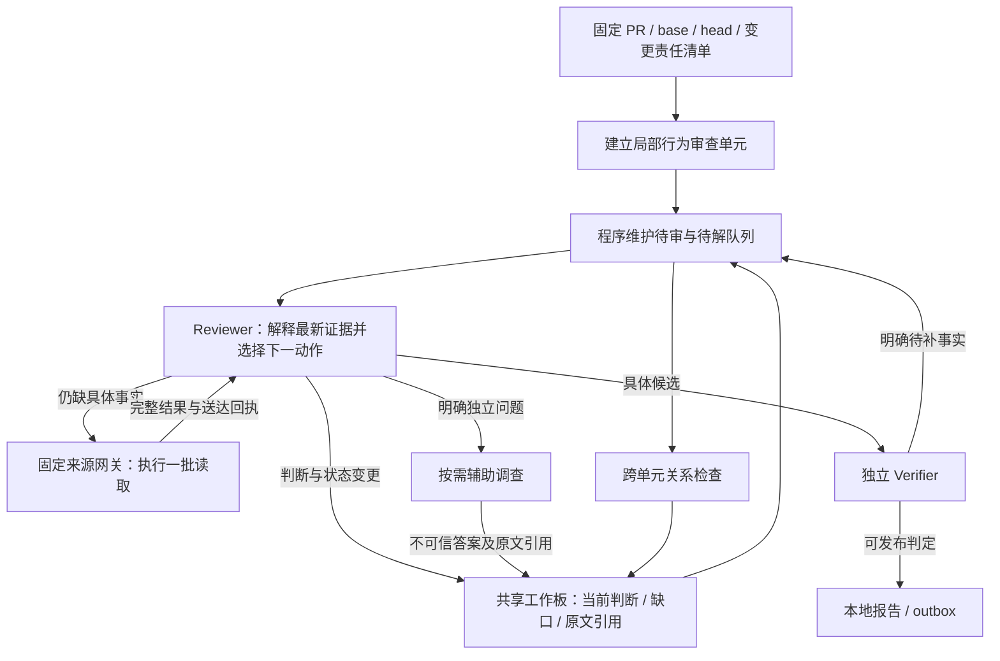

# v4.2 调查决策与增量交付方案

日期：2026-11-05。依据：`dev@42c1e26`、v4.2 设计 19.19–19.22、2026-11-04 的原生请求与工作板只读复核。

状态：**前两阶段与最小入口已实验性实现，正在验收，不是已经验证的效果改进**。2026-11-05 用户授权两名 GPT-6.1 Terra / xhigh 实现状态和执行循环，主代理负责入口与先小后大的对照测试。生产默认仍为 legacy，新实验保持独立运行身份及本地交付。

## 1. 要解决的缺口与不可误读的证据

`5527278` 的同 PR 诊断有 76 个供应商完整响应、12612418 已知 tokens、7 次失败用量未知、0 Case、0/24 区域完成。停止后的工作板副本可完整还原 75 个已持久化 response/exchange；最后一个供应商响应完成不等于整个本地批次已经提交。原始账本和 journal 不改写。

75 个持久化响应的可见正文均为空，407 次工具调用主要为读取和搜索。模型附带 66 次 review_state，只有一次带观察、两次带开放问题；前 28 个请求的工作状态为空，一项 Tooltip 调查状态连续出现在 15 个请求中，期间取证已涉及其他路径。这证明可接续的调查状态稀少，不证明模型内部没有推理。不得用供应商内部 reasoning 代替可检查的工作状态。

当前每批之后重建「工作板 + 活跃原文 + 最近工具交换」。该设计原本为避免历史无限增长，但依赖模型主动保存足够的判断；真实运行没有满足这个假设。成功回读不触发现有的重复失败检测；最新工作单元提示也没有继承旧提示中的及时独立交付说明。源码重叠和候选纠错已分别修复机制，但无法单独解决调查收敛。

本方案回答的核心问题：**下一次取证由哪个尚未回答的问题驱动，返回后如何改变该问题的状态，何时把成果交给独立核验？**

## 2. 目标、边界和取舍

目标是让每个有效模型响应产生可恢复的判断或明确的下一步，先验证单一调查的交付闭环，再扩大到完整 PR。保留同一 Reviewer 的连续责任，不重新引入先深度发现、再由另一个 agent 从头调查的固定交接。

不增加 token、请求、取证步骤、候选数、引用数或输出字数的停止配额。读过不等于审过，候选不等于缺陷，导航不等于证据。允许合理回读、跨文件调查、未知结果和无候选的已检查范围。无法同时保证任意开放任务无限探索、有限成本和发现全部缺陷。

主要取舍是收紧模型与控制器之间的动作契约：每个逻辑取证批次通过一个决策入口表达，可包含多个原生来源操作；模型仍决定需要什么事实，程序负责身份、状态转换、队列和事务。新契约会增加一些简短判断输出，也可能不适合当前中转模型，必须先用小型实验验证，不能仅凭单测扩大运行。

## 3. 总体流程



控制器不在每轮另调用一个 Planner 模型。事实真假、行为关联和证据充分性由 Reviewer/Verifier 判断；程序不伪装成语义裁判。

## 4. 决策入口：交付成为主流程的一部分

新策略拟使用单一原生入口 `review_step`，保持供应商原生工具协议和自动工具选择；不通过关闭模型思考来强制调用。工具定义只暴露当前阶段有意义的操作。它把一个有效响应中的判断更新和下一步事务化，不在每次源码读取前要求重复填写整张进度表。

公共信息只保留：当前工作项及预期版本、对最新材料的简短判断、支持该判断的原始引用、下一动作。已经成立且没有变化的判断以稳定 ID 引用，不重复复述整份历史。工作项、候选和缺口的新 ID 均由控制器生成。

| 动作 | 模型必须交代 | 程序如何处理 |
|---|---|---|
| `request_evidence` | 当前缺口；为什么影响这项判断；不同结果会如何改变判断；要执行的来源操作列表 | 先保存决策与请求清单，执行全部合法读取，保存完整原生回执，再回到该工作项 |
| `offer_candidate` | 具体触发、行为、影响及支持来源；相关未知前提 | 创建/修正候选并立刻入核验队列，不等待整个 PR 完成；关键前提未知仍标待补，不能作为已成立案例 |
| `close_question` | 有来源支持的回答或反证，以及仍受影响的责任 | 更新问题及依赖；反驳一个疑点不自动完成其所在区域 |
| `complete_review` | 实际检查范围、带来源的判断、留下的候选/依赖 | 校验覆盖和原文送达；只有相关必需工作闭合才能完成，否则保留 partial |
| `unresolved` | 缺失事实、已尝试路径、恢复所需条件 | 保存明确未决项，交出执行权，其他工作可以继续；不是 clean |
| `delegate` | 一个可独立回答的问题、所需输入及返回条件 | 创建独立租约任务；同一个问题只有一个当前责任人，答案仍需主责复核 |

示例是调查问题，不预判 Cal.com 缺陷真假：

```text
问题：新增参与者入口的调用者权限与可修改对象范围是否一致？
当前判断：已经定位入口和被修改对象；调用方身份如何取得仍待确认。
下一缺口：调用方提供的身份是否可能覆盖对象所属用户。
取证批次：读取身份来源、对象查询、调用位置的固定版本原文。
返回后选择：形成候选 / 由反证关闭疑点 / 明确仍缺的关键事实。
```

这里记录的是可检查的简短工作结论，不索取或持久化隐藏思维链。语义不成立的结论不能因为结构合法而自动通过。

### 4.1 为什么与此前失败的 review_state 要求不同

过去在独立读取工具上附带可选或强制状态，同批状态容易冲突，缺字段还会妨碍读取，而提交结果仍是另一项可选行为。新入口以一次决策拥有一个工具批次：一份状态增量、一组取证动作、一个事务身份。合法读取结果不会因为兄弟候选格式错误被丢弃；无效项反馈到自己的待修记录，不覆盖已保存状态。

已成功返回的来源在模型确认处理前标为未消费，下一轮必须保留其完整结果。协议错误不丢原文、判断或原始尝试，也不从头开始 PR。同证据、同错误反馈下重复无效响应可按既有明确失败语义保存 partial；不存在固定格式修复次数。

包装后的回执拟为 `step_id + results[]`，每项保留来源网关的完整原生结果、独立请求身份和原始引用。必须同步增加版本化的送达解码：逐项验证实际成功模型请求中出现的原文及映射；不能只把旧读取调用换成包装工具，却仍用仅识别旧顶层字段的证明器。最新批次刚取得的来源只在下一次成功模型请求后具备该消费者的送达资格。

该改造明确改变“允许模型无状态直接无限读取”的执行方式。取证能力始终保留，具体缺口可以请求任意必要来源；是否能在当前模型上稳定完成这种协议，是第一阶段验收项。

## 5. 状态：保留判断的身份与历史

复用现有 ReviewScope、Question、Case、Task、EvidenceRef、租约、审计和 outbox。新增一个小型决策事件及其当前投影，不另建一套平行候选/核验协议。

每个工作项维护：固定责任范围、当前责任人、当前问题、带来源的有效判断、反证、关键缺口、待消费回执、关联候选、依赖、状态和版本。字段按阶段存在，不要求每次重发全部数组。已关闭问题保留简短结论和来源索引，可按 ID 回读；焦点切换不得覆盖旧问题。

每个 DecisionEvent 绑定 run/base/head/workspace、工作项版本、task/lease、模型 turn/call，以及实际输入和原生输出。控制器生成 ID，提交采用比较交换。纯措辞、时间戳、读取新切片和新引用 ID 不自动记为语义进展。

状态转换为：

```text
待审 → 判断中 → 等待取证 → 判断中
              → 候选已提交（范围审查和独立核验分别继续）
              → 已检查（没有支持的候选也允许）
              → 未解决（记录恢复条件）
```

问题状态与范围状态分开；某个疑点 refuted 不是整个范围 reviewed。新来源或已验证反证改变关键前提时，重开相关工作项并使对应旧核验许可失效；无关导航变化不导致整轮重审。

## 6. 上下文：当前判断与原文分工

每次请求携带当前工作项、其有效判断与关键缺口、相关原文工作集、未消费的最新完整工具交换，以及查询共享空间的目录入口。其他工作项仅提供必要状态和依赖引用，审计历史完整外置。

同一问题内需比较的原文同时保留，不能回到“只有上一批结果”的设计。工作项明确转移或关闭后，已消费且没有开放比较依赖的原文可退出活跃投影；其原始数据、引用和历史送达证明保留。新调查按需要重新取得原文；导航和结论摘要不能代替独立核验来源。

启用已有 `source-line-union-1` 消除同来源重叠显示；最新原生工具交换保持完整。来源选择绑定问题和依赖，不以全局累计读取集合不断增长。原文不足时明确补取，无法在供应商容量内忠实表达必要工作集时保存 partial；不得静默截断、伪造已消费或把分页目标当审查上限。

当前判断可能出错，所以复核必须能从固定原文重建；保留摘要不意味着相信摘要。

## 7. 责任粒度与共享协作

第一阶段保持同一固定调查范围，只替换决策循环，避免同时改变分组与交付而无法归因。通过后再改责任编译：以改动涉及的可定位行为入口/函数为初始单元，函数不可可靠定位时保留路径和变更范围的显式回退。分组不依赖事先知道哪里有 bug。

初始工作项由固定变更清单产生，问题是“这里改变了什么可达行为，以及上下游约束是否仍一致”，并不由人工预先提供缺陷。Reviewer 自主形成具体疑点、反证或已检查结论；同一责任人继续调查自己发现的疑点。小型已知问题实验只验证执行闭环，缺陷发现能力仍需后续完整 PR 和未见集验证。

所有固定变更区域必须有且仅有一个当前主责；来源共享可以一对多。多个改动确实属于同一条行为链时，可依据实际调用/数据关系合并责任，转移及依赖更新须原子化。不能因为索引没有找到边，就假定两个单元独立。

每个执行中的 Reviewer 聚焦一个当前工作项，完成后接下一个；这不限制总问题数。程序按待解缺口、就绪核验及未审责任公平调度。已有具体候选即入独立核验；整合任务在其依赖单元可提供原文和阶段结果后可开展，最终完整性仍检查全部责任，不能用早期整合代替未审部分。

共享工作板展示「谁负责、判断到哪、还缺什么、原文在哪、什么改变会重开」。主责可以委派独立问题；只有确有就绪工作时才创建助手。第一阶段采用一个 Reviewer 加现有独立 Verifier，之后单独测辅助协作收益，避免把更多 agent 当作交付保证。

## 8. 进展判断与停止语义

程序能测：新增且实际送达的来源范围、完整查询边界变化、测试结果、问题/候选/责任的真实状态转换、工具错误是否修复。程序不能据此证明模型理解了材料，也不能确定任意自然语言判断是否充分。

相同问题、相同固定来源、相同读取与相同结果再次出现时，复用原始结果并在决策输入中标示“已送达的回读”；请求需解释它服务于哪项待决比较或纠错，继续具备取证能力。新切片和措辞变化不能伪装成新的原始事实。

重复成功读取本身不触发按次数终止。它使下一轮明确回到该问题的决策，而不是默默扩充工作集。Reviewer 可提交结论、指定真正尚缺的关键事实，或记录无法继续判断的原因。没有新增源码也可能形成有效反证，不能把信息增益简化为新字节数。

如果模型仍反复改写同一缺口却不判断，本试点视为未证明可用；不能以增加表单、改名或换目录掩盖失败，也不继续自动扩大到完整 PR。人工诊断中止保留为 interrupted/partial，绝不算已完成。这是一项模型行为验收，不能承诺纯程序即可保证收敛。

## 9. 事务、恢复与兼容

1. 先持久化已验证的决策、原始提交及动作 outbox，再执行来源操作。批次中每项完整保存，重试基于固定身份；来源请求成功不等于其后语义判断已经提交。
2. Candidate 创建/修正、决策处置及核验入队保持同一事务，继承候选纠错的独立尝试记录。错误引用逐项反馈，不能猜测映射。
3. 原生批次写入结果未知时保留 partial 并按现有受影响范围阻断，不能自动重放潜在写入。读取缓存只复用同一冻结来源，新的模型消费者仍需自身送达证明。
4. 新增完整执行策略，设计提议名为 `v42-decisions-7`；首个实现采用 `v42-units-6` 固定责任内核上的不可变 `decision_cycle_policy=decision-cycle-1`，避免扩大内核迁移范围。一个 profile 绑定决策 schema、上下文投影和责任编译版本，避免再累加任意组合开关。新实验创建空工作板；旧 checkpoint 用原语义恢复，不转换为新版本。
5. 免费中转延迟继续只记录；网络等待/退避维持已授权策略。所有物理调用计量，失败未知用量单列，不能把换路由后的结果合并成同配置对照。

## 10. 代码改动与实施顺序

| 顺序 | 模块/文件 | 具体交付 | 进入下一步的条件 |
|---|---|---|---|
| A | `contracts.py`、`store.py`；新增决策事件模块 | 版本化决策、稳定问题身份、待消费来源、事务 outbox | 状态转移/崩溃恢复/租约/错误兄弟隔离回归通过 |
| B | 新增 `decision_loop.py`、`context.py`，复用 `tools.py` 网关 | 同一 Reviewer 的判断与动作协议，完整来源与局部原文工作集 | 单问题真实模型能交付正确结果；协议失败不会遗失调查 |
| C | `runtime.py`、`integration.py` | 新 profile 入口、就绪队列、即时核验入队 | 固定范围对照证明行为变化，完整本地回归通过 |
| D | `scope.py`、共享投影和相关调度 | 小行为责任单元、原子转移、跨单元关系与按需委派 | 覆盖无遗漏，跨文件真实案例不因拆分漏检 |
| E | `scripts/benchmarks/` 与实验记录 | 分层对照、用量与质量报告、未见集记录 | 真实交付与质量验收，才讨论默认切换 |

首个可验证切片只做 A+B+C 的最小路径，冻结原责任分组；小范围真实验证前不一次性开发 D 的完整语义分组。2026-11-05 已按状态/决策循环两项下发用户指定的代理，主代理完成运行与评测集成。

## 11. 分层验收：先证明能交付，再测完整 PR

### 11.1 离线正确性

覆盖跨两批原文比较、合法多次回读、焦点切换后找回旧判断、反例关闭问题、无候选的已检查范围、真实规则缺失、错 ID/错引用纠正、来源损坏、迟到响应、租约失效、决策提交及来源返回时崩溃、候选入队事务和独立发布核验。包含需要超过以往短循环长度的调查，不能靠固定步数截断通过。

测试必须从固定入口贯穿实际网关、状态库、模型协议替身和独立核验，另有真实模型试验；脚本模型测试不能充当效果成绩。

### 11.2 三类小型真实问题

预先冻结独立评分标准，模型仅看到任务及来源，不看到标准答案：

- 需要跨文件、对照基线才能形成有依据候选的案例；
- 容易怀疑但存在明确反证的案例；
- 缺少真实业务规则或环境，应该给出准确缺口的案例。

每类预注册三个独立重复用于波动观察；重复次数是实验设计，不是单个审查的调用配额。来源、模型、路由、推理设置、网络策略和初始材料绑定，双方均不开启额外协作；结果按所有样本报告，不剔除失败来改善统计。

对照 A 用 `42c1e26` 的原循环及已实现源码去重，对照 B 用新决策循环，同一问题责任和来源策略；这样先隔离决策闭环变量。之后 B 与 C 比较责任粒度，再单独评估助手，不同时变更多个因素。

门槛：三类结果均须产生与冻结标准一致的可检查结果；引用和来源绑定不能有误；重启后能接续同一个问题；无法正确结束或依赖人工提示的样本明确失败。全通过只是进入下一阶段的条件，不能说明对真实代码的普遍质量。

测量首次正确阶段性交付所需已知 token、最终正确完成率、全运行已知/未知用量、反证与缺口准确性、当前请求输入大小、重复正文、关键状态丢失、真实来源读取和模型纠错。若两组都完整正确，争取中位 token 至少降低 50%，这是待验证工程目标；基线未完成时不报告虚假的节省百分比，分别报告完成情况和消耗。

### 11.3 完整 PR 与未见集

小问题验证通过后，才按当前用户要求在固定 50 PR 中做一个完整 PR：Cal.com #14740 可用作已参与开发的诊断，不能作为未见质量证明。新运行空状态，不导入旧候选和裁判信息，全部责任处理完后才运行独立裁判。

再预先选取未参与设计的 PR 验证召回和误报；具体名单先冻结。发布门槛和旧 v3 比较需同模型/配置/评分口径，否则只列分开的结果。不能用更多 unresolved、减少责任范围或降低独立核验要求换取低 token；部分可发布结果与全 PR 完成分别报告。

只要小问题仍长期取证不交付，就停止扩大实验，回查明确的失败轨迹和契约，不重复启动千万 token 的整 PR 试验。方案不承诺固定完成时间或必然优于 v3。

## 12. 外部机制参考

[Anthropic 的 agent 工作流说明](https://www.anthropic.com/research/building-effective-agents)区分模型自主执行与程序编排，并建议从简单可组合方案开始；这里借鉴的是清晰的决策交接，不引用厂商数据作为本项目效果证明。

[Anthropic 的上下文工程说明](https://www.anthropic.com/research/effective-context-engineering-for-ai-agents)讨论按任务维护必要上下文。这里据此提出当前判断、相关原文与审计分离；本项目具体的状态契约、送达证明和验收门槛是基于自身诊断作出的设计，效果仍待实验。

## 13. 2026-11-05 首个实现与验收记录

用户明确授权两名 GPT-6.1 Terra / xhigh 执行前两阶段，并要求小范围对照通过后才能运行完整 PR。状态代理负责 `decision_state.py`、存储事务与原生送达解码；循环代理负责 `decision_loop.py`、当前问题原文投影及对应测试；主代理完成产品入口、持久核验就绪记录消费与实验工具。

新运行设置 `REVIEWFORGE_V42_DECISION_CYCLE=decision-cycle-1` 即选择完整配置：自动绑定 `shared-1`、`candidate-draft-1`、`source-line-union-1`、`git-lf-1`，保留 `v42-units-6` 责任编译。显式冲突值或助手委派配置会在模型和工作板创建前拒绝。没有设置该选项的旧运行保持原行为；开启或关闭它产生不同绑定，不将旧 checkpoint 转换为新策略。责任重分组、额外助手及默认生产切换不在本轮范围内。

原生模型接口只暴露 `review_step`，其中包含简短可见判断、控制器分配的问题身份、版本和下一动作。来源批次的每项操作先登记再执行，完整回执随后进入真实成功请求，才能成为送达来源。错误候选可修正或显式撤回；候选晋升与核验就绪记录同事务，实际持久 verify Task 建成后才确认消费。原有独立核验、覆盖和跨单元整合门禁仍生效。

当前问题关联的原文自动投影，旧问题和来源索引仍可查询恢复；最新完整工具交换保留。跨批比较、合法多次回读不因次数停止。失败判断依赖完整批次状态，未知来源操作不会被伪装为成功或自动重放。

恢复边界：已完成持久审计的来源结果可在新租约下重新送达；原 exchange 尚未完整保存且租约已更换，或操作仍处于 in-flight 未知结果时，保守返回 partial。`finish=false` 的多条整合关系/回执沿用逐项事务，不能宣称整个动作全事务；最终范围完成与决策处置同事务。实际运行中遇到这些边界应记录并判为未完整交付。

离线结果：完整后端 **4165 passed、1 skipped**（431.39 秒）。此后只补全原生 `review_step` 描述中完成动作的嵌套字段与枚举，并增加实际发送工具描述断言；相关状态、循环、产品与实验隔离专项 **42 passed**。Ruff、格式、`spec-check` 和严格裁判离线测试通过。先前完整回归在 72% 时因发现混合成功/失败批次误停而主动停止，未计作完整通过；修复后上述完整回归才通过。

小范围使用三类受控源码问题和真实控制台模型，每类每组预注册三次重复；这是机制对照，不是实际 PR 质量或 v3 优势证明。评分标准与可读源码分开冻结。缺陷与反例的源码行为已经独立执行核对。真实结果将在本节追加；完整 PR 仍受小范围通过门槛约束，不能以单项 smoke 成功跳过。

### 13.1 首轮小范围真实诊断：尚未通过

冻结目录 `.reviewforge/benchmarks/v42-delivery-small-20261105-142039`，基线 `42c1e26`，新循环 `982fc03`；后者的[完整 CI](https://github.com/Wayne0607/ReviewForge/actions/runs/41981935079)通过。冻结控制台两角色均为 `deepseek-v4.1-flash-free`，两组的模型指纹、重试设置、输入、base/head 源码摘要及责任范围逐项相同，不开启助手。评分标准没有进入可读取源码。

先运行真实缺陷样本的第一组：

| 路径 | 供应商完整响应 | 已知 tokens | 失败/未知/在途 | 持久 response/exchange | 候选/完成区域 | 处置 |
|---|---:|---:|---:|---:|---:|---|
| 基线 | 11 | 186585 | 0/0/0 | 10/10 | 0/0 | 固定源码反复读取，仍无持久问题或候选；请求间隙人工中断，partial |
| 新循环 | 6 | 61111 | 0/0/0 | 5/5 | 0/0 | 确认嵌套来源参数校验缺口后在请求间隙人工中断，partial |

供应商最后响应已计量，不等于最后本地决策批次已提交。原始工作板、请求账本、原生审计和 `manual-interruption.json` 保留，不将仍显示 running 的中断原工作板改写成已完成。两者均未通过交付门槛，未计算节省比例；预注册其余样本在此次缺口修复前尚未执行，没有剔除失败或运行完整 PR。

新循环第三次成功请求后已经持久化调查问题，但模型传入 `find_references({query: ...})`，实际必填字段为 `symbol`。嵌套 custom 操作只校验了动作外层，内部 `KeyError` 被误记成真实工具不可用，产生两条不应存在的未解决故障。修复为按模型实际可见 JSON Schema 在调用网关前校验；参数错误返回可纠正反馈，不猜测字段映射、不建立工具故障。内置 Pydantic 参数校验同样分类，真正 I/O 故障仍保持未解决。显式加入并锁定 `jsonschema` 运行依赖，避免只在本机偶然可用。

本轮新增 **247696 已知 tokens、0 未知请求**，此前 v4.2 累计为 35387045/217，合计 **35634741 已知 tokens、217 请求未知**，非供应商账单。后续修复创建新绑定复测，不升级或覆盖本轮中断状态。

参数校验修复后，包含真实产品入口错误参数纠正、两主责、跨单元整合、独立 Verifier 与恢复的相关专项 **58 passed**，lint/format 通过。新一轮先复测修复后的相同缺陷输入；其基线第一样本引用上述同配置冻结记录，不重新消耗重复基线调用。其余预注册重复保持未开始，须如实列出，不把本次修复后定向结果替代完整三类验收。

### 13.2 参数校验修复后：出现候选，交付仍未通过

`30c67d3` 的[完整 Linux CI](https://github.com/Wayne0607/ReviewForge/actions/runs/41983774275)为 **4180 passed、3 skipped**，校验后的相同输入冻结于 `.reviewforge/benchmarks/v42-delivery-small-20261105-145731`。本轮仅启动新循环缺陷样本第一次重复，基线引用 13.1 同配置冻结记录，其余样本尚未开始。

第 5 次 Reviewer 响应后晋升了一个与样例缺陷描述一致的候选，至此消耗 **39755 已知 tokens**；这只表示阶段性候选交付，不等于独立核验接受或整个样本通过。模型确实指出了配置分钟与调用秒的单位差异，并把调查问题标为 answered。错误 `find_references(query=...)` 本轮得到可纠正参数反馈，没有再创建虚假的工具故障。

后续确认一个新接口缺口：候选处理用 `result.update(outcome)` 合并结果，将工作项 `revision` 覆盖成草稿 `revision`；提示却要求模型复用返回 ID/版本。真实轨迹出现工作项版本冲突、错误草稿处置，以及主责尝试整合回执的纠错。候选更新也令已有核验输入失效，不能把不断执行的工具调用当成已交付。

2026-11-05 15:09:06 +08:00 在物理请求间隙人工停止，无在途或未知新增：**55 完整响应、567686 已知 tokens**（Reviewer 20 请求/285347，Verifier 35 请求/282339），1 Case、0 独立 verdict、0 完成区域。Reviewer 本地保存 19 response/exchange，最后一份供应商完成响应不代表本地批次提交。候选草稿状态为 promoted 3、applied 2、repair_needed 1；这些尝试不能当作 6 个独立缺陷。最大请求输入 53377 字符。

原始账本和中断状态保持。本轮不通过，未运行完整 PR。已知累计增加到 **36202427 tokens、217 请求未知**，非账单。后续修复显式分开工作项与草稿版本，并将自动投影的全量判断历史改为当前判断及可回读历史；需新运行验证，不能追认本次结果为已修正。

修复后的原生回执统一使用 `work_item_id/work_item_revision`，候选另外返回 `draft_id/draft_revision`；纠错测试从每轮回执复制工作项版本，贯穿无效候选、修正晋升、关闭问题、完成范围和草稿撤回。最新判断投影与完整持久历史分离，新增只读 `read_decision_history` 供模型按同范围身份回读，显式分页时返回继续位置；导航不创建证据引用。相关专项 **63 passed**，lint/format 通过。

小测工具增加显式操作者停止文件 `operator-stop.json`：请求停止后先等待两角色已经发出的请求完成，再在后续模型调用前退出，并输出 partial 报告。它没有调用/token/时间配额，不改变审查质量判定；用于避免确认契约故障后继续发起无效调用，也避免将仍在途的使用量强行记为零。

### 13.3 版本回执修复后：核验导航触发候选失效

`fd15297` 的[完整 Linux CI](https://github.com/Wayne0607/ReviewForge/actions/runs/41986083264)为 **4185 passed、3 skipped**。新冻结目录 `.reviewforge/benchmarks/v42-delivery-small-20261105-151824` 仍只运行新循环缺陷样本第一次重复，基线引用 13.1，其余样本未开始。没有完整 PR 运行。

本轮产生一个方向正确的 Case，但没有持久独立 verdict、完成区域或评论。确认契约缺口后于 2026-11-05 15:30:42 +08:00 写入停止请求；工具等待在途请求完成并输出 `partial` 报告，`interruption=PilotStopRequested`。总计 **43 完整物理响应、472815 已知 tokens、0 未知/在途**（Reviewer 8/108533，Verifier 35/364282）；输入 454407、输出 18408，缓存命中 355328 已包含在输入中。Reviewer 本地审计为 9 request、7 response/exchange；request 包括未实际发给供应商的停止检查，物理响应也不等于本地批次已提交。最大请求输入 45041 字符。

事件账本确认：`verification_observations` 只追加了 **3 个搜索和 1 个 diff 导航引用**，Case 的缺陷陈述、触发条件和原始事实没有变化，revision 却从 0 增到 1；旧核验任务释放、新核验入队，主责任务随后 superseded。独立核验已经从模型取得一次结果，但在持久 verdict 前因 revision 改变抛出冲突，因此该结果没有落盘。不能推定它是 accept，也不能把反复核验当成模型尚未作过判断。

另一个完成接口缺口是原文引用混入 diff/search 导航时，仅返回笼统的“source body was not delivered”，导致模型误以为原文丢失并重复读取。修复逐项指出完成字段位置、原引用 ID、类型及错误原因，不猜测替代 ID，不修改原始来源与送达门禁；完成动作同时明确主责关系只能指向其他主责，整合回执仅由整合角色提交。

仅对 `decision-cycle-1` 修正核验存储：先验证全部传入引用的运行、快照、身份和原文完整性，再将 search 和明确标记为导航的 diff/query 留在来源库及审计事件中，不加入 Case 的语义来源集合。Verifier 采用存储返回的集合，防止后续通用更新重新加回导航。真实新增原文或问题继续触发原有版本失效。旧策略保持原行为；损坏、外来或缺失的导航也不能通过过滤被隐藏。

本轮仍未通过小范围门槛，不计算节省比例。本任务实际新增累计 **1288197 已知 tokens、0 未知请求**；v4.2 累计 **36675242 已知 tokens、217 请求未知**，非供应商账单。全部旧中断记录和其余未开始样本保留，新修复须另建冻结绑定验收。

合并修复后，决策状态/循环/产品入口、来源参数、版本回执、历史回读、批次纠错、完成引用、核验导航、独立 Verifier、共享状态、调度及小测工具的联合回归 **213 passed**；Ruff、涉及新增文件的格式检查和 `git diff --check` 通过。脚本化核验结果能够落盘仍不等于真实模型交付验收。
